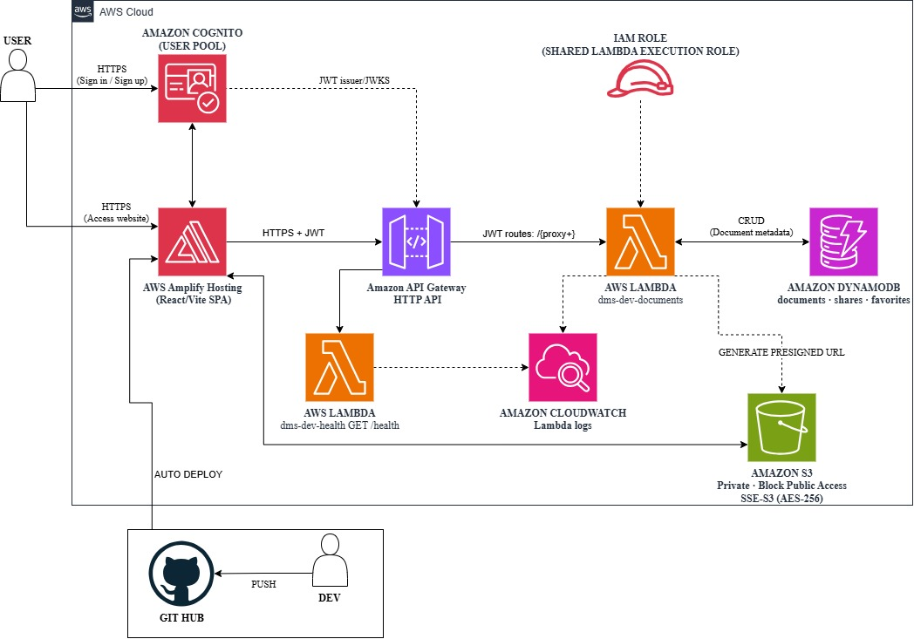

# Serverless Document Management System
## A Unified AWS Serverless Solution for Secure Document Storage and Management

### 1. Executive Summary
The Serverless Document Management System (DMS) is a web application for storing, finding, and managing documents. Its frontend is built with React/Vite, while AWS managed and serverless services provide authentication, APIs, business logic, metadata storage, and file storage. Implemented features include sign-in, uploads and downloads, document metadata updates, favorites, trash/restore, and document sharing. The architecture and test results in this report describe the previously verified deployment. The project's AWS resources were cleaned up on November 19, 2026, so there is no active production environment now.

### 2. Problem Statement
### What's the Problem?
Documents are often scattered across personal computers, messaging apps, and email, which makes them hard to find and easy to lose. There is no single place to store them, no consistent control over who can view or change a file, and no clear record of who owns which document. Traditional solutions require running and maintaining a dedicated server, while commercial document platforms are costly and more complex than a small team needs.

### The Solution
Amazon Cognito authenticates users and issues JWTs. The React/Vite frontend calls business APIs through an Amazon API Gateway HTTP API. A JWT authorizer validates tokens before API Gateway forwards document routes to Lambda. Lambda reads the authenticated Cognito `sub` claim and checks ownership or sharing permissions before processing each document. Metadata is stored in three separate DynamoDB tables for documents, shares, and favorites. For file operations, Lambda creates presigned URLs that expire after five minutes; the browser transfers file bytes directly to private S3 instead of sending them through API Gateway or Lambda. `GET /health` is a public health-check route, and `OPTIONS /{proxy+}` handles CORS preflight without JWT authorization. Both Lambda functions share an IAM execution role scoped to the runtime access required for logs, DynamoDB, and S3. CloudWatch collects Lambda logs. In the previous deployment, GitHub main was connected to Amplify for frontend build and hosting.

### Benefits and Return on Investment
The solution gives users a single, secure place to manage documents, reduces the time spent searching for files, and provides a reusable serverless foundation for future extensions such as full-text search, document versioning, or AI-based document analysis. It also serves as a hands-on study resource for core AWS serverless services. Every service is pay-per-use and there is no hardware or licence to buy. Under the assumptions in Section 6, the AWS Pricing Calculator estimates a pre-discount cost of about $1.19 USD per month, or $14.24 USD for 12 months if usage remains constant. This is a planning estimate, not a bill; applicable free-tier allowances, discounts, taxes, and actual traffic can change the amount charged. With no upfront investment, the return comes from time saved, better document security, and automatic scaling if usage grows.

### 3. Solution Architecture
The diagram below describes the UniCloud DMS architecture that was verified during its deployment in the `ap-southeast-1` Region. AWS Amplify hosted the React/Vite frontend. Amazon Cognito handled sign-up/sign-in and issued JWTs; API Gateway HTTP API authenticated document routes and invoked Lambda. Lambda checked access, operated on three DynamoDB tables, and generated presigned URLs. The browser transferred file bytes directly to a private S3 bucket. Both Lambda functions shared an execution role, and CloudWatch received Lambda runtime logs.

> **Status:** This diagram represents the previous deployment. The project's AWS resources were cleaned up on November 19, 2026; the old API endpoint and frontend hosting are no longer active.

**Request flow**
1. The user accesses the AWS Amplify frontend over HTTPS.
2. The frontend sends the user to Cognito for sign-up or sign-in; Cognito returns tokens to the frontend.
3. The frontend calls the API Gateway HTTP API with a JWT. The JWT authorizer validates tokens for document routes.
4. `ANY /{proxy+}` sends authenticated business routes to the `dms-dev-documents` Lambda. Public `GET /health` invokes `dms-dev-health`; `OPTIONS /{proxy+}` handles unauthenticated CORS preflight.
5. Lambda reads the authenticated Cognito `sub`, checks access, and reads/writes metadata in the `documents`, `shares`, and `favorites` DynamoDB tables.
6. For uploads and downloads, Lambda creates a presigned PUT/GET URL with a five-minute expiry and returns it to the frontend.
7. The browser uses that URL to transfer file bytes directly to or from the private S3 bucket. The bucket blocks public access and uses SSE-S3 encryption.
8. Lambda sends runtime logs to Amazon CloudWatch. The previous frontend deployment path was Developer → GitHub main → AWS Amplify Hosting.

### AWS Services Used
- **AWS Amplify Hosting**: Hosted the React/Vite SPA and automatically built/deployed from GitHub main during the previous deployment.
- **Amazon Cognito User Pool**: Managed user sign-up/sign-in and issued tokens to the frontend.
- **Amazon API Gateway HTTP API**: Received API requests and used a JWT authorizer to protect document routes. `GET /health` and CORS preflight are unauthenticated exceptions.
- **AWS Lambda**: `dms-dev-documents` handled document APIs, authorization, metadata, and presigned URLs; `dms-dev-health` handled health checks. Both functions shared a Lambda execution role.
- **Amazon DynamoDB**: Three on-demand tables, `dms-dev-documents`, `dms-dev-shares`, and `dms-dev-favorites`, stored document metadata and sharing/favorite relationships.
- **Amazon S3**: Stored document bytes in a private bucket with Block Public Access and SSE-S3 encryption. The browser transferred files directly with presigned URLs.
- **Amazon CloudWatch Logs**: Collected Lambda runtime logs.
- **AWS IAM**: Provided the shared execution role for both Lambda functions with runtime permissions scoped to the project.
- **AWS SAM/CloudFormation**: Described and deployed the backend during the previous deployment.

### Component Design
- **Frontend**: React/Vite app that uses Cognito for authentication and API Gateway for document operations.
- **Authentication and authorization**: API Gateway validates JWTs. Lambda uses the Cognito `sub` claim to identify the owner and checks recipient sharing rights in the backend. Document access does not rely on Cognito User Groups.
- **API layer**: HTTP API uses `ANY /{proxy+}` for the documents Lambda, public `GET /health` for the health Lambda, and unauthenticated `OPTIONS` for CORS.
- **Business logic**: Lambda handles upload/completion, lists/details, metadata updates, download URLs, favorites, trash/restore, sharing/revocation, and permanent deletion.
- **Metadata**: Three separate on-demand DynamoDB tables hold documents, shares, and favorites.
- **Files**: A private S3 bucket stores file contents. Five-minute presigned URLs let the browser transfer files without routing bytes through Lambda.
- **Monitoring**: CloudWatch Logs receives Lambda runtime logs. The diagram does not claim API Gateway access logging or alarms.
- **Frontend CI/CD**: GitHub main previously triggered Amplify build/deploy. This describes the cleaned-up environment's former workflow, not currently active hosting.

### 4. Technical Implementation
**Implementation Phases**
The project has four phases:
- Research and Design: Study the AWS serverless services involved and draw the architecture (Weeks 1-2).
- Calculate Cost and Check Feasibility: Use the AWS Pricing Calculator to estimate costs and confirm the design fits the requirements (Week 3).
- Refine Architecture: Adjust the design for security, cost, and usability, for example the DynamoDB data model and IAM policies (Weeks 4-5).
- Develop, Test, and Deploy: Build the backend and frontend, test all document operations, and deploy to production (Weeks 6-12).

**Technical Requirements and Implemented Configuration**
- **Frontend**: React/Vite SPA; AWS Amplify Hosting was used during the previous deployment and connected to GitHub main.
- **Authentication**: Cognito User Pool issues JWTs; API Gateway HTTP API uses a JWT authorizer for document routes.
- **API routing**: API Gateway configures `ANY /{proxy+}` for the documents Lambda, public `GET /health` for the health Lambda, and unauthenticated `OPTIONS /{proxy+}` for CORS. Document operations include `POST /documents/upload-url`, `POST /documents/{id}/complete`, `GET /documents`, `GET /documents/shared`, `GET /documents/{id}`, `PATCH /documents/{id}`, `GET /documents/{id}/download-url`, favorite/trash/restore/shares routes, and `DELETE /documents/{id}`.
- **Authorization**: Lambda reads the authenticated user's Cognito `sub` claim and checks owner or recipient-sharing permissions. Ownership is not accepted from the request body.
- **Data**: Three on-demand DynamoDB tables, `documents`, `shares`, and `favorites`; the project does not store all data in a single table.
- **Storage**: Private S3 bucket with Block Public Access and SSE-S3 encryption; uploads are limited to 20 MiB and presigned URLs expire after five minutes.
- **IAM**: Both Lambda functions use a shared execution role with permissions scoped to backend runtime needs.
- **Monitoring**: Lambda runtime logs are sent to CloudWatch Logs. Describe API Gateway access logs or alarms only when backed by corresponding configuration and evidence.

### 5. Timeline & Milestones
**Project Timeline**
- Weeks 1-2: Research AWS serverless services and design the architecture.
- Week 3: Estimate cost with the AWS Pricing Calculator and check feasibility.
- Weeks 4-5: Refine the architecture (data model, security, cost).
- Weeks 6-10: Implement authentication, API, Lambda functions, DynamoDB, S3, and the frontend; test each feature.
- Weeks 11-12: Deploy, set up monitoring, finalize documentation, and present the final demo.

### 6. Budget Estimation
The estimate was exported from the AWS Pricing Calculator on November 18, 2026 for the Asia Pacific (Singapore) Region. It is a monthly, before-discounts estimate and covers the services below. The annual figure is the monthly estimate multiplied by 12; it assumes the same usage every month.

### Infrastructure Costs
| AWS service | Monthly estimate (USD) |
| --- | ---: |
| AWS Lambda | $0.0062 |
| Amazon API Gateway (HTTP API) | $0.0125 |
| Amazon DynamoDB (on-demand) | $0.0020 |
| Amazon S3 Standard | $0.1257 |
| Amazon Cognito (Essentials, 10 MAU) | $0.0550 |
| AWS Amplify Hosting | $0.3500 |
| Amazon CloudWatch | $0.0352 |
| AWS data transfer | $0.6000 |
| **Estimated total** | **$1.1866 (~$1.19)** |

**Estimated annual total:** $14.24 USD (monthly estimate × 12).

**Hardware:** $0; the solution uses managed AWS services.

**Monthly usage assumptions:** 10,000 API Gateway HTTP API requests; 10,000 Lambda requests and 250 Lambda GB-seconds; 4,000 DynamoDB eventually consistent read request units, 2,000 standard write request units, 1 KB average item size, and 0.1 GB table storage; 5 GB of S3 Standard storage, 100 write/list requests, and 500 read requests; 10 Cognito monthly active users; 20 Amplify build minutes, 1 GB served, and 0.002 GB stored; 0.05 GB of CloudWatch standard logs ingested with one month of log retention; and 5 GB of internet data transfer out. Other optional usage shown in the calculator was excluded. These are planning assumptions, not measured production usage.

The estimate is before discounts and does not determine the final bill. Free-tier eligibility and allowances, account-specific discounts, taxes, and usage outside these assumptions may change actual charges. The estimate assumes one month of CloudWatch log retention; the deployed log groups should be configured to match this assumption if the estimated storage cost is to represent the live setup. Review usage and the AWS bill after deployment, and set AWS Budgets alerts before increasing traffic or stored data.

### 7. Risk Assessment
#### Risk Matrix
- Unauthorized Access: High impact, low probability.
- Accidental Deletion or Data Loss: High impact, low probability.
- Cost Overruns: Medium impact, low probability.
- Misconfiguration (CORS, IAM, API Gateway): Medium impact, medium probability.
- Service Limits and Lambda Cold Starts: Low impact, medium probability.

#### Mitigation Strategies
- Access: Cognito authentication, Cognito authorizer, private S3 bucket, least-privilege IAM, and short-lived pre-signed URLs.
- Data loss: If object recovery is required, enable and test S3 Versioning before operation; the current template does not configure Versioning. Restrict delete permissions to reduce accidental deletion.
- Cost: AWS Budgets alerts and CloudWatch alarms; keep resources on pay-per-use.
- Misconfiguration: Test each integration step by step and review IAM and CORS settings before release.
- Performance: Use pre-signed URLs to keep large files out of API Gateway and Lambda payload limits, and keep functions small.

#### Contingency Plans
- Roll back the frontend to a previous build in AWS Amplify if a deployment fails.
- Use an infrastructure-as-code template (such as AWS SAM or CloudFormation) to redeploy or remove the backend stack quickly.
- Restore documents from previous S3 object versions if files are deleted or overwritten by mistake.

### 8. Expected Outcomes
#### Technical Improvements:
A centralized, secure platform replaces scattered document storage, with authenticated access, searchable metadata, and direct, efficient file transfer.  
The serverless design scales automatically without server maintenance.
#### Long-term Value
A reusable serverless foundation that can be extended with full-text search, document versioning, sharing, notifications, or AI-based analysis.  
A practical reference project for building secure, low-cost applications on AWS.
