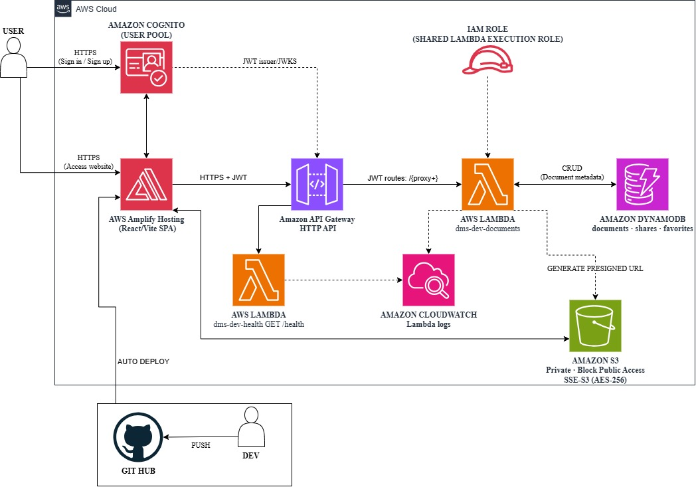

# Hệ thống quản lý tài liệu Serverless
## Giải pháp AWS Serverless thống nhất để lưu trữ và quản lý tài liệu an toàn

### 1. Tóm tắt điều hành
Hệ thống quản lý tài liệu Serverless (Serverless Document Management System - DMS) là ứng dụng web giúp người dùng lưu trữ, tìm kiếm và quản lý tài liệu. Frontend được xây dựng bằng React/Vite; các dịch vụ AWS đảm nhiệm xác thực, API, xử lý nghiệp vụ, lưu metadata và lưu nội dung tệp. Các chức năng đã triển khai gồm đăng nhập, tải lên/tải xuống, cập nhật thông tin tài liệu, yêu thích, thùng rác/khôi phục và chia sẻ tài liệu. Sơ đồ kiến trúc và các kết quả kiểm thử trong báo cáo mô tả lần triển khai trước; tài nguyên AWS đã được dọn dẹp ngày 19/11/2026 nên hệ thống hiện không có môi trường production đang hoạt động.

### 2. Vấn đề cần giải quyết
### Vấn đề là gì?
Tài liệu thường nằm rải rác trên máy tính cá nhân, ứng dụng nhắn tin và email, khiến việc tìm kiếm khó khăn và dễ bị thất lạc. Không có một nơi lưu trữ tập trung, không có cơ chế kiểm soát nhất quán ai được xem hoặc chỉnh sửa tệp, và cũng không có bản ghi rõ ràng về chủ sở hữu của từng tài liệu. Các giải pháp truyền thống đòi hỏi phải vận hành và bảo trì một máy chủ riêng, trong khi các nền tảng quản lý tài liệu thương mại thì tốn kém và phức tạp hơn mức một nhóm nhỏ cần.

### Giải pháp
Amazon Cognito xác thực người dùng và cấp JWT. Frontend React/Vite gọi các API nghiệp vụ qua Amazon API Gateway HTTP API; JWT authorizer xác thực token trước khi API Gateway chuyển route tài liệu đến Lambda. Lambda lấy `sub` từ claims đã xác thực và kiểm tra quyền sở hữu hoặc quyền chia sẻ trước khi xử lý từng tài liệu. Metadata được lưu trong ba bảng DynamoDB riêng cho documents, shares và favorites. Với thao tác tệp, Lambda tạo presigned URL có thời hạn 5 phút; trình duyệt truyền nội dung trực tiếp với S3 private, không chuyển bytes tệp qua API Gateway hoặc Lambda. Route `GET /health` được công khai để kiểm tra tình trạng dịch vụ, còn `OPTIONS /{proxy+}` không yêu cầu JWT để xử lý CORS preflight. Lambda dùng IAM execution role dùng chung, giới hạn theo quyền cần cho log, DynamoDB và S3. CloudWatch thu thập Lambda logs. Trong lần triển khai trước, GitHub main được kết nối với Amplify để tự động build và host frontend.

### Lợi ích và hiệu quả đầu tư
Giải pháp mang lại cho người dùng một nơi tập trung và an toàn để quản lý tài liệu, giảm thời gian tìm kiếm file, đồng thời tạo nền tảng serverless có thể tái sử dụng để mở rộng sau này như tìm kiếm toàn văn (full-text search), quản lý phiên bản tài liệu hoặc phân tích tài liệu bằng AI. Dự án cũng là tài liệu học tập thực tế về các dịch vụ serverless cốt lõi của AWS. Các dịch vụ tính phí theo mức sử dụng và không cần mua phần cứng hay giấy phép. Với các giả định ở Mục 6, AWS Pricing Calculator ước tính chi phí trước chiết khấu khoảng 1,19 USD mỗi tháng, tương đương 14,24 USD cho 12 tháng nếu mức sử dụng không đổi. Đây là con số phục vụ lập kế hoạch, không phải hóa đơn; hạn mức miễn phí áp dụng được, chiết khấu, thuế và lưu lượng thực tế có thể làm thay đổi số tiền bị tính. Không cần đầu tư ban đầu, lợi ích đến từ việc tiết kiệm thời gian, tăng tính bảo mật cho tài liệu và khả năng tự động mở rộng khi nhu cầu sử dụng tăng.

### 3. Kiến trúc giải pháp
Sơ đồ dưới đây mô tả kiến trúc UniCloud DMS trong lần triển khai đã kiểm chứng tại region `ap-southeast-1`. Frontend React/Vite được host trên AWS Amplify. Amazon Cognito xử lý đăng ký/đăng nhập và cấp JWT; API Gateway HTTP API xác thực JWT cho route tài liệu rồi gọi Lambda. Lambda kiểm tra quyền, thao tác metadata trên ba bảng DynamoDB và tạo presigned URL. Trình duyệt truyền bytes tệp trực tiếp tới bucket S3 riêng tư. Lambda execution role được dùng chung bởi hai hàm Lambda; CloudWatch nhận log thực thi Lambda.

> **Trạng thái:** Sơ đồ thể hiện kiến trúc của lần triển khai trước. Các tài nguyên AWS của dự án đã được cleanup ngày 19/11/2026; endpoint API và frontend hosting cũ hiện không hoạt động.

**Luồng xử lý**
1. Người dùng truy cập frontend trên AWS Amplify qua HTTPS.
2. Frontend gửi người dùng đến Cognito để đăng ký hoặc đăng nhập; Cognito trả token cho frontend.
3. Frontend gọi API Gateway HTTP API kèm JWT. JWT authorizer xác thực token cho route tài liệu.
4. `ANY /{proxy+}` chuyển các route nghiệp vụ đã xác thực đến Lambda `dms-dev-documents`. `GET /health` là route công khai đến Lambda `dms-dev-health`; `OPTIONS /{proxy+}` phục vụ CORS preflight không cần xác thực.
5. Lambda lấy Cognito `sub` đã xác thực, kiểm tra quyền truy cập và đọc/ghi metadata trong các bảng DynamoDB `documents`, `shares` và `favorites`.
6. Với upload/download, Lambda tạo presigned PUT/GET URL có thời hạn 5 phút và trả URL về frontend.
7. Trình duyệt dùng URL đó để truyền bytes trực tiếp với S3 bucket private; bucket bật Block Public Access và mã hóa SSE-S3.
8. Lambda gửi runtime logs đến Amazon CloudWatch. Luồng deploy frontend trong lần triển khai trước là Developer → GitHub main → AWS Amplify Hosting.

### Các dịch vụ AWS sử dụng
- **AWS Amplify Hosting**: Host frontend React/Vite dạng SPA và từng tự động build/deploy từ nhánh GitHub main trong lần triển khai trước.
- **Amazon Cognito User Pool**: Đăng ký, đăng nhập và cấp token cho frontend.
- **Amazon API Gateway HTTP API**: Nhận API request; JWT authorizer bảo vệ route tài liệu. `GET /health` và CORS preflight là các ngoại lệ không cần JWT.
- **AWS Lambda**: `dms-dev-documents` xử lý API tài liệu, phân quyền, metadata và presigned URL; `dms-dev-health` phục vụ health check. Hai hàm dùng chung Lambda execution role.
- **Amazon DynamoDB**: Ba bảng on-demand `dms-dev-documents`, `dms-dev-shares` và `dms-dev-favorites` lưu metadata và quan hệ chia sẻ/yêu thích.
- **Amazon S3**: Lưu bytes của tài liệu trong bucket private, bật Block Public Access và mã hóa SSE-S3. Trình duyệt truyền file trực tiếp bằng presigned URL.
- **Amazon CloudWatch Logs**: Thu thập log thực thi từ Lambda.
- **AWS IAM**: Cấp execution role dùng chung cho hai Lambda với quyền runtime cần thiết theo phạm vi dự án.
- **AWS SAM/CloudFormation**: Mô tả và triển khai backend trong lần triển khai trước.

### Thiết kế thành phần
- **Frontend**: Ứng dụng React/Vite; gọi Cognito để xác thực và gọi API Gateway cho nghiệp vụ tài liệu.
- **Xác thực và phân quyền**: API Gateway xác thực JWT. Lambda dùng Cognito `sub` để xác định chủ sở hữu; quyền chia sẻ được kiểm tra ở backend. Dự án không dựa vào Cognito User Groups để phân quyền tài liệu.
- **Lớp API**: HTTP API dùng route proxy `ANY /{proxy+}` cho Lambda documents, route công khai `GET /health` cho Lambda health và route `OPTIONS` cho CORS.
- **Nghiệp vụ**: Lambda xử lý upload/complete, danh sách/chi tiết, cập nhật metadata, download URL, favorite, trash/restore, chia sẻ/thu hồi và xóa vĩnh viễn.
- **Metadata**: Ba bảng DynamoDB tách riêng documents, shares và favorites; cấu hình billing on-demand.
- **Tệp**: S3 bucket riêng tư lưu nội dung; presigned URL 5 phút giúp trình duyệt truyền file mà không đi qua Lambda.
- **Giám sát**: CloudWatch Logs nhận runtime logs của Lambda. Sơ đồ không khẳng định API Gateway access logs hoặc alarm.
- **CI/CD frontend**: GitHub main từng kích hoạt Amplify build/deploy; đây là luồng của môi trường đã cleanup, không phải hosting hiện đang hoạt động.

### 4. Triển khai kỹ thuật
**Các giai đoạn triển khai**
Dự án gồm bốn giai đoạn:
- Nghiên cứu và thiết kế: Tìm hiểu các dịch vụ serverless của AWS liên quan và vẽ kiến trúc (Tuần 1-2).
- Tính chi phí và kiểm tra tính khả thi: Dùng AWS Pricing Calculator để ước tính chi phí và xác nhận thiết kế đáp ứng yêu cầu (Tuần 3).
- Tinh chỉnh kiến trúc: Điều chỉnh thiết kế về bảo mật, chi phí và tính tiện dụng, ví dụ mô hình dữ liệu DynamoDB và IAM policy (Tuần 4-5).
- Phát triển, kiểm thử và triển khai: Xây dựng backend và frontend, kiểm thử tất cả thao tác với tài liệu và deploy lên môi trường production (Tuần 6-12).

**Yêu cầu kỹ thuật và cấu hình đã hiện thực hóa**
- **Frontend**: React/Vite SPA; AWS Amplify Hosting được dùng trong lần triển khai trước và kết nối GitHub main.
- **Xác thực**: Cognito User Pool cấp JWT; API Gateway HTTP API dùng JWT authorizer cho route tài liệu.
- **API routing**: API Gateway cấu hình `ANY /{proxy+}` cho Lambda documents, `GET /health` công khai cho Lambda health và `OPTIONS /{proxy+}` không xác thực cho CORS. Các thao tác tài liệu gồm `POST /documents/upload-url`, `POST /documents/{id}/complete`, `GET /documents`, `GET /documents/shared`, `GET /documents/{id}`, `PATCH /documents/{id}`, `GET /documents/{id}/download-url`, các route favorite/trash/restore/shares và `DELETE /documents/{id}`.
- **Phân quyền**: Lambda lấy người dùng từ Cognito `sub` trong claims đã xác thực; backend kiểm tra quyền owner hoặc người nhận chia sẻ. Không nhận quyền sở hữu từ request body.
- **Dữ liệu**: Ba bảng DynamoDB on-demand `documents`, `shares` và `favorites`; không gộp toàn bộ dữ liệu vào một bảng.
- **Lưu trữ**: S3 private, Block Public Access, mã hóa SSE-S3; upload giới hạn tối đa 20 MiB và dùng presigned URL thời hạn 5 phút.
- **IAM**: Execution role dùng chung cho hai Lambda, giới hạn quyền theo chức năng backend.
- **Giám sát**: Lambda runtime logs được gửi tới CloudWatch Logs. Chỉ mô tả API Gateway access logging hoặc alarms khi có cấu hình và minh chứng tương ứng.

### 5. Lộ trình và các mốc quan trọng
**Lộ trình dự án**
- Tuần 1-2: Nghiên cứu các dịch vụ serverless của AWS và thiết kế kiến trúc.
- Tuần 3: Ước tính chi phí bằng AWS Pricing Calculator và kiểm tra tính khả thi.
- Tuần 4-5: Tinh chỉnh kiến trúc (mô hình dữ liệu, bảo mật, chi phí).
- Tuần 6-10: Triển khai xác thực, API, các hàm Lambda, DynamoDB, S3 và frontend; kiểm thử từng tính năng.
- Tuần 11-12: Deploy, thiết lập giám sát, hoàn thiện tài liệu và trình bày demo cuối cùng.

### 6. Ước tính ngân sách
Ước tính được xuất từ AWS Pricing Calculator ngày 18/11/2026 cho Region Asia Pacific (Singapore). Đây là ước tính theo tháng, trước chiết khấu và bao gồm các dịch vụ dưới đây. Chi phí năm được tính bằng chi phí tháng nhân 12, với giả định mức sử dụng mỗi tháng không đổi.

### Chi phí hạ tầng
| Dịch vụ AWS | Ước tính mỗi tháng (USD) |
| --- | ---: |
| AWS Lambda | $0.0062 |
| Amazon API Gateway (HTTP API) | $0.0125 |
| Amazon DynamoDB (on-demand) | $0.0020 |
| Amazon S3 Standard | $0.1257 |
| Amazon Cognito (Essentials, 10 MAU) | $0.0550 |
| AWS Amplify Hosting | $0.3500 |
| Amazon CloudWatch | $0.0352 |
| Truyền dữ liệu AWS | $0.6000 |
| **Tổng ước tính** | **$1.1866 (~$1.19)** |

**Tổng ước tính mỗi năm:** $14.24 USD (chi phí tháng × 12).

**Phần cứng:** $0; giải pháp sử dụng các dịch vụ AWS được quản lý.

**Giả định sử dụng mỗi tháng:** 10.000 request API Gateway HTTP API; 10.000 request Lambda và 250 Lambda GB-second; DynamoDB gồm 4.000 read request unit nhất quán cuối cùng, 2.000 write request unit tiêu chuẩn, kích thước trung bình mỗi item 1 KB và 0,1 GB dữ liệu bảng; S3 Standard lưu 5 GB, 100 request ghi/liệt kê và 500 request đọc; 10 người dùng hoạt động hằng tháng trên Cognito; Amplify có 20 phút build, phục vụ 1 GB và lưu 0,002 GB; CloudWatch ingest 0,05 GB standard logs và lưu log trong một tháng; truyền 5 GB dữ liệu ra Internet. Các loại sử dụng tùy chọn khác trong calculator được loại khỏi ước tính. Đây là giả định để lập kế hoạch, không phải số liệu đo từ môi trường production.

Ước tính chưa trừ chiết khấu và không xác định hóa đơn thực tế. Hạn mức miễn phí đủ điều kiện, ưu đãi riêng của tài khoản, thuế và mức sử dụng ngoài giả định có thể làm thay đổi chi phí thực tế. Ước tính giả định log CloudWatch được lưu một tháng; cần cấu hình thời hạn lưu của các log group đã triển khai tương ứng nếu muốn chi phí lưu trữ phản ánh hệ thống đang chạy. Sau khi deploy, hãy theo dõi usage và hóa đơn AWS, đồng thời thiết lập cảnh báo AWS Budgets trước khi tăng lưu lượng hoặc dung lượng lưu trữ.

### 7. Đánh giá rủi ro
#### Ma trận rủi ro
- Truy cập trái phép: Tác động cao, xác suất thấp.
- Xóa nhầm hoặc mất dữ liệu: Tác động cao, xác suất thấp.
- Vượt ngân sách: Tác động trung bình, xác suất thấp.
- Cấu hình sai (CORS, IAM, API Gateway): Tác động trung bình, xác suất trung bình.
- Giới hạn dịch vụ và cold start của Lambda: Tác động thấp, xác suất trung bình.

#### Chiến lược giảm thiểu
- Truy cập: Xác thực bằng Cognito, Cognito authorizer, S3 bucket riêng tư, IAM đặc quyền tối thiểu và pre-signed URL có thời hạn ngắn.
- Mất dữ liệu: Nếu cần khôi phục object, hãy bật và kiểm thử S3 Versioning trước khi vận hành; template hiện tại chưa cấu hình Versioning. Hạn chế quyền xóa để giảm thao tác nhầm.
- Chi phí: Cảnh báo AWS Budgets và alarm CloudWatch; giữ tài nguyên ở mô hình tính phí theo mức sử dụng.
- Cấu hình sai: Kiểm thử từng bước tích hợp và rà soát lại cài đặt IAM và CORS trước khi phát hành.
- Hiệu năng: Dùng pre-signed URL để file lớn không đi qua giới hạn payload của API Gateway và Lambda, đồng thời giữ các hàm nhỏ gọn.

#### Kế hoạch dự phòng
- Rollback frontend về bản build trước trong AWS Amplify nếu deploy bị lỗi.
- Dùng mẫu infrastructure-as-code (như AWS SAM hoặc CloudFormation) để deploy lại hoặc gỡ backend stack nhanh chóng.
- Khôi phục tài liệu từ các phiên bản S3 object trước đó nếu file bị xóa hoặc ghi đè nhầm.

### 8. Kết quả kỳ vọng
#### Cải thiện về kỹ thuật:
Một nền tảng tập trung và an toàn thay thế cho việc lưu tài liệu rải rác, với truy cập được xác thực, metadata có thể tìm kiếm và truyền file trực tiếp hiệu quả.  
Thiết kế serverless tự động mở rộng mà không cần bảo trì máy chủ.
#### Giá trị lâu dài
Nền tảng serverless có thể tái sử dụng và mở rộng với tìm kiếm toàn văn, quản lý phiên bản tài liệu, chia sẻ, thông báo hoặc phân tích bằng AI.  
Một dự án tham khảo thực tế về xây dựng ứng dụng an toàn, chi phí thấp trên AWS.
