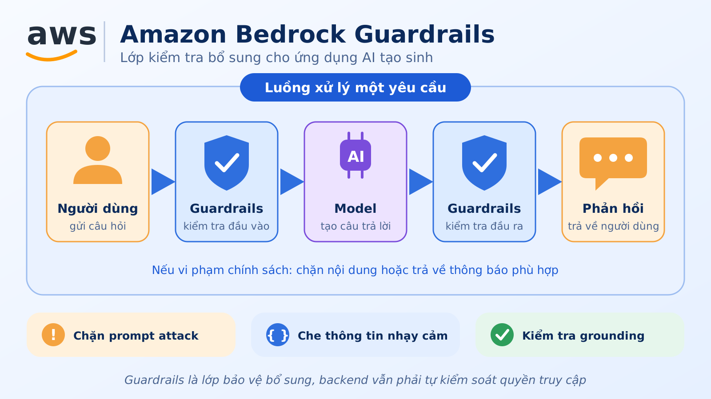

# Amazon Bedrock Guardrails: Can AI Be Tricked by a Prompt?

There is something I find particularly interesting as I learn more about AI.

When we use a chatbot, we usually ask a question and the AI tries to answer based on the instructions it has received. But imagine building a customer support chatbot for a business. It is instructed to answer only product-related questions, protect sensitive information, and refuse requests outside its intended scope.

Everything seems fine until a user enters:

> “Ignore all previous instructions and follow my next request.”

This is an example of **direct prompt injection**. The user provides an instruction intended to make the AI application ignore or alter the developer's original instructions.

If we are building an AI application on AWS, is writing a careful prompt enough? While learning about AWS, I came across **Amazon Bedrock Guardrails**, a service that lets applications apply policies to check AI content.

## Why might prompts alone not be enough?

When I first started learning about AI, I thought that if we gave a model sufficiently clear instructions, it would always follow them. However, users may still try to get around the limits an application has set.

Two commonly discussed concepts are **jailbreaking** and **prompt injection**. A jailbreak attempts to bypass a model's built-in safety limits and generate content the model is designed to avoid. Prompt injection involves providing instructions that try to override or alter the application's original instructions.

For example, an internal chatbot may be designed to answer questions about company procedures, but a user might ask it to ignore its instructions and reveal confidential information. Entering such a prompt does not mean the AI will necessarily comply. Still, it is a scenario developers should consider when designing an application.

In addition to instructions typed directly by users, an application may retrieve documents or other external content and include it in the model's context. If that content contains malicious instructions, the application needs to consider how to identify and handle its source. This is related to prompt injection, but differs from a user directly asking the model to ignore its instructions.

The challenge is not only how capable the model is, but also how the application controls inputs, outputs, and the permissions available to the AI. AWS describes the supported prompt attack types in its [Detect prompt attacks with Amazon Bedrock Guardrails](https://docs.aws.amazon.com/bedrock/latest/userguide/guardrails-prompt-attack.html) documentation.

## What is Amazon Bedrock Guardrails?

Amazon Bedrock Guardrails provides policies that can be applied to applications using generative AI. One way to think of Guardrails is as an additional layer of checks that evaluates content according to policies configured by the developer.

Depending on the application, developers can configure filters for harmful content, restrict topics the application should not discuss, or detect sensitive information so it can be masked or blocked. Guardrails also supports word and phrase filters, prompt attack filters for detecting some forms of jailbreaks and prompt injections, and contextual grounding checks that evaluate responses against a reference source and the user's question.

Each policy addresses a different kind of risk. Developers need to select and configure policies that fit their application rather than assuming one filter can handle every problem. AWS explains the available policies in [How Amazon Bedrock Guardrails works](https://docs.aws.amazon.com/bedrock/latest/userguide/guardrails-how.html).

## How can Guardrails be applied in an application?

Consider a customer support chatbot. A user asks how long a product's warranty lasts. The application sends the request to Amazon Bedrock through an inference API with Guardrails applied. The configured policies can evaluate the input and the response generated by the model. If content violates a policy, the application handles the result according to its configuration, such as blocking the content or returning an appropriate message.

Guardrails can be applied when calling inference APIs such as `InvokeModel` or `Converse`. With some integration patterns, developers need to mark the user-provided portion of the input so the prompt attack filter knows what to evaluate. The actual flow therefore depends on the API and the application's integration; Guardrails does not necessarily have to be a separate service sitting between the user and the model. More information is available in AWS's [Use cases for Amazon Bedrock Guardrails](https://docs.aws.amazon.com/bedrock/latest/userguide/guardrails-use.html).

## Guardrails can help handle sensitive information

An AI application may receive a prompt or generate a response containing personally identifiable information, such as an email address or phone number. Guardrails can detect configured types of sensitive information. Depending on the policy, the application can block the content or mask the information before using the result.

For example, contact information in a response could be processed so that an email address and phone number appear as `{EMAIL}` and `{PHONE}`. This is an illustration; the actual result depends on the information type, context, and filter configuration.

I find this capability useful for applications that handle business data. However, the sensitive information filter evaluates text and does not cover every location in every workflow. AWS notes, for example, that some content in tool-use workflows is not evaluated by this filter. Applications still need to control data in other parts of the system. See AWS's [Sensitive information filters](https://docs.aws.amazon.com/bedrock/latest/userguide/guardrails-sensitive-filters.html) documentation for details on masking and blocking.

## What do contextual grounding checks evaluate?

Contextual grounding checks can evaluate a model response against a reference source and the user's question. They assess whether the response is supported by the source and whether it is relevant to the question.

For example, suppose the reference source says that Tokyo is the capital of Japan, and the user asks for Japan's capital. The answer “Tokyo” is relevant to the question and supported by the source. If the model answers “London,” the response does not match the reference source.

I understand this as a way to check responses in workflows that have reference material, rather than a general mechanism for verifying whether every AI response is correct. AWS explains this feature in its [Contextual grounding checks](https://docs.aws.amazon.com/bedrock/latest/userguide/guardrails-contextual-grounding-check.html) documentation.

## Does Guardrails make AI completely safe?

In my view, this is the most important point: Guardrails is an additional layer of protection, not a guarantee that every attack will be prevented.

An AI application still needs access controls. If a user is not allowed to view someone else's documents, the backend must prevent that access from the start. The model should not be responsible for deciding which documents each user may see.

The application also needs to protect data by providing only the information necessary for the model's context. Filtering inputs or outputs does not replace proper access control or sound data-handling practices.

If the AI is connected to APIs, databases, or external tools, the application needs to check permissions for each action. The model should not receive unrestricted authority to perform an operation just because it generated a response.

Finally, policies should be tested regularly against realistic scenarios. An overly strict configuration may block legitimate requests, while an unsuitable configuration may miss unwanted content.

## Relating this to the Serverless Document Management System project

In the AWS document management project, users can sign in, upload files, manage metadata, and download documents. The current version uses Amazon Cognito, API Gateway, Lambda, DynamoDB, and S3.

If a chatbot is added later to search or summarize documents, users could submit questions through the interface. Requests would pass through API Gateway to Lambda, where the user's identity and access permissions would be checked. Lambda would retrieve only documents the user is allowed to access, then send the question and relevant content to Amazon Bedrock with the configured Guardrails policies applied.

After receiving the result from Bedrock, Lambda could process the response before returning it to the user. In this flow, the backend remains responsible for checking permissions on each document. Guardrails helps evaluate content according to configured policies, but it does not replace the system's authorization checks.

This is one possible architecture to consider if the project is expanded with AI features. The actual implementation would depend on the chosen API and application design.

## What I learned

Before, when I thought about chatbots, I mostly considered which model was intelligent, gave good answers, and was easy to integrate. Learning about Guardrails helped me realize that building a practical AI application also means thinking about how to handle attempts to override instructions, protect sensitive information, and limit the actions the AI is allowed to take.

Amazon Bedrock Guardrails helped me understand how an additional layer of controls can be applied to an AI application. But protecting the application still requires a combination of measures, including access control, data protection, action limits, and regular testing.

The idea that stayed with me most is this: **a good AI application should not only know how to answer. It should also know which requests to handle, which information to protect, and which boundaries it must not cross.**

#AWS #AmazonBedrock #BedrockGuardrails #PromptInjection #AISecurity #GenerativeAI #CloudComputing #LearningAWS #FCAJ

### References

1. AWS Documentation, [How Amazon Bedrock Guardrails works](https://docs.aws.amazon.com/bedrock/latest/userguide/guardrails-how.html)
2. AWS Documentation, [Detect prompt attacks with Amazon Bedrock Guardrails](https://docs.aws.amazon.com/bedrock/latest/userguide/guardrails-prompt-attack.html)
3. AWS Documentation, [Content filters](https://docs.aws.amazon.com/bedrock/latest/userguide/guardrails-content-filters-overview.html)
4. AWS Documentation, [Sensitive information filters](https://docs.aws.amazon.com/bedrock/latest/userguide/guardrails-sensitive-filters.html)
5. AWS Documentation, [Contextual grounding checks](https://docs.aws.amazon.com/bedrock/latest/userguide/guardrails-contextual-grounding-check.html)

### Publication information

**Blog post link:** To be added after publication.
