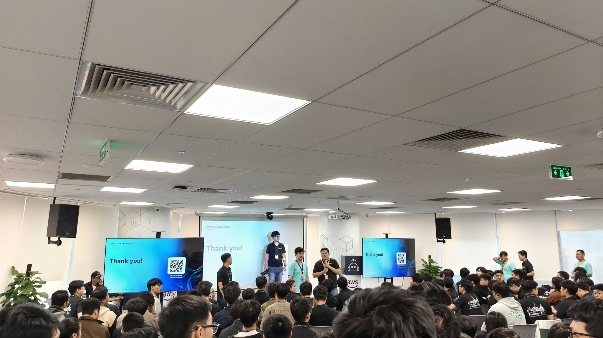
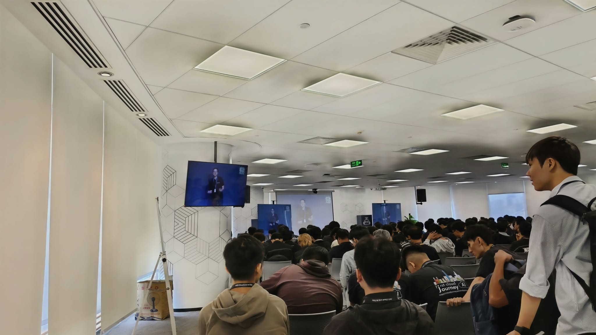
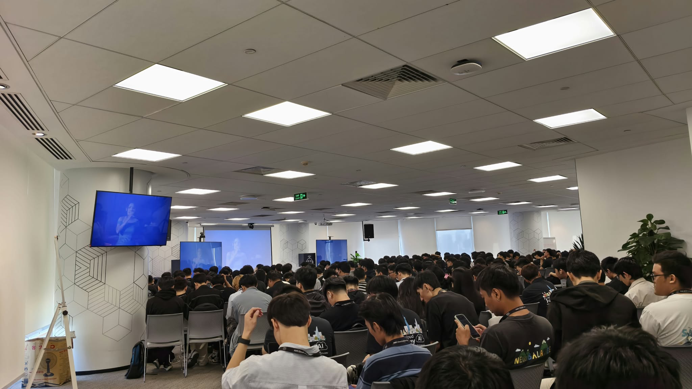

# Summary Report: “AWS Cloud & AI Day Vietnam 2026 - Watch Party”

## Event Objectives

- Introduce the latest developments in cloud computing and artificial intelligence.
- Explore how **agentic AI** can support software development, business processes, and enterprise transformation.
- Share real-world customer stories and practical approaches to **data analytics, cloud migration, and modern application development**.
- Provide opportunities for developers, students, technology professionals, and business leaders to learn directly from AWS experts and partners.
- Connect attendees with the local AWS community through technical sessions, workshops, demonstrations, and networking activities.

The main **AWS Cloud & AI Day Vietnam 2026** program took place in Hanoi on **September 29, 2026**, with keynote presentations, technical sessions, hands-on activities, customer stories, and community networking. I attended a watch party at my company office on the 26th floor of Bitexco Tower in Ho Chi Minh City and followed the Hanoi presentations via livestream.

## Event Information

- **Main event:** AWS Cloud & AI Day Vietnam 2026
- **Date:** September 29, 2026
- **Main event venue:** JW Marriott Hotel Hanoi
- **My attendance location:** Company watch party, 26th floor, Bitexco Tower, Ho Chi Minh City
- **Format:** Followed the Hanoi presentations via livestream at the watch party
- **Hanoi program format:** One-day, in-person event
- **Main Areas:** Agentic AI, Data & Analytics, Cloud Migration, Modern Applications
- **Sessions:** 30+ sessions
- **Special Activities:** Expo, Startup Zone, Developer Community Zone, Workshops, and 8-Bit Agents Activation

## Keynote Speakers

The official AWS event page listed the following keynote speakers:

- **H.E. Hoang Minh** – Deputy Minister of Science and Technology
- **H.E. Jennifer Wicks** – U.S. Ambassador to Vietnam
- **Dr. Werner Vogels** – CTO, Amazon.com
- **Eric Yeo** – Country General Manager Malaysia, Vietnam, Indochina, AWS
- **Mai Le** – Director of Product Management, Katalon
- **Dr. Jens Lottner** – Chief Executive Officer, Techcombank

## Key Highlights

### Agentic AI

One of the most prominent themes of the event was **agentic AI**.

Rather than focusing only on traditional chat-based AI, the event highlighted the idea of AI systems that can take actions, interact with tools, support workflows, and help organizations solve more complex tasks.

This theme appeared across several sessions, including:

- **From Demo to Deployment: Solving Agentic AI's Toughest Challenges**
- **Building software like never before with agentic AI**
- **Migration at Scale with Agentic AI: AWS Transform and Beyond**
- **Amazon Quick Play & Build: Create Your AI Assistant, Compete, Win**

What I found particularly interesting was the shift in perspective from simply asking AI questions toward building systems in which AI can participate as part of an actual workflow.

### Building Software with Agentic AI

The session **"Building software like never before with agentic AI"** showed that AI is increasingly becoming part of the software development process.

For developers, this suggests a future where AI can support multiple stages of development rather than being used only for code completion.

From a student perspective, this made me think about how AI tools could assist with:

- Understanding requirements
- Generating and explaining code
- Testing applications
- Debugging
- Improving development productivity

The event therefore connected AI with practical software engineering rather than treating AI as an isolated technology.

### Data as the Foundation for AI

Another important topic was the session **"Build and AI-ready data foundation."**

This highlighted an important idea: AI applications are only as useful as the data that supports them.

For organizations, preparing data for AI involves more than simply collecting a large amount of information. Data needs to be accessible, well-managed, and suitable for analytics and AI workloads.

This topic helped me understand that building an AI system is not only about choosing a powerful model. The underlying data architecture is equally important.

### Cloud Migration and Modernization

The event also focused on migration and modernization through the session **"Migration at Scale with Agentic AI: AWS Transform and Beyond."**

This showed how AI can become part of the modernization process, especially when organizations need to deal with large existing systems and workloads.

Instead of viewing migration as simply moving applications from one environment to another, modernization requires organizations to think about:

- Application architecture
- Scalability
- Operational efficiency
- Security
- Long-term maintainability

This was especially relevant to me because it connected cloud technology with real business and engineering problems rather than focusing only on infrastructure.

### Internal Developer Platforms and Cloud-Native Development

The agenda also included **"Platform Engineering at Scale: Internal Developer Platform on EKS"**, presented with VPBank.

This session demonstrated another direction of modern cloud development: instead of asking every developer to manage infrastructure independently, organizations can create internal platforms that simplify development and deployment.

This helped me see how technologies such as containers, Kubernetes, and platform engineering can be combined to improve developer productivity in larger organizations.

### Security and Workload Identity

One of the advanced sessions was **"Beyond IAM Roles: Engineering Workload Identity on AWS,"** presented with Vingroup.

This topic was especially interesting from a cloud-security perspective because identity is a fundamental part of protecting cloud workloads.

It reinforced the idea that cloud security is not only about protecting networks and data, but also about carefully controlling which workloads, applications, and services are allowed to access resources.

### Amazon Quick and Hands-on AI

The event also provided practical activities around **Amazon Quick**, including:

**"Amazon Quick Play & Build: Create Your AI Assistant, Compete, Win."**

AWS described this as a hands-on activity where participants could build their own AI assistant and interact with the technology directly.

The event also featured the **8-Bit Agents Activation**, which was designed to let participants build and deploy AI agents through an interactive experience.

These activities were useful because they demonstrated how AI concepts can move from theory into something that users can actually build and experiment with.

## Key Takeaways

### 1. AI Is Moving Toward Agentic Systems

One of my biggest takeaways from the event was the growing importance of **agentic AI**.

AI is increasingly being integrated into applications and workflows instead of being used only as a question-and-answer interface.

This means developers need to think not only about models, but also about:

- Tools
- Data
- Workflows
- Security
- Human oversight

### 2. Data Infrastructure Is Essential

I also learned that AI development cannot be separated from data architecture.

A strong AI application requires data that is:

- Available
- Reliable
- Well organized
- Secure
- Suitable for the intended AI workload

Therefore, learning cloud databases, storage, analytics, and data pipelines is still very important even in the age of generative AI.

### 3. Modern Applications Require Multiple AWS Services

Another important lesson was that modern applications are rarely built around a single service.

Depending on the problem, developers may combine:

- Compute
- Databases
- Storage
- Identity
- APIs
- AI services
- Monitoring
- DevOps tools

This connected strongly with what I am currently learning about serverless architecture.

### 4. Security Must Be Designed from the Beginning

The sessions related to workload identity reinforced the importance of authorization and access control.

Instead of adding security after an application is finished, developers should think about identity and permissions during the architecture design stage.

### 5. Cloud Is More Than “Moving to the Cloud”

Before learning about cloud architecture, it is easy to think that cloud migration simply means moving an existing application to AWS.

The event showed me that cloud migration can also be an opportunity to:

- Modernize architecture
- Improve scalability
- Automate operations
- Introduce AI capabilities
- Improve developer productivity

## Applying What I Learned to My Project

The event also gave me several ideas that I can apply to my own **Serverless Document Management System** project.

My current architecture uses:

- **Amazon Cognito** for authentication
- **AWS Amplify** for frontend hosting
- **Amazon API Gateway** for REST APIs
- **AWS Lambda** for backend logic
- **Amazon DynamoDB** for document metadata
- **Amazon S3** for document storage
- **Amazon CloudWatch** for monitoring

The event helped me understand that these services should not be viewed separately.

Instead, they form a complete system in which:

```text
User
  ↓
Cognito
  ↓
Frontend
  ↓
API Gateway
  ↓
Lambda
  ↓
DynamoDB / S3
  ↓
CloudWatch
```

## Event Photos

### Attendees listening to a presentation



### Participants following the event on screen



### Another view of the audience


