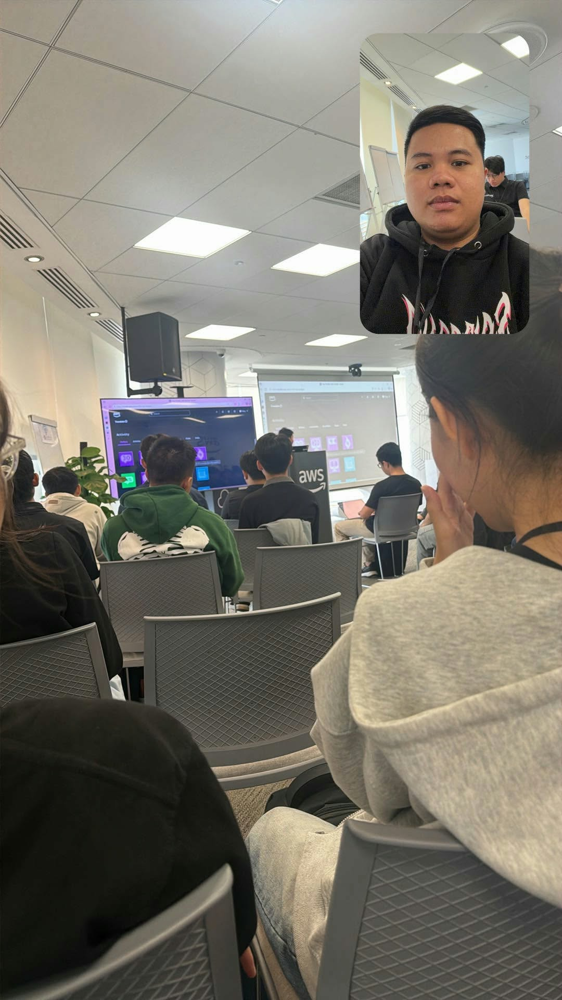
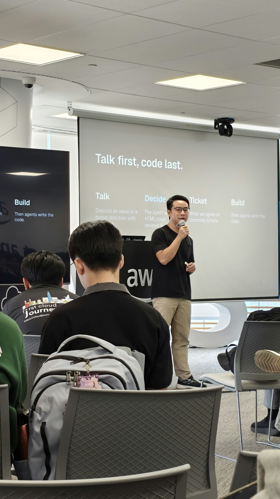
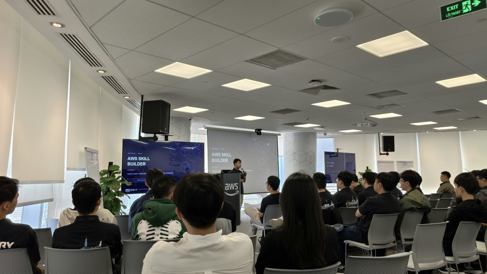

# Event Report: FCAJ Community Day

## Event Information

- **Date and time:** 09:00–12:00, Saturday, October 31, 2026
- **Location:** Bitexco Financial Tower, 2 Hai Trieu Street, Ho Chi Minh City
- **Role:** Attendee
- **Program:** [FCAJ Community Day on Luma](https://luma.com/1izeyind)

## Speakers

The event featured speakers from technology companies and the FCAJ community:

- **Thinh Nguyen** – STYL Solutions
- **Henry Duc Bui** – CloudThinker
- **Hung Tran** – NAB
- **Dao Luong** – FCAJ
- **Khang Duong** – FCAJ
- **Tuan Tran** – FCAJ

## What I Heard at the Event

### Lessons Learned from Building Software Factories

The program opened with practical lessons from building software factories at scale. The talk covered common pitfalls and approaches that have worked for teams doing this in practice. I took away that as software development grows, processes and tools should help teams work consistently instead of simply adding more steps or technology.

### Education and Preparing Cloud Talent

The Education session shared an educator's perspective on preparing the next generation of cloud talent. It discussed what students should prepare before entering the industry and how universities and businesses can bridge the gap between academic learning and workplace needs. I was reminded that students need both foundational knowledge and hands-on practice through projects that apply that knowledge to concrete problems.

### AWS Lambda Web Functions and Serverless Architecture

The AWS Lambda Web Functions session introduced a new way to run web applications on Lambda. The presentation covered native HTTP support and concurrent request handling, with the program highlighting up to 128 concurrent requests. It also discussed reducing adapter overhead, Active CPU Billing, and live performance benchmarks against Docker deployments on EC2/ECS.

From this session, I learned to consider how an application receives requests, its concurrency needs, compute costs, and real-world performance when choosing a serverless architecture. Benchmarks can help teams make decisions based on their workloads instead of assuming that one model fits every application.

### Amazon SQS: Building Asynchronous Systems

In the Amazon SQS session, I heard why modern systems use asynchronous processing and how queues can decouple components. Once work is placed in a queue, the part accepting requests and the part processing them can operate more independently, helping the system absorb workload and scale separate components. The session also covered design patterns and practical implementation tips.

My main takeaway was that asynchronous processing can be useful for tasks that do not need to return a result immediately. It also requires a plan for failures, retries, and message status monitoring so that the workflow remains reliable.

### My 3-Month AWS Internship Journey

This session shared a three-month AWS internship experience, how AWS services were applied to a real project, and advice for students about to begin an internship. The story showed me how learning cloud services becomes more concrete when connected to a product: students need to understand requirements, choose suitable services, and observe how the system operates.

### Start and Maintain Consistency with Open Source Contributing

The final session discussed making a first open-source contribution, building a regular contribution habit, and staying motivated. I learned that newcomers can begin with small steps, such as reading contribution guidelines, writing clear bug reports, improving documentation, or choosing a suitable issue. Contributing over time can strengthen skills in reading code, collaboration, and communication in software teams.

## Key Takeaways

The sessions connected cloud concepts with practical software development situations. I took away three main points: architecture choices should be based on workload and measurements; asynchronous processing reduces dependencies between components but requires failure handling; and professional skills grow through project work, internships, and community contributions.

## Applying the Learning to My Project

My document management project currently receives requests through API Gateway and processes them with Lambda. After the SQS session, I see a possible opportunity to explore a queue for background tasks if the project later needs notifications or longer document-processing jobs. This is a future idea, not a feature that has been implemented. The Lambda Web Functions session also gave me another architecture to investigate, but compatibility and performance should be evaluated against the application's requirements before choosing it.

## Reflection

I found FCAJ Community Day useful because it combined software engineering experience, cloud architecture, an internship story, and open-source participation. The sessions gave me practical perspectives to continue learning AWS and consider possible improvements to my project.

## Event Photos

### Attending the event

### Speaker presentation on software development

### AWS Skill Builder session

