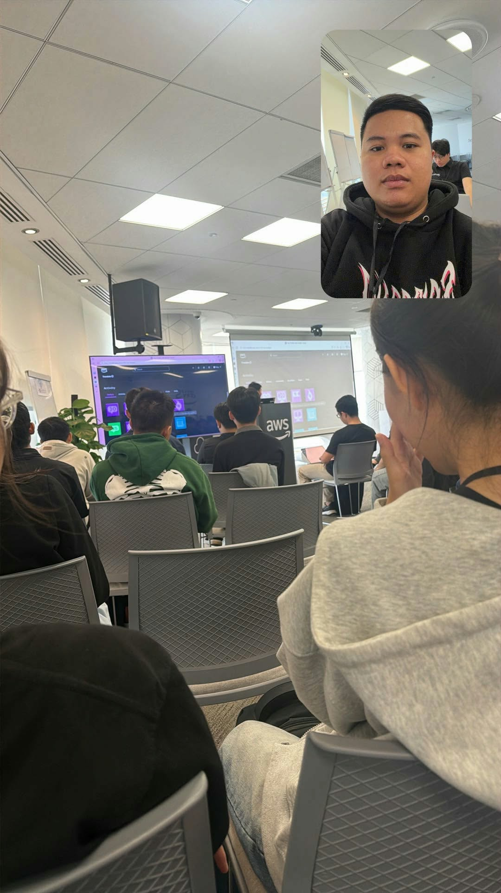
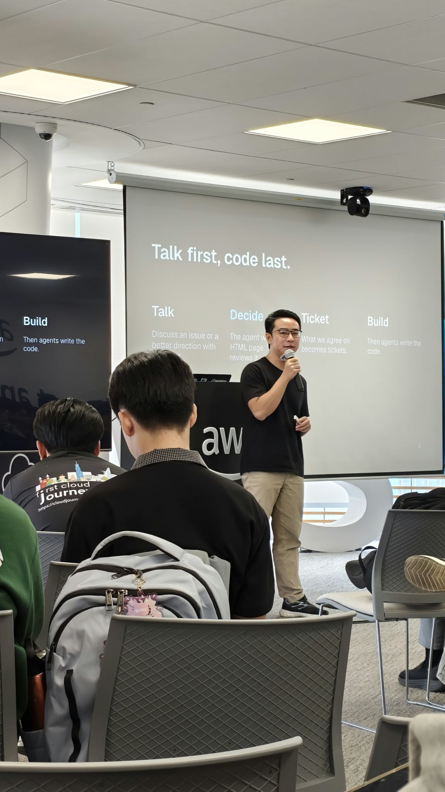
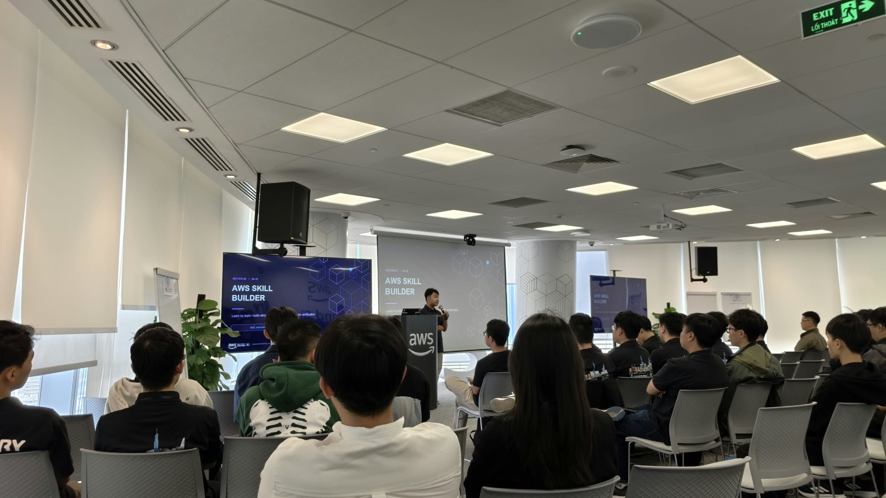

# Báo cáo sự kiện: FCAJ Community Day

## Thông tin sự kiện

- **Thời gian:** 09:00–12:00, Thứ Bảy, ngày 31/10/2026
- **Địa điểm:** Bitexco Financial Tower, 2 đường Hải Triều, Thành phố Hồ Chí Minh
- **Vai trò:** Người tham dự
- **Chương trình:** [FCAJ Community Day trên Luma](https://luma.com/1izeyind)

## Các diễn giả

Buổi chia sẻ có sự tham gia của các diễn giả đến từ doanh nghiệp và cộng đồng FCAJ:

- **Thinh Nguyen** – STYL Solutions
- **Henry Duc Bui** – CloudThinker
- **Hung Tran** – NAB
- **Dao Luong** – FCAJ
- **Khang Duong** – FCAJ
- **Tuan Tran** – FCAJ

## Nội dung em được nghe tại sự kiện

### Bài học khi xây dựng Software Factory

Mở đầu chương trình là phần chia sẻ về những bài học thực tế khi xây dựng software factory ở quy mô lớn. Qua nội dung này, em nghe được rằng khi mở rộng quy trình phát triển phần mềm, đội ngũ cần chú ý đến những khó khăn thường gặp và tập trung vào những cách làm đã chứng minh được hiệu quả trong thực tế. Điều em ghi nhận là quy trình và công cụ cần hỗ trợ đội ngũ làm việc ổn định, thay vì chỉ bổ sung thêm nhiều bước hoặc công nghệ.

### Giáo dục và chuẩn bị nhân lực Cloud

Phiên Education mang đến góc nhìn của người làm giáo dục về việc chuẩn bị thế hệ nhân lực Cloud tiếp theo. Nội dung tập trung vào những điều sinh viên nên chuẩn bị trước khi bước vào môi trường doanh nghiệp và khoảng cách giữa kiến thức ở trường với nhu cầu thực tế. Em nhận ra rằng ngoài kiến thức nền tảng, sinh viên cần chủ động thực hành, làm dự án và rèn khả năng áp dụng kiến thức vào bài toán cụ thể.

### AWS Lambda Web Functions và kiến trúc Serverless

Phiên AWS Lambda Web Functions giới thiệu cách tiếp cận mới để chạy ứng dụng web trên Lambda. Diễn giả trình bày native HTTP support và khả năng xử lý nhiều request đồng thời, được nêu trong chương trình là tối đa 128 request. Phần chia sẻ cũng đề cập đến việc giảm overhead từ adapter, Active CPU Billing và so sánh hiệu năng trực tiếp với cách triển khai Docker trên EC2/ECS.

Qua phiên này, em hiểu thêm rằng khi chọn kiến trúc serverless, cần xem xét cả cách ứng dụng nhận request, mức độ đồng thời, chi phí tính toán và hiệu năng thực tế. Việc có benchmark giúp nhóm phát triển đánh giá lựa chọn kiến trúc dựa trên workload, thay vì mặc định một mô hình luôn phù hợp cho mọi ứng dụng.

### Amazon SQS và xử lý bất đồng bộ

Ở phiên Amazon SQS: Building Asynchronous Systems, em được nghe lý do các hệ thống hiện đại cần xử lý bất đồng bộ và cách hàng đợi giúp tách rời các thành phần. Khi request được đưa vào queue, bên tiếp nhận và bên xử lý có thể hoạt động độc lập hơn, nhờ đó hệ thống có thêm khả năng hấp thụ tải và mở rộng từng phần. Phiên này cũng giới thiệu các mẫu thiết kế cùng lưu ý thực tế khi triển khai SQS.

Điều em rút ra là xử lý bất đồng bộ phù hợp với những tác vụ không cần trả kết quả ngay cho người dùng. Tuy nhiên, khi áp dụng cần thiết kế cách xử lý lỗi, retry và theo dõi trạng thái message để quy trình đáng tin cậy.

### Hành trình thực tập AWS trong ba tháng

Phiên My 3-Month AWS Internship Journey chia sẻ trải nghiệm thực tập trong ba tháng, cách áp dụng dịch vụ AWS vào một dự án thực tế và những bài học dành cho người sắp bắt đầu kỳ thực tập. Qua câu chuyện này, em thấy việc học dịch vụ Cloud sẽ hiệu quả hơn khi gắn với một sản phẩm cụ thể: người học phải hiểu yêu cầu, chọn dịch vụ phù hợp và quan sát cách hệ thống vận hành.

### Bắt đầu và duy trì đóng góp mã nguồn mở

Phiên cuối nói về cách thực hiện đóng góp mã nguồn mở đầu tiên, xây dựng thói quen đóng góp đều đặn và duy trì động lực. Em hiểu rằng người mới có thể bắt đầu từ những việc nhỏ, chẳng hạn đọc hướng dẫn, báo lỗi rõ ràng, cải thiện tài liệu hoặc xử lý một issue phù hợp. Việc tham gia lâu dài giúp rèn kỹ năng đọc code, cộng tác và giao tiếp trong môi trường phát triển phần mềm.

## Bài học em rút ra

Các phiên chia sẻ giúp em kết nối kiến thức về Cloud với những tình huống phát triển phần mềm thực tế. Em ghi nhận ba điểm chính: lựa chọn kiến trúc cần dựa trên workload và số liệu; xử lý bất đồng bộ giúp các thành phần ít phụ thuộc nhau hơn nhưng cần có chiến lược xử lý lỗi; và kỹ năng nghề nghiệp được hình thành qua thực hành dự án, thực tập, cũng như đóng góp cho cộng đồng.

## Liên hệ với dự án

Dự án quản lý tài liệu của em hiện nhận request qua API Gateway và xử lý bằng Lambda. Sau khi nghe phần trình bày về SQS, em thấy có thể nghiên cứu dùng queue cho các tác vụ nền nếu sau này dự án cần xử lý thông báo hoặc công việc xử lý tài liệu lâu hơn. Đây là ý tưởng có thể xem xét trong tương lai, chưa phải chức năng đã triển khai. Phần chia sẻ về Lambda Web Functions cũng giúp em có thêm một hướng kiến trúc để tìm hiểu, nhưng cần đánh giá khả năng tương thích và benchmark theo yêu cầu của ứng dụng trước khi lựa chọn.

## Cảm nhận

Em thấy FCAJ Community Day hữu ích vì chương trình kết hợp kinh nghiệm xây dựng phần mềm, kiến trúc Cloud, câu chuyện thực tập và hoạt động mã nguồn mở. Những nội dung được chia sẻ giúp em có thêm góc nhìn thực tế để tiếp tục học AWS và cân nhắc các hướng cải tiến cho dự án của mình.

## Hình ảnh sự kiện

### Em tham dự buổi chia sẻ

### Diễn giả trình bày về phát triển phần mềm

### Phiên AWS Skill Builder

