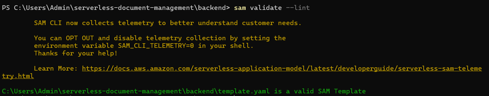
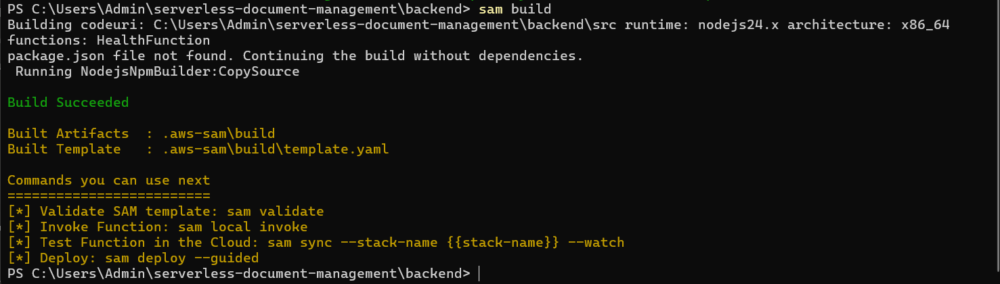
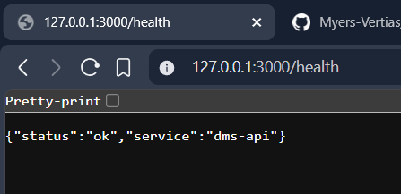

{}
This page records the deployed implementation and observed results. Any unverified behavior is identified explicitly.
{}

## Objective

Verify the current frontend and establish a clean baseline before connecting AWS.

## Implementation steps

1. Open the UniCloud DMS repository and verify that package.json and package-lock.json are present. Both files are present.
2. Run `npm ci`, `npm run lint`, and `npm run build` from the repository root; record any existing warnings or failures.
3. Run `npm run dev` and open the URL printed by Vite. Confirm the mock frontend pages still work before replacing mock services. Verified on 2026-11-10: the built-in demo login opened the Dashboard and displayed the seeded document records.
4. Install the AWS CLI and AWS SAM CLI on Windows. Verify the AWS session with `aws sts get-caller-identity --profile dms-dev` and verify SAM with `sam --version`.
5. Create a Git branch or backup commit before backend integration. Never put credentials or tokens in source control.

## Baseline recorded on 2026-11-10

- `npm ci`: completed successfully; 61 packages added. npm reported one high-severity vulnerability in the dependency audit summary. No `npm audit` investigation has been performed yet.
- `npm run lint`: completed with zero errors and 10 warnings. Existing warnings are in `Profile.jsx`, `Dashboard.jsx`, `Trash.jsx`, `Shared.jsx`, `Documents.jsx`, `Favorites.jsx`, and `DocumentDetail.jsx` (React purity, state-in-effect, and hook dependency rules).
- `npm run build`: completed successfully with Vite 8.3.3; production assets were generated in `dist/`.
- Baseline browser check before AWS integration: Vite served the app at `http://127.0.0.1:5173/`; built-in mock login reached `/dashboard`, which displayed three seeded documents. This records the starting mock flow. Later AWS-backed workflows are documented in sections 5.8–5.10.
- Runtime versions recorded: Node.js 25.9.0 and npm 11.14.1. Confirm the Node.js support/LTS choice before finalizing the reproducible guide.
- AWS CLI authenticated through IAM user `dms-dev`; `aws sts get-caller-identity --profile dms-dev` returned an ARN ending in `user/dms-dev`.
- AWS SAM CLI installed successfully, version 1.171.0.
- From `backend/`, `sam validate --lint` confirmed that `template.yaml` is a valid SAM template; no AWS resources have been deployed.
- `sam build` succeeded for `HealthFunction` with runtime `nodejs24.x` and architecture `x86_64`; build artifacts are under `.aws-sam/build`. The scaffold handler has no external package dependencies yet.
- `sam local start-api --port 3000` started the API locally with Docker, and `GET http://127.0.0.1:3000/health` returned `{"status":"ok","service":"dms-api"}`. This confirms the local health route only; AWS resources have not been deployed.

## Screenshots and remaining evidence

The local mock dashboard, frontend lint/build transcript, and `sam --version` were recorded in the baseline above; separate screenshots for those commands were not retained. The SAM validation/build and local health results have the screenshots below.

## Expected result

The initial production build and SAM checks succeeded; lint reported 10 existing warnings. The mock login/dashboard and local SAM health route worked. This was the pre-integration baseline; later sections record the deployed Cognito/API/S3/DynamoDB workflow.

## Troubleshooting

- If npm installation fails, verify the Node.js version and current working directory.
- Use the exact local URL and port printed by Vite.
