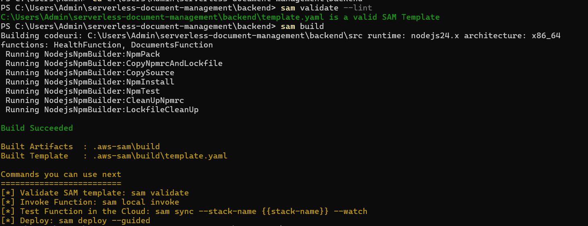

{}
This page records the deployed implementation and observed results. Any unverified behavior is identified explicitly.
{}

## Objective

Prepare a development machine, run the frontend, and confirm that the backend can start locally before configuring AWS resources.

## Required tools

- [Git for Windows](https://git-scm.com/download/win) to obtain the source and manage changes.
- [Node.js 24 LTS](https://nodejs.org/en/download) and npm to install dependencies, run the React/Vite frontend, and match the Lambda `nodejs24.x` runtime major version.
- [AWS CLI v2](https://docs.aws.amazon.com/cli/latest/userguide/getting-started-install.html) for AWS authentication and operations in later deployment steps.
- [AWS SAM CLI](https://docs.aws.amazon.com/serverless-application-model/latest/developerguide/install-sam-cli.html) to validate, build, and run the Lambda/API Gateway backend locally.
- [Docker Desktop for Windows](https://docs.docker.com/desktop/setup/install/windows-install/) running when using `sam local start-api`.

{}
This page prepares and runs the application locally. AWS credentials are not needed to open the frontend UI or call the local health endpoint. Do not use root access keys or store access keys, passwords, JWTs, or presigned URLs in source code.
{}

## Instructions

### A. Get the source and run the frontend

1. Install Git, Node.js/npm, AWS CLI v2, AWS SAM CLI, and Docker Desktop. Docker Desktop must be running when using SAM local.
2. Run the following commands to obtain the source and enter the project directory:

   ```powershell
   git clone https://github.com/Myers-Vertias/serverless-document-management.git
   Set-Location serverless-document-management
   ```

3. Confirm that the current directory contains `package.json`, `package-lock.json`, and `.env.example`, then check tool versions:

   ```powershell
   node --version
   npm --version
   git --version
   aws --version
   sam --version
   docker --version
   ```

4. Install the exact dependencies recorded in `package-lock.json`:

   ```powershell
   npm ci
   ```

5. Run lint and create a production build:

   ```powershell
   npm run lint
   npm run build
   ```

   Record existing lint warnings; do not confuse warnings with build failures.

6. Create the local configuration file from the template:

   ```powershell
   Copy-Item .env.example .env.local
   ```

   Keep the `replace-with-...` values until the AWS services have been created. Then fill in the Region, Cognito User Pool ID, App Client ID, API URL, and S3 bucket name from the outputs in later deployment sections. Do not commit `.env.local`.

7. Start Vite:

   ```powershell
   npm run dev
   ```

8. Open the local address printed by Vite, usually `http://localhost:5173`. Confirm that the sign-in page appears. Cognito sign-in works only after the real values have been added to `.env.local`.

### B. Check the backend locally

1. Open a second terminal and change to the repository's `backend` directory:

   ```powershell
   Set-Location backend
   ```

2. Validate the SAM template and build the Lambda functions:

   ```powershell
   sam validate --lint
   sam build
   ```

3. If Docker Desktop is running, start the local API:

   ```powershell
   sam local start-api --port 3000
   ```

4. Open `http://127.0.0.1:3000/health`. The expected response is:

   ```json
   {"status":"ok","service":"dms-api"}
   ```

5. Press `Ctrl+C` to stop the local processes when finished.

This health endpoint confirms only that the local API starts. It does not verify Cognito, DynamoDB, S3, or the deployed API; those are configured separately in later sections.

### C. Prepare for AWS steps

1. Continue to section 5.1.2 to select the AWS account/Region and configure a lab identity. Use an appropriately permissioned development identity, not root.
2. After configuring a personal profile, verify the identity with `aws sts get-caller-identity --profile <lab-profile>`. Replace `<lab-profile>` with the learner's profile name; do not use the instructor's profile.
3. Create a Git branch or commit to preserve the current state before backend integration.

## Baseline recorded on 2026-11-10

- `npm ci`: completed successfully; 61 packages added. npm reported one high-severity vulnerability in the dependency audit summary. No `npm audit` investigation has been performed yet.
- `npm run lint`: completed with zero errors and 10 warnings. Existing warnings are in `Profile.jsx`, `Dashboard.jsx`, `Trash.jsx`, `Shared.jsx`, `Documents.jsx`, `Favorites.jsx`, and `DocumentDetail.jsx` (React purity, state-in-effect, and hook dependency rules).
- `npm run build`: completed successfully with Vite 8.3.3; production assets were generated in `dist/`.
- Baseline browser check before AWS integration: Vite served the app at `http://127.0.0.1:5173/`; built-in mock login reached `/dashboard`, which displayed three seeded documents. This records the starting mock flow. Later AWS-backed workflows are documented in sections 5.8–5.10.
- Runtime versions in the recorded baseline: Node.js 25.9.0 and npm 11.14.1. The guide now recommends Node.js 24 LTS to match the Lambda `nodejs24.x` runtime; the earlier baseline version is retained as historical information about that run.
- AWS CLI authenticated through IAM user `dms-dev`; `aws sts get-caller-identity --profile dms-dev` returned an ARN ending in `user/dms-dev`.
- AWS SAM CLI installed successfully, version 1.171.0.
- From `backend/`, `sam validate --lint` confirmed that `template.yaml` is a valid SAM template; no AWS resources have been deployed.
- `sam build` succeeded for `HealthFunction` with runtime `nodejs24.x` and architecture `x86_64`; build artifacts are under `.aws-sam/build`. The scaffold handler has no external package dependencies yet.
- `sam local start-api --port 3000` started the API locally with Docker, and `GET http://127.0.0.1:3000/health` returned `{"status":"ok","service":"dms-api"}`. This confirms the local health route only; AWS resources have not been deployed.

## Screenshots and remaining evidence

The local mock dashboard, frontend lint/build transcript, and `sam --version` were recorded in the baseline above; separate screenshots for those commands were not retained. The SAM validation/build and local health results have the screenshots below.




## Expected result

The initial production build and SAM checks succeeded; lint reported 10 existing warnings. The mock login/dashboard and local SAM health route worked. This was the pre-integration baseline; later sections record the deployed Cognito/API/S3/DynamoDB workflow.

## Troubleshooting

- If npm installation fails, verify the Node.js version and current working directory.
- Use the exact local URL and port printed by Vite.
