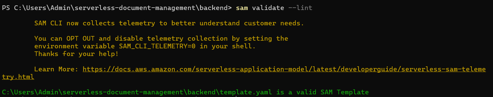
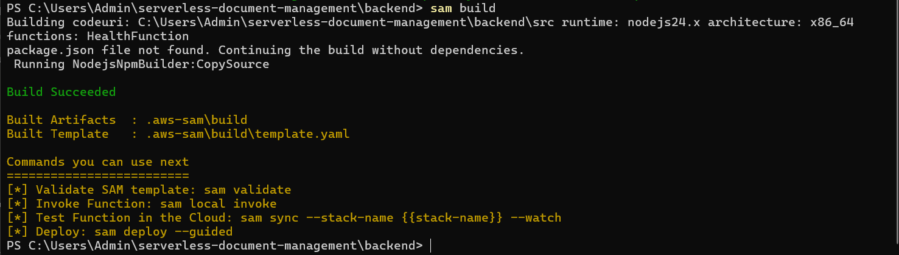
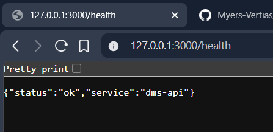
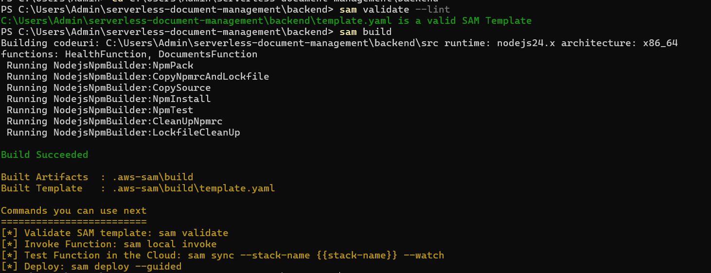

{}
Trang này ghi nhận cấu hình đã triển khai và kết quả đã quan sát; hành vi chưa xác minh được nêu rõ.
{}

## Mục tiêu

Kiểm tra frontend hiện tại và ghi nhận trạng thái ban đầu trước khi kết nối AWS.

## Các bước thực hiện

1. Mở repository UniCloud DMS và xác nhận có package.json cùng package-lock.json. Đã xác nhận cả hai file đều có.
2. Chạy `npm ci`, `npm run lint` và `npm run build` tại thư mục gốc; ghi lại warning/lỗi có sẵn.
3. Chạy `npm run dev`, mở URL Vite in ra và xác nhận các trang frontend mock vẫn hoạt động trước khi thay service. Đã xác minh ngày 2026-11-10: đăng nhập demo tích hợp sẵn mở được Dashboard và hiển thị các tài liệu mẫu.
4. Cài AWS CLI và AWS SAM CLI trên Windows. Xác nhận phiên AWS bằng `aws sts get-caller-identity --profile dms-dev` và xác nhận SAM bằng `sam --version`.
5. Tạo Git branch hoặc commit sao lưu trước khi tích hợp backend. Không đưa credentials hay token vào source control.

## Baseline ghi nhận ngày 2026-11-10

- `npm ci`: hoàn tất thành công, cài thêm 61 packages. Tóm tắt audit của npm báo một vulnerability mức high; chưa chạy `npm audit` để điều tra chi tiết.
- `npm run lint`: hoàn tất, không có lỗi và có 10 warnings. Các warning có sẵn nằm ở `Profile.jsx`, `Dashboard.jsx`, `Trash.jsx`, `Shared.jsx`, `Documents.jsx`, `Favorites.jsx` và `DocumentDetail.jsx` (quy tắc React purity, state trong effect và dependency của hooks).
- `npm run build`: hoàn tất thành công với Vite 8.3.3; đã tạo production assets trong `dist/`.
- Kiểm tra nền trước khi tích hợp AWS: Vite phục vụ ứng dụng tại `http://127.0.0.1:5173/`; đăng nhập mock tích hợp sẵn mở được `/dashboard` và hiển thị ba tài liệu mẫu. Đây là ghi nhận luồng mock ban đầu. Các luồng dùng AWS backend được ghi ở mục 5.8–5.10.
- Phiên bản môi trường ghi nhận: Node.js 25.9.0 và npm 11.14.1. Cần xác nhận lựa chọn phiên bản Node.js support/LTS trước khi chốt hướng dẫn có thể tái lập.
- AWS CLI đăng nhập qua IAM user `dms-dev`; `aws sts get-caller-identity --profile dms-dev` trả về ARN kết thúc bằng `user/dms-dev`.
- AWS SAM CLI đã cài thành công, phiên bản 1.171.0.
- Trong `backend/`, `sam validate --lint` xác nhận `template.yaml` là SAM template hợp lệ; chưa deploy tài nguyên AWS.
- `sam build` hoàn tất thành công cho `HealthFunction` với runtime `nodejs24.x`, architecture `x86_64`; build artifact nằm trong `.aws-sam/build`. Function scaffold chưa cần package dependencies.
- `sam local start-api --port 3000` khởi chạy API cục bộ bằng Docker; gọi `GET http://127.0.0.1:3000/health` nhận được `{"status":"ok","service":"dms-api"}`. Bước này chỉ xác nhận health route cục bộ; chưa deploy tài nguyên lên AWS.

## Vị trí ảnh chụp màn hình

Dashboard mock, transcript lint/build frontend và kết quả `sam --version` đã được ghi ở phần baseline; không lưu ảnh riêng cho các lệnh này. Kết quả SAM validate/build và health local có ảnh minh chứng bên dưới.

## Kết quả mong đợi

Production build và SAM checks ban đầu thành công; lint có 10 warning sẵn có. Mock login/Dashboard và SAM health route local hoạt động. Đây là baseline trước tích hợp; các mục sau ghi nhận luồng Cognito/API/S3/DynamoDB đã triển khai.

## Khắc phục sự cố

- Nếu cài npm thất bại, kiểm tra phiên bản Node.js và thư mục đang làm việc.
- Dùng đúng URL và cổng được Vite in ra.
