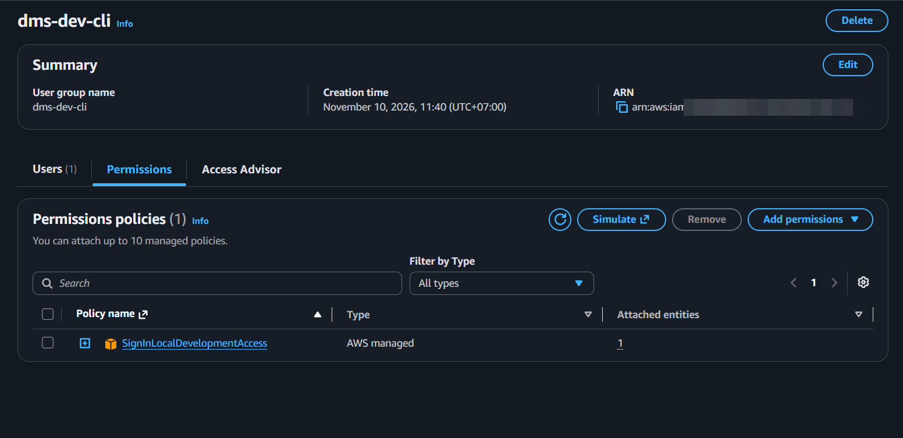
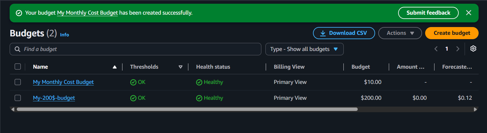

{}
This page records the deployed implementation and observed results. Any unverified behavior is identified explicitly.
{}

## Objective

Choose a development account and define a consistent Region and resource naming convention.

## Implementation steps

1. Sign in to the intended AWS account. Do not use root access keys for daily development.
2. Choose one Region for Cognito, DynamoDB, Lambda, API Gateway, and S3, then record it in lab notes.
3. Review current AWS pricing and billing. Consider a budget alert before creating resources; an alert does not automatically stop spending.
4. Use a development prefix such as `unicloud-dms-dev`. Add a unique suffix to globally unique names such as S3 buckets.
5. Use least-privilege IAM identities. Do not solve AccessDenied errors by attaching broad administrator permissions.
6. Create the `dms-dev` IAM user and `dms-dev-cli` group for local development. The group has `SignInLocalDevelopmentAccess`, `PowerUserAccess`, and the inline `DmsPassLambdaExecutionRole` policy; the inline policy only allows passing `dms-lambda-execution` to Lambda.
7. `PowerUserAccess` allows broad management of AWS services but does not allow managing IAM users/groups. Treat it as temporary workshop development access, monitor resource costs, and narrow the permissions after the deployment workflow is finalized.
8. A monthly USD 10 budget alert is configured for actual 85%, actual 100%, and forecasted 100% thresholds. The alert is not a spending cap. SAM created the managed artifact bucket `aws-sam-cli-managed-default-samclisourcebucket-5wpco5qcy6qp`; stack `dms-dev` was subsequently deployed and updated in `ap-southeast-1`.

## Screenshots and remaining evidence

The AWS console evidence throughout this report shows the selected Region as Asia Pacific (Singapore), `ap-southeast-1`. The budget screenshot above records the USD 10 alert. A separate screenshot combining the Region and budget settings was not captured.

## Expected result

The `dms-dev` development IAM user/group and scoped role-passing policy are documented above. A USD 10 monthly alert exists, and the AWS resources were deployed in Singapore. Billing review after deployment remains pending; a budget alert does not cap spending.

## Troubleshooting

- Free-tier eligibility varies by account and service; check current pricing instead of assuming resources are free.
- Never capture credentials, passwords, or tokens.
