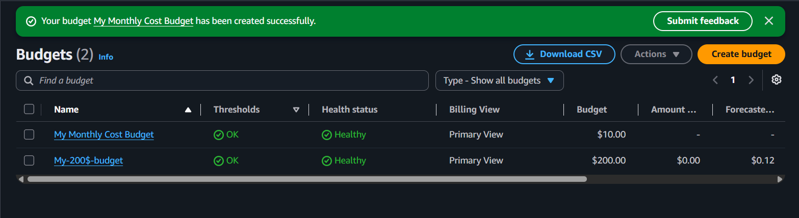

{}
Trang này ghi nhận cấu hình đã triển khai và kết quả đã quan sát; hành vi chưa xác minh được nêu rõ.
{}

## Mục tiêu

Chọn tài khoản development và thống nhất Region cùng quy ước đặt tên tài nguyên.

## Các bước thực hiện

1. Đăng nhập đúng tài khoản AWS. Không dùng root access key cho phát triển hằng ngày.
2. Chọn một Region cho Cognito, DynamoDB, Lambda, API Gateway và S3 rồi ghi vào ghi chú lab.
3. Kiểm tra giá và billing AWS hiện tại. Cân nhắc tạo cảnh báo ngân sách trước khi tạo resource; cảnh báo không tự động dừng chi tiêu.
4. Dùng tiền tố development như `unicloud-dms-dev`. Thêm hậu tố duy nhất cho tên toàn cầu như S3 bucket.
5. Dùng IAM identity theo đặc quyền tối thiểu. Không sửa AccessDenied bằng cách gắn quyền quản trị quá rộng.
6. Tạo IAM user `dms-dev` và group `dms-dev-cli` cho phát triển cục bộ. Group có `SignInLocalDevelopmentAccess`, `PowerUserAccess` và inline policy `DmsPassLambdaExecutionRole`; policy inline chỉ cho phép chuyển role `dms-lambda-execution` cho Lambda.
7. `PowerUserAccess` cho phép quản lý rộng các dịch vụ AWS nhưng không quản lý IAM users/groups. Đây là quyền phát triển tạm thời cho workshop; cần theo dõi chi phí tài nguyên và thu hẹp quyền sau khi chốt quy trình triển khai.
8. Đã cấu hình monthly budget alert 10 USD với ngưỡng actual 85%, actual 100% và forecast 100%. Alert không giới hạn chi tiêu. SAM tạo managed artifact bucket `aws-sam-cli-managed-default-samclisourcebucket-5wpco5qcy6qp`; sau đó stack `dms-dev` đã triển khai/cập nhật tại `ap-southeast-1`.

## Vị trí ảnh chụp màn hình

Ảnh AWS console trong báo cáo hiển thị Region Asia Pacific (Singapore), `ap-southeast-1`. Ảnh ngân sách phía trên ghi nhận cảnh báo 10 USD/tháng. Không chụp riêng một ảnh ghép Region và cấu hình ngân sách.

## Kết quả mong đợi

IAM user/group `dms-dev` và quyền chuyển role có phạm vi hẹp được ghi nhận ở trên. Đã tạo cảnh báo 10 USD/tháng và triển khai tài nguyên tại Singapore. Việc kiểm tra Billing sau triển khai còn chờ; cảnh báo ngân sách không giới hạn chi tiêu.

## Khắc phục sự cố

- Điều kiện free tier tùy tài khoản và dịch vụ; kiểm tra bảng giá hiện hành, không mặc định resource miễn phí.
- Không chụp credentials, mật khẩu hoặc token.
