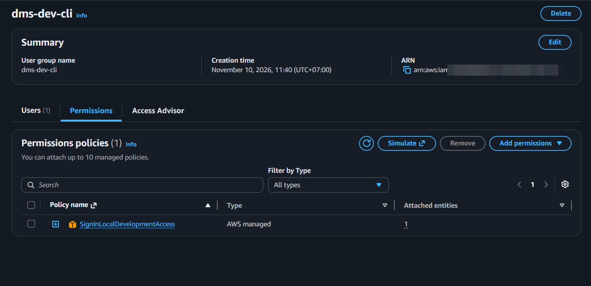

{}
Thực hiện các bước bằng tài khoản development của người học. Cấu hình thực tế của project được tách riêng bên dưới để tránh sao chép nhầm ID hoặc quyền từ tài khoản khác.
{}

## Mục tiêu

Chọn tài khoản development và thống nhất Region cùng quy ước đặt tên tài nguyên.

## Các bước thực hiện

1. Đăng nhập đúng tài khoản AWS. Không dùng root access key cho phát triển hằng ngày.
2. Chọn một Region cho Cognito, DynamoDB, Lambda, API Gateway và S3 rồi ghi vào ghi chú lab.
3. Kiểm tra giá và billing AWS hiện tại. Cân nhắc tạo cảnh báo ngân sách trước khi tạo resource; cảnh báo không tự động dừng chi tiêu.
4. Dùng tiền tố development như `unicloud-dms-dev`. Thêm hậu tố duy nhất cho tên toàn cầu như S3 bucket.
5. Dùng IAM identity theo đặc quyền tối thiểu. Không sửa AccessDenied bằng cách gắn quyền quản trị quá rộng.
6. Ưu tiên dùng IAM Identity Center và profile AWS CLI riêng cho lab. Cấp quyền theo yêu cầu triển khai, trong đó quyền `iam:PassRole` chỉ áp dụng cho Lambda execution role của project. Nếu lớp học cấp sẵn IAM user, chỉ dùng danh tính đó trong phạm vi được cho phép; không tạo access key dài hạn tùy tiện.
7. Trước khi triển khai, xác nhận profile và tài khoản đích bằng `aws sts get-caller-identity --profile <lab-profile>`. Dùng cùng Region, chẳng hạn `ap-southeast-1`, cho Cognito, API Gateway, Lambda, DynamoDB và S3.
8. Tạo AWS Budget theo giới hạn phù hợp với lab, thêm cảnh báo actual/forecast và kiểm tra người nhận email. Cảnh báo không giới hạn chi tiêu; xem lại Billing định kỳ.

## Cấu hình môi trường project đã triển khai

Trong lần triển khai được ghi nhận, group CLI là `dms-dev-cli`, gồm `SignInLocalDevelopmentAccess`, `PowerUserAccess` và inline policy `DmsPassLambdaExecutionRole`, giới hạn chuyển role `dms-lambda-execution` cho Lambda. Đây là cấu hình của môi trường project, không phải quyền khuyến nghị để sao chép nguyên trạng. `PowerUserAccess` có phạm vi rộng và không quản lý IAM user/group; nên dùng permission set hẹp hơn khi dựng môi trường mới. Budget thực tế là 10 USD/tháng với ngưỡng actual 85%, actual 100% và forecast 100%. Stack `dms-dev` được triển khai tại `ap-southeast-1`; bucket artifact SAM do CLI quản lý tách biệt với bucket tài liệu.

## Vị trí ảnh chụp màn hình

Ảnh AWS console trong báo cáo hiển thị Region Asia Pacific (Singapore), `ap-southeast-1`. Ảnh ngân sách phía trên ghi nhận cảnh báo 10 USD/tháng. Không chụp riêng một ảnh ghép Region và cấu hình ngân sách.

## Kết quả mong đợi

IAM user/group `dms-dev` và quyền chuyển role có phạm vi hẹp được ghi nhận ở trên. Đã tạo cảnh báo 10 USD/tháng và triển khai tài nguyên tại Singapore. Đã chụp kết quả kiểm tra Billing/Cost Explorer bước đầu ngày 18/11/2026; Bills tháng 11 vẫn `Pending`, hiển thị `USD 0.00`, nên đây chưa phải số tiền cuối cùng. Cảnh báo ngân sách không giới hạn chi tiêu.

## Khắc phục sự cố

- Điều kiện free tier tùy tài khoản và dịch vụ; kiểm tra bảng giá hiện hành, không mặc định resource miễn phí.
- Không chụp credentials, mật khẩu hoặc token.
