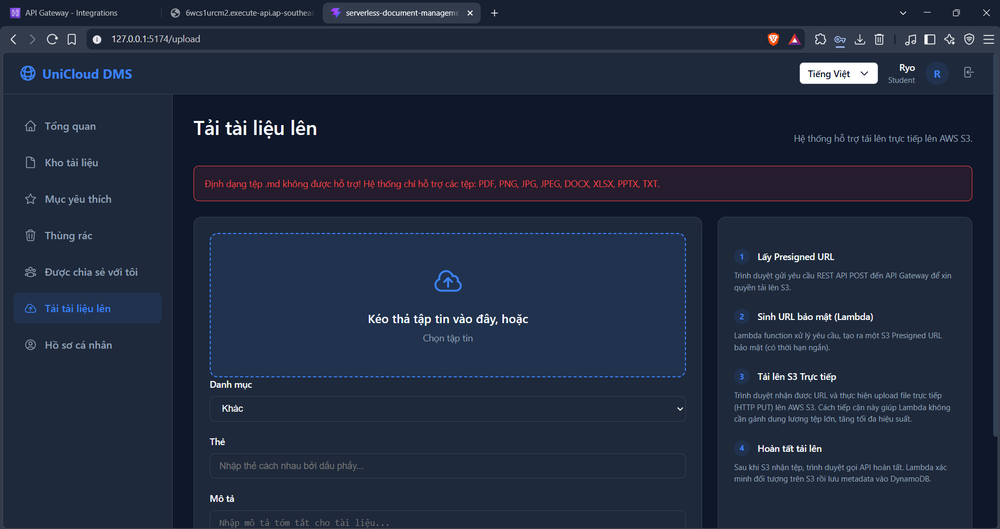

{}
The images below record some observed results. Distinguish local frontend screenshots from production screenshots; do not infer untested cases from a build result or document list.
{}

## Objective

Record actual outcomes for the sign-in, metadata, upload, view, and download flows.

## Implementation steps

1. Create/verify a dedicated test user, then test sign-in and sign-out.
2. Upload a harmless sample file and verify both the private S3 object and DynamoDB metadata.
3. List the document, open its detail view, update allowed metadata, and download the file.
4. Test invalid file type/size and missing/expired authentication. Record Pass/Fail only after the test was run.

## Screenshots and remaining evidence

The missing-token case is covered by the HTTP `401` evidence in section 5.7.2.

Selecting a `.md` file was rejected by the frontend, which displayed the supported extensions before upload.

Oversized-file rejection and expired-token behavior were not tested in this workshop run.

## Expected result

The main document workflow has reproducible evidence and recorded outcomes.

## Troubleshooting

- Do not mark an unexecuted test as passed because code compiled.
- Use synthetic sample files rather than personal records.
