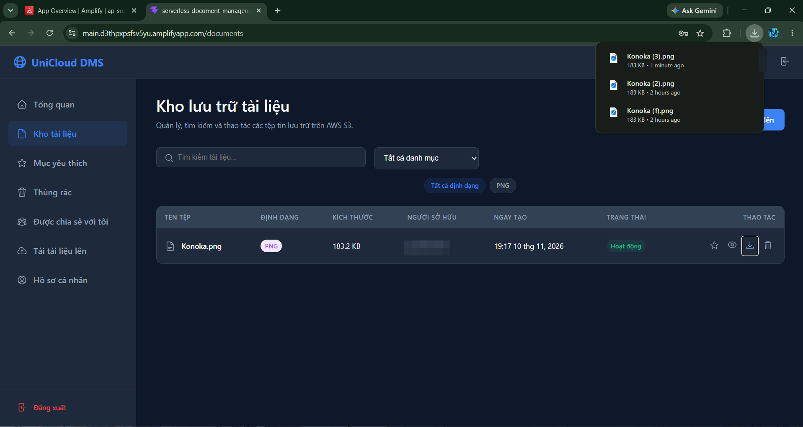
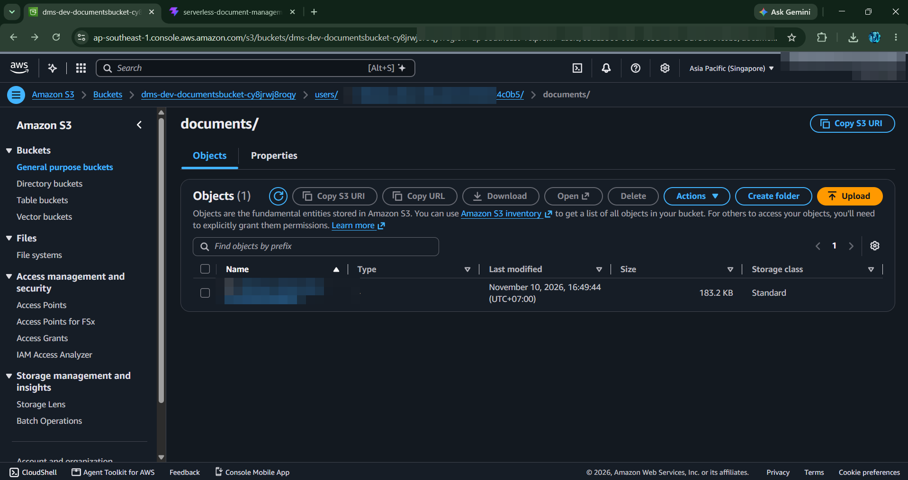
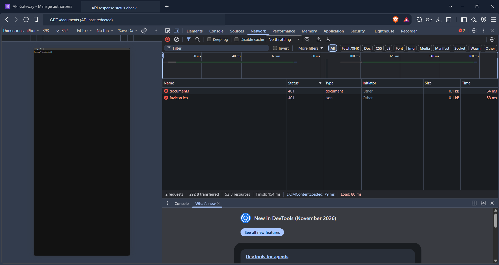
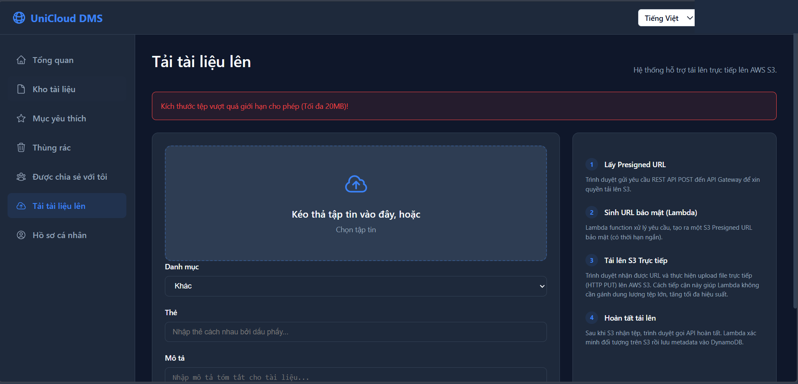
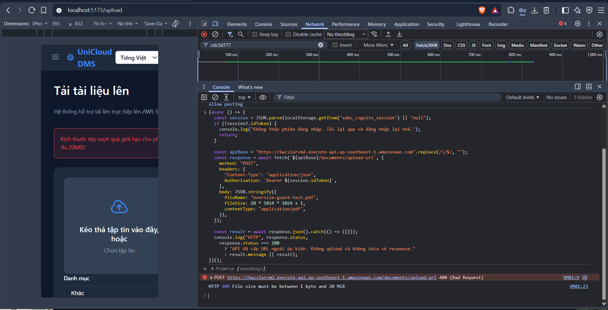

{}
The images below record observed results. Each caption identifies whether it came from the local frontend or production.
{}

## Objective

Record actual outcomes for the sign-in, metadata, upload, view, and download flows.

## Implementation steps

1. Open the frontend configured in section 5.8.1, sign in with the Cognito lab account, and open Documents.
2. Select a supported sample under 20 MiB and upload it. Wait for `Active`; file bytes go directly to the private S3 bucket, while metadata is written to DynamoDB through the API.
3. Open details, update an allowed category/description/tag, and save. Return to the list and reopen details to confirm the saved values; use Download to retrieve the file through a presigned URL.
4. To observe upload limits, select an unsupported extension and a file over 20 MiB. The form rejects the file before upload completes; the API also rejects oversized metadata before issuing a presigned URL.

## Screenshots and remaining evidence

The missing-token case is covered by the HTTP `401` evidence in section 5.7.2.

Selecting a `.md` file was rejected by the frontend, which displayed the supported extensions before upload.

On November 18, 2026, the local upload form rejected the selected file for exceeding its displayed 20 MB limit.

The UI check confirms client-side validation. A separate authenticated request to the deployed `POST /documents/upload-url` supplied a file size of 20 MiB + 1 byte and received HTTP `400` with `File size must be between 1 byte and 20 MiB`. The request contained metadata only; the API rejected it before generating an upload URL, and no file was sent to S3.

## Expected result

The main document workflow has reproducible evidence and recorded outcomes.

## Troubleshooting

- Do not mark an unexecuted test as passed because code compiled.
- Use synthetic sample files rather than personal records.
