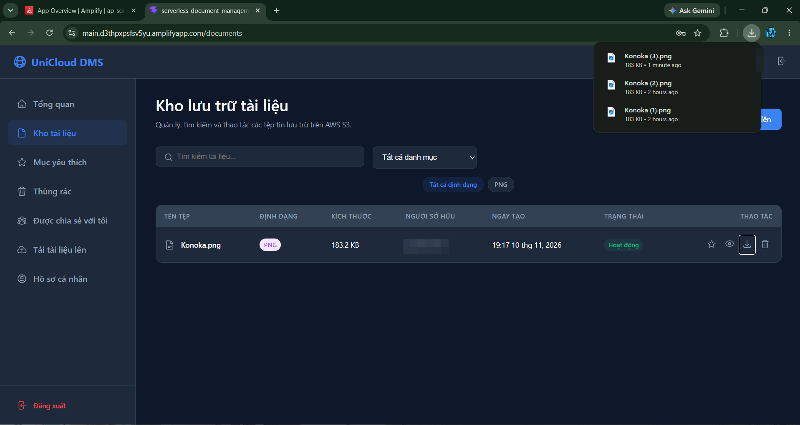
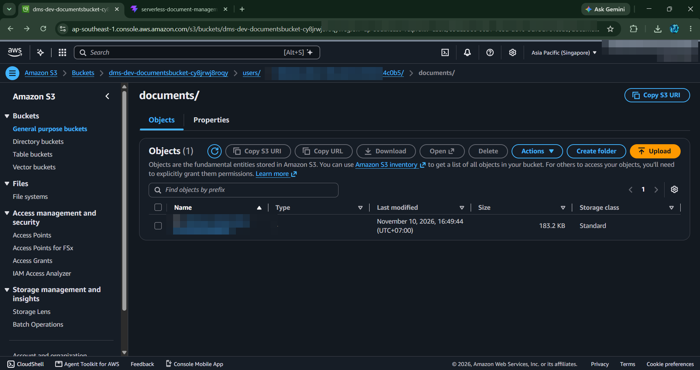
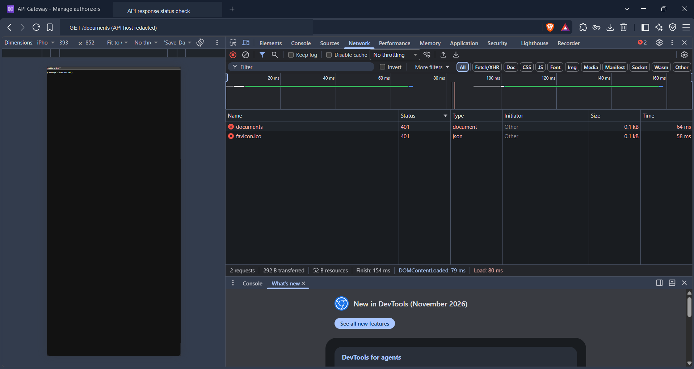
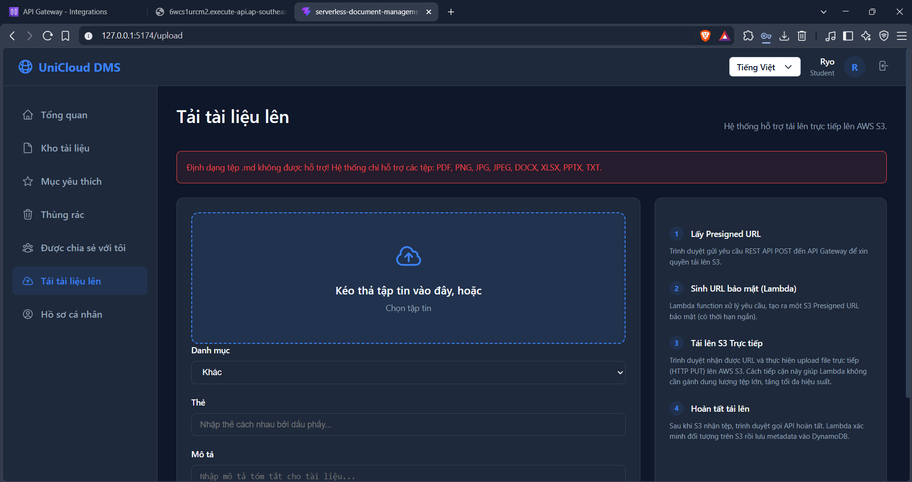
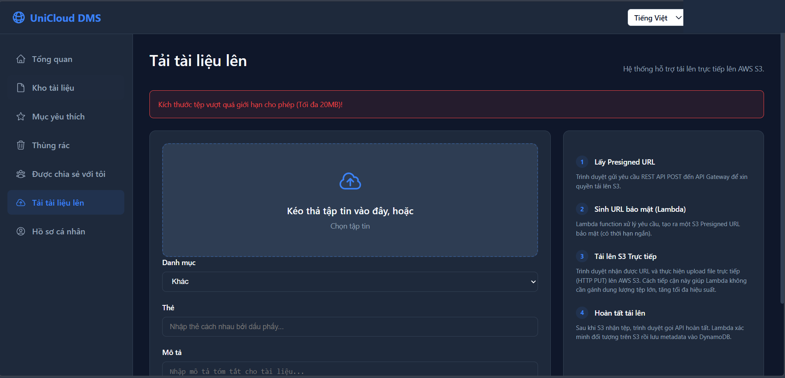
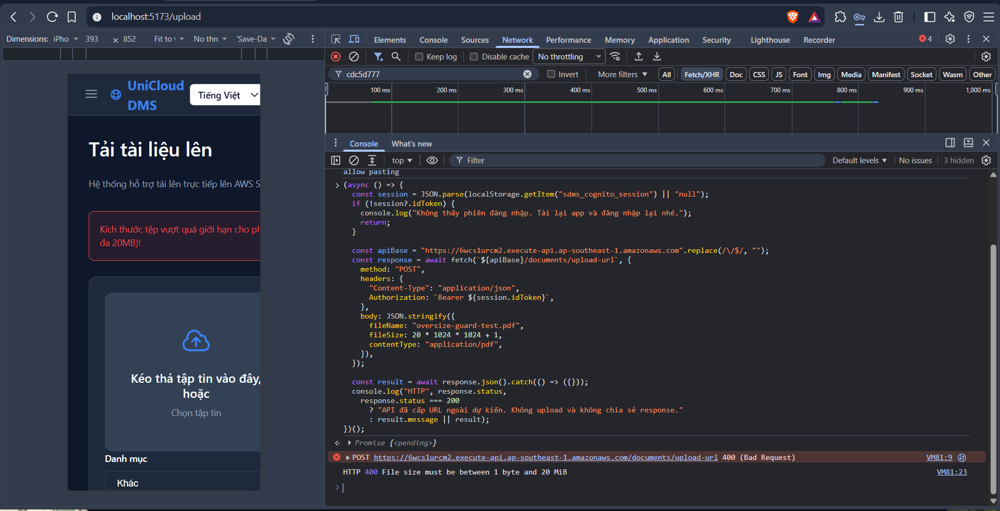

{}
Ảnh bên dưới ghi nhận các kết quả đã quan sát. Chú thích nêu rõ ảnh đến từ frontend local hay production.
{}

## Mục tiêu

Ghi nhận kết quả thực tế cho luồng đăng nhập, metadata, upload, xem và download.

## Các bước thực hiện

1. Mở frontend đã cấu hình từ mục 5.8.1, đăng nhập bằng tài khoản Cognito lab và vào Kho tài liệu.
2. Chọn file mẫu được hỗ trợ, dưới 20 MiB, rồi upload. Chờ trạng thái `Active`; file bytes được gửi thẳng lên bucket S3 private, metadata được ghi qua API vào DynamoDB.
3. Mở trang chi tiết, cập nhật danh mục/mô tả/thẻ hợp lệ rồi lưu. Trở lại danh sách và mở lại chi tiết để xác nhận dữ liệu đã lưu; dùng Download để lấy file qua presigned URL.
4. Để xem giới hạn upload, chọn đuôi file không hỗ trợ và file vượt 20 MiB. Giao diện từ chối file trước khi hoàn tất upload; API cũng từ chối metadata request vượt giới hạn trước khi cấp presigned URL.

## Vị trí ảnh chụp màn hình

Trường hợp thiếu token được dẫn chứng bằng HTTP `401` ở mục 5.7.2.

Khi chọn file `.md`, frontend từ chối và hiển thị danh sách định dạng được hỗ trợ trước khi tải lên.

Ngày 18/11/2026, form upload local đã từ chối file được chọn vì vượt giới hạn 20 MB hiển thị trên giao diện.

Kiểm tra trên UI xác nhận client-side validation. Ở lần kiểm tra riêng, request đã xác thực gửi trực tiếp tới `POST /documents/upload-url` với dung lượng 20 MiB + 1 byte nhận HTTP `400` và thông báo `File size must be between 1 byte and 20 MiB`. Request chỉ chứa metadata; API từ chối trước khi tạo upload URL và không gửi file lên S3.

## Kết quả mong đợi

Luồng tài liệu chính có minh chứng lặp lại được và kết quả đã ghi nhận.

## Khắc phục sự cố

- Không đánh dấu đạt khi chưa chạy test chỉ vì code build được.
- Dùng file mẫu tổng hợp thay vì hồ sơ cá nhân.
