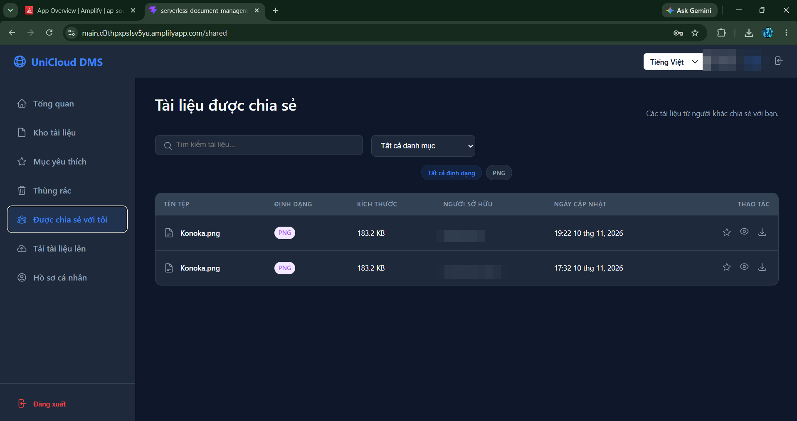
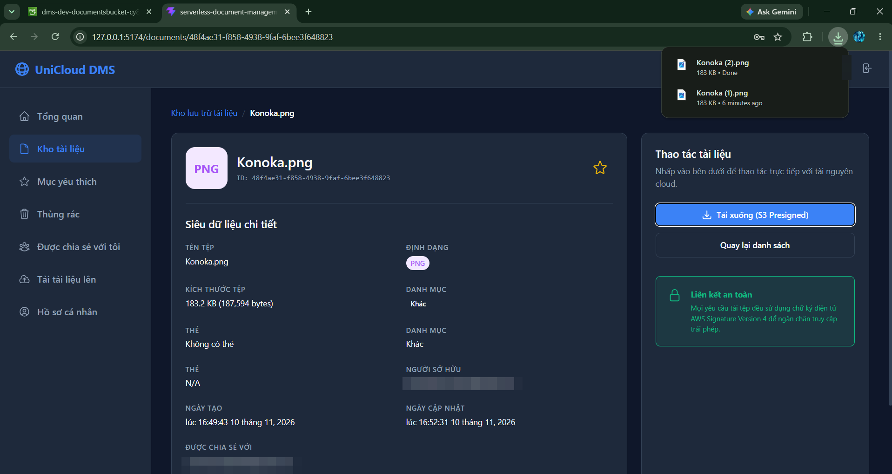

{}
This report records only steps performed and verified. Add evidence only after completing the corresponding step.
{}

## Objective

Verify that an owner can share a document with another account, and that the recipient can see the shared document and initiate its download.

## Steps performed

1. Sign in as the document owner and upload a document.
2. Share the document with the recipient account's email address.
3. Sign in as the recipient account.
4. Open **Shared With Me**, confirm the document appears, and select Download.

## Verified result

The recipient account displayed the document under **Shared With Me**. After Download was selected, the application displayed its simulated download confirmation, and the browser's download history listed `Konoka.png` with status **Done**. This verifies shared-document visibility and the browser download interaction. It does not independently verify that the file contents were retrieved directly from S3.

## Evidence

## Notes

Other authorization cases, such as access by a user who was not granted sharing permission, share revocation, and direct API access checks, are not included in this verified result. Record them in their corresponding test section after performing them.
