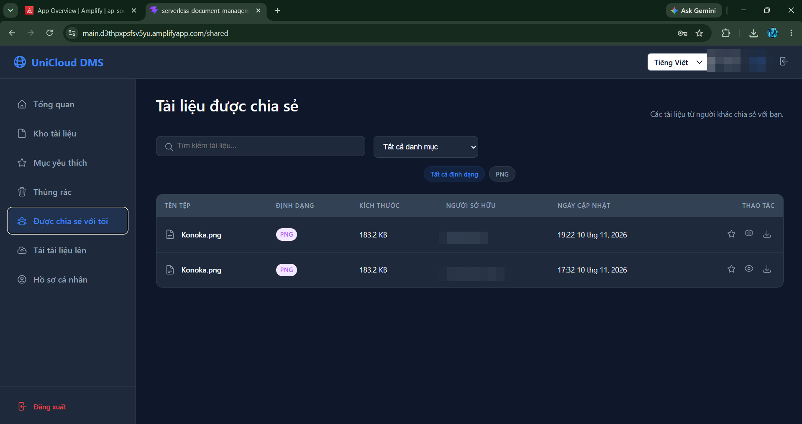
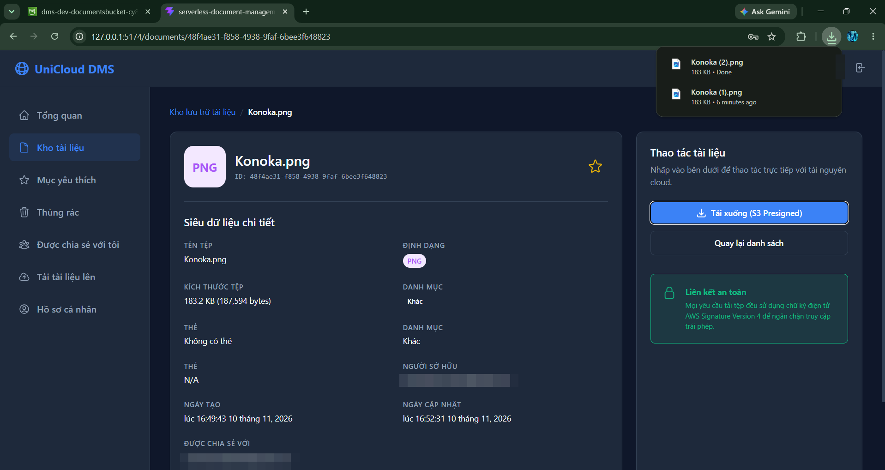
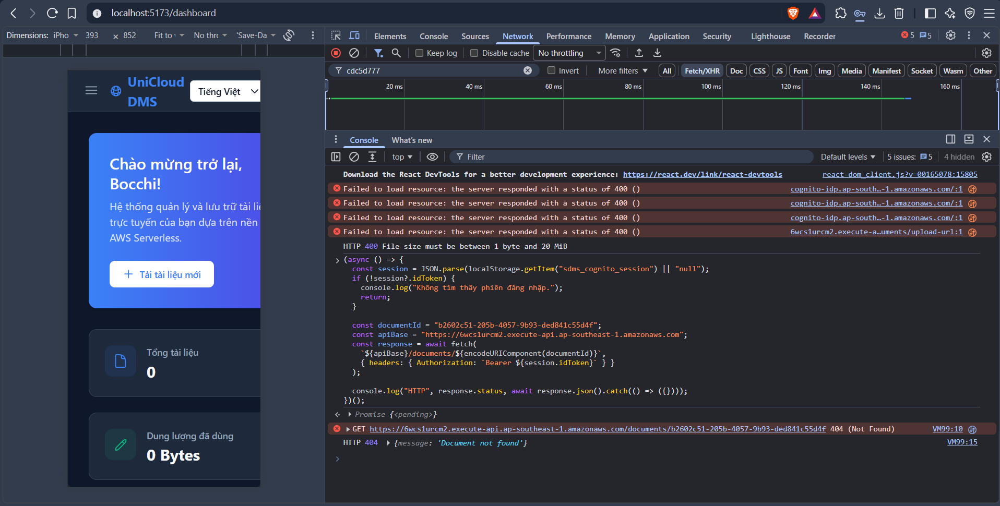

# 5.10.2 Kiểm thử chia sẻ tài liệu giữa hai người dùng

## Mục tiêu

Xác nhận người sở hữu có thể chia sẻ tài liệu với tài khoản khác và tài khoản nhận có thể xem, tải tài liệu được chia sẻ.

## Các bước thực hiện

Hoàn thành từng bước theo thứ tự. Đọc thao tác, phần giải thích và kết quả cần xác nhận trước khi chuyển sang bước kế tiếp.

### Bước 1: Đăng nhập bằng tài khoản người sở hữu và tải một tài liệu

Đăng nhập bằng tài khoản người sở hữu và tải một tài liệu lên hệ thống.

### Bước 2: Chia sẻ tài liệu với email của tài khoản người nhận

Chia sẻ tài liệu với email của tài khoản người nhận.

### Bước 3: Đăng xuất, đăng nhập bằng tài khoản người nhận

Đăng xuất, đăng nhập bằng tài khoản người nhận.

### Bước 4: Mở mục Được chia sẻ với tôi, xác nhận tài liệu xuất hiện

Mở mục **Được chia sẻ với tôi**, xác nhận tài liệu xuất hiện, sau đó tải xuống.

## Kết quả đã xác minh

Tài khoản người nhận nhìn thấy tài liệu trong mục **Được chia sẻ với tôi**. Sau khi chọn tải xuống, lịch sử tải xuống của trình duyệt ghi nhận tệp `Konoka.png` với trạng thái **Done**. Ảnh minh chứng ghi lại tài liệu chia sẻ trên giao diện và kết quả tải xuống ở trình duyệt.

Ngày 18/11/2026, khi đăng nhập bằng tài khoản khác, một request đã xác thực chỉ đọc `GET /documents/{documentId}` tới tài liệu của chủ sở hữu nhưng chưa chia sẻ cho tài khoản này trả HTTP `404` với thông báo `Document not found`. Request không sửa đổi dữ liệu. Kết quả xác nhận tài khoản được kiểm tra không thể truy xuất tài liệu chưa chia sẻ; API dùng not-found cho tài liệu nằm ngoài quyền truy cập của người gọi.

## Minh chứng

