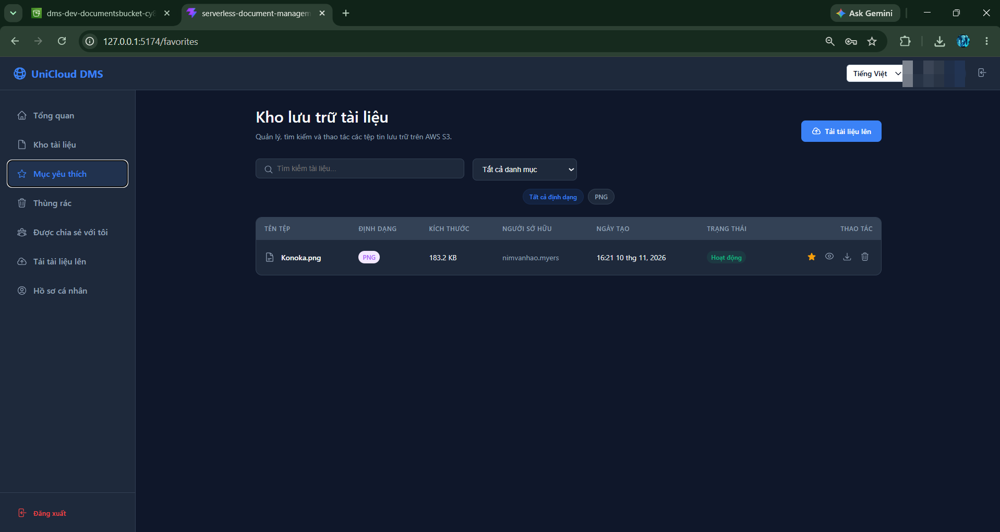
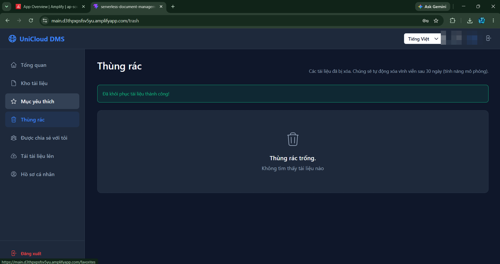
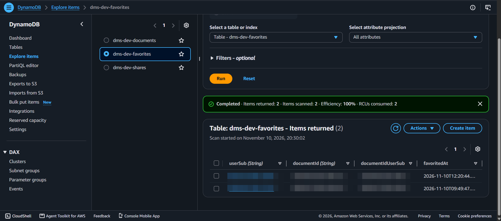
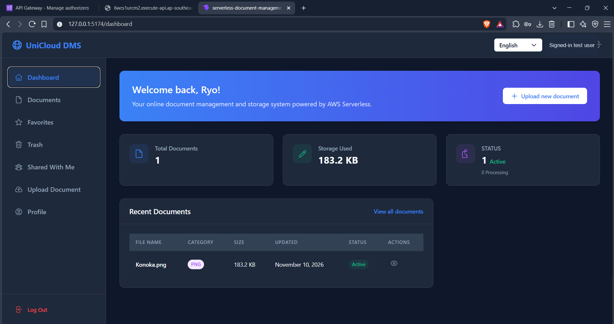
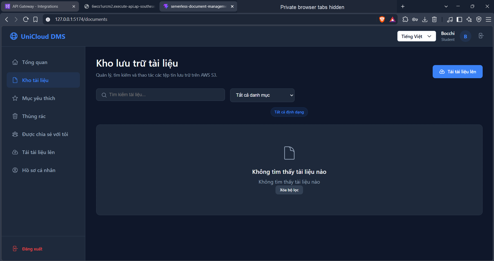
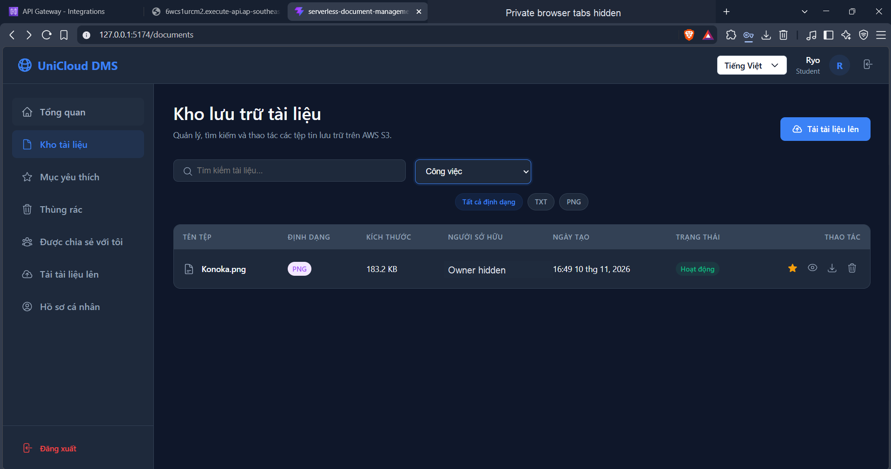
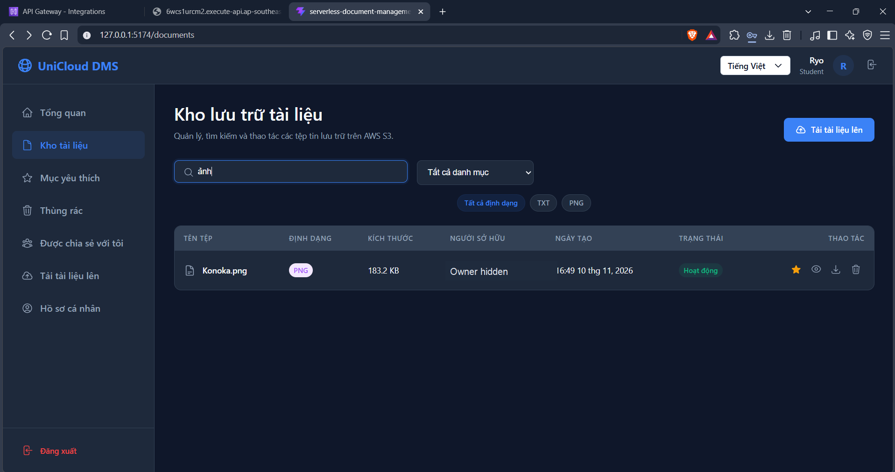
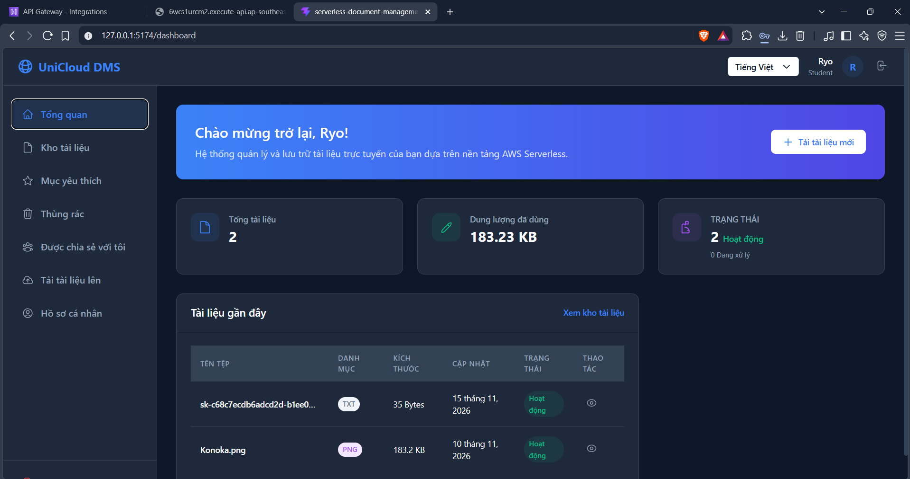

## Objective

Record the end-to-end verification of favorites, document metadata, Trash and language selection for the deployed document management application.

## Environment

- Frontend: AWS Amplify production branch
- Test accounts: document owner and a second Cognito user
- Storage and API: Amazon S3 and the deployed API Gateway/Lambda backend
- The available images include Favorites and language UI captures from a local run, a Trash capture from production, and records from the deployed DynamoDB tables; each caption identifies its source.

## User procedure

1. Sign in as the owner, open Documents, and use a document's star control to add it to Favorites; open Favorites to view the list.
2. Open document details, choose Edit metadata, update category, tags, or description, and save. Return to details to see the saved values.
3. From Documents, move the file to Trash; open Trash and choose Restore to return it to the active list.
4. Use the language selector in the top bar to switch between Vietnamese and English. Navigate between Documents and Dashboard, then refresh to confirm the selection persists.
5. Use the category filter and tag search in Documents to narrow the list by metadata.

## Verified results

1. **Favorites:** The owner marked the uploaded document as a favorite, and it appeared in the Favorites page. The favorite toggle was also observed from the document list and details page. Favorites are a personal per-account setting and are independent of document sharing; cross-account favorite synchronization is outside this workflow.
2. **Metadata:** The document category was changed to `Work`, the tag to `ảnh`, and the description to `ảnh Konoka`. The saved values appeared in document details.
3. **Trash and restore:** Moving the document to Trash removed it from the active document list. Restore returned it to the active list and emptied the Trash entry.
4. **Language selection:** Vietnamese and English were both selected. The Vietnamese selection remained after refreshing the Documents page, navigating to Dashboard, and signing out and back in as the same account. No separate screenshot was added for the last check because it showed the same interface state.
5. **Category filter:** Selecting the `Work` category returned `Konoka.png` in the local document list.
6. **Tag search:** Searching for the saved Vietnamese tag `ảnh` returned `Konoka.png` in the local document list.

## Evidence

