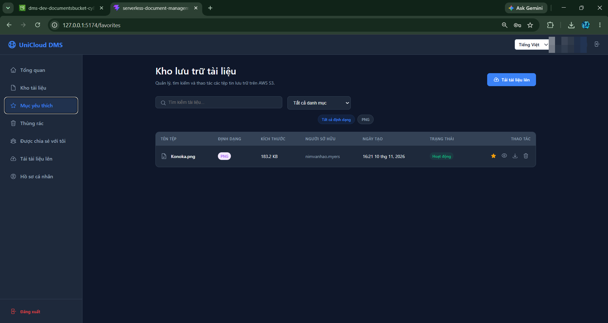
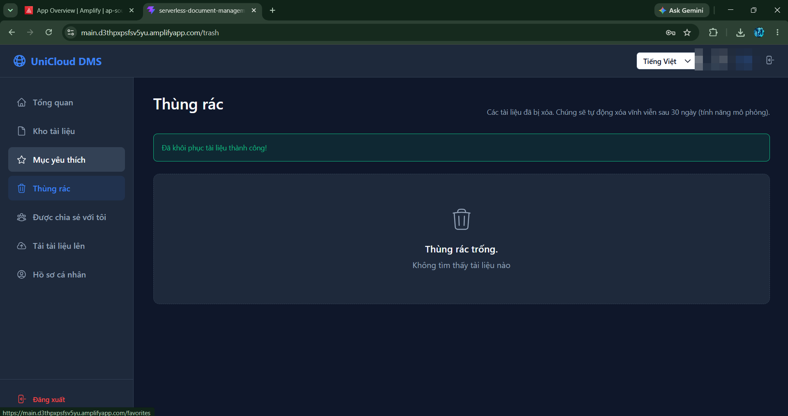
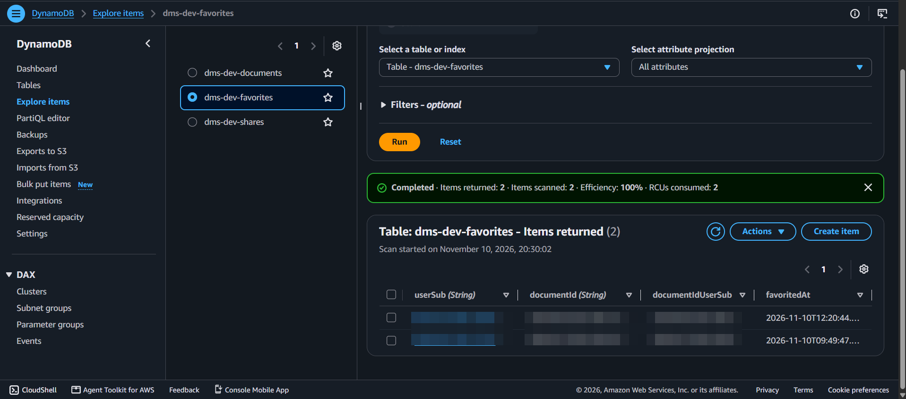
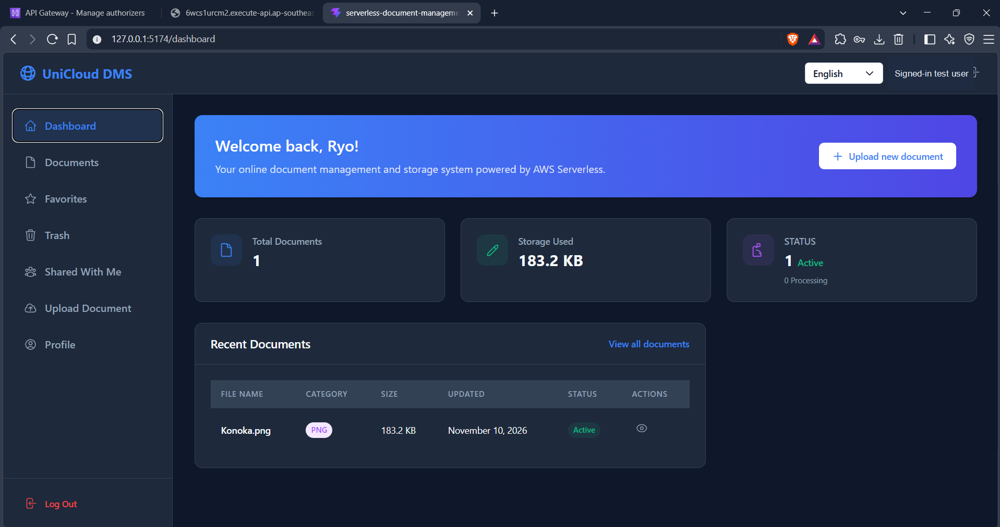
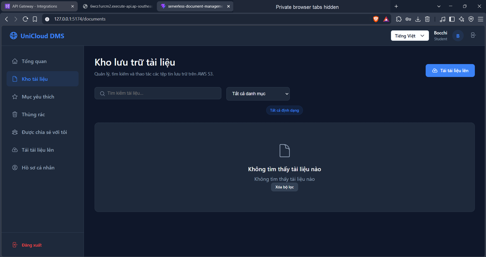
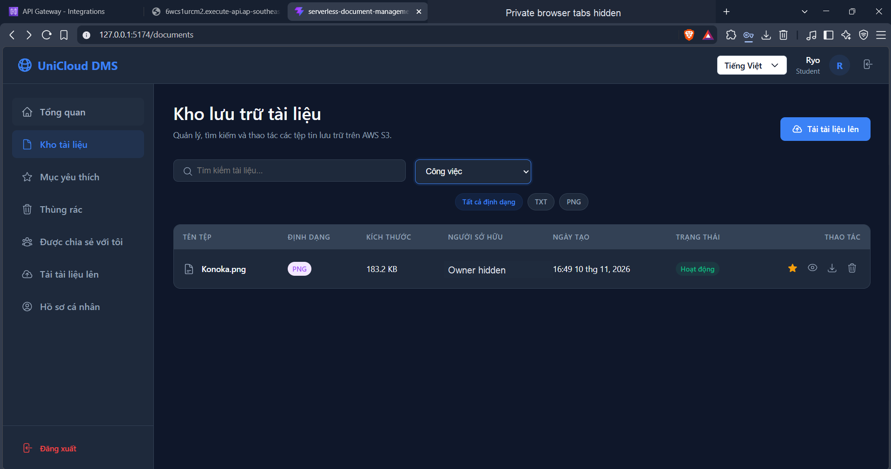
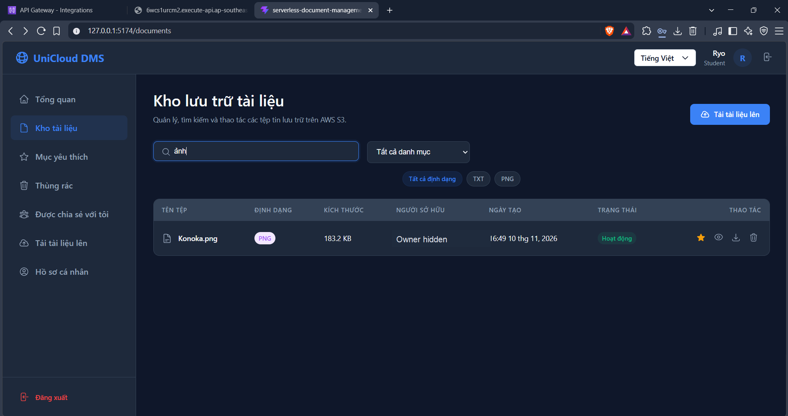
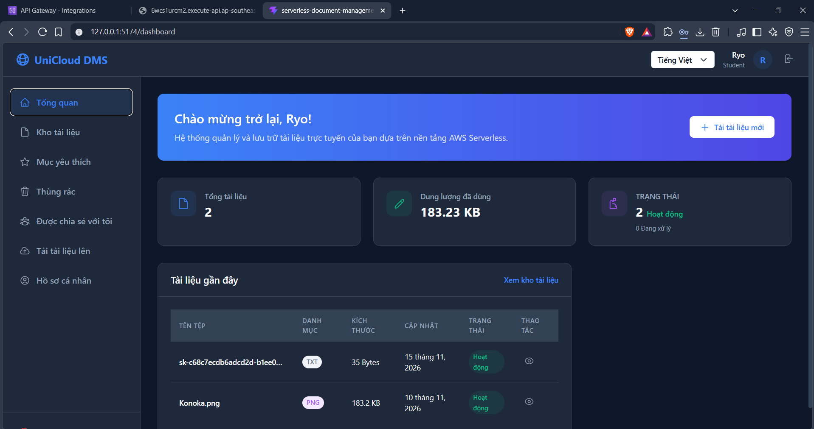

## Mục tiêu

Ghi nhận kết quả kiểm thử đầu cuối các chức năng yêu thích, siêu dữ liệu tài liệu, thùng rác và lựa chọn ngôn ngữ của ứng dụng quản lý tài liệu đã triển khai.

## Môi trường

- Giao diện: nhánh production trên AWS Amplify
- Tài khoản kiểm thử: chủ sở hữu tài liệu và một người dùng Cognito thứ hai
- Lưu trữ và API: Amazon S3 cùng backend API Gateway/Lambda đã triển khai
- Bộ ảnh hiện có gồm ảnh giao diện Favorites và lựa chọn ngôn ngữ từ phiên local, ảnh Trash từ production và bản ghi từ các bảng DynamoDB đã triển khai; nguồn ảnh được ghi rõ trong chú thích.

## Các bước thao tác

Hoàn thành từng bước theo thứ tự. Đọc thao tác, phần giải thích và kết quả cần xác nhận trước khi chuyển sang bước kế tiếp.

### Bước 1: Đăng nhập bằng chủ sở hữu, mở Kho tài liệu và dùng biểu

Đăng nhập bằng chủ sở hữu, mở Kho tài liệu và dùng biểu tượng sao trên một tài liệu để thêm vào Yêu thích; vào trang Yêu thích để xem danh sách.

### Bước 2: Mở chi tiết tài liệu, chọn sửa metadata, cập nhật danh

Mở chi tiết tài liệu, chọn sửa metadata, cập nhật danh mục, thẻ hoặc mô tả rồi lưu. Trở lại chi tiết để xem giá trị đã lưu.

### Bước 3: Từ Kho tài liệu, chuyển tài liệu vào Thùng rác

Từ Kho tài liệu, chuyển tài liệu vào Thùng rác; mở Thùng rác và chọn khôi phục để đưa tài liệu về danh sách đang hoạt động.

### Bước 4: Dùng bộ chọn ngôn ngữ ở thanh trên để chuyển Việt/Anh

Dùng bộ chọn ngôn ngữ ở thanh trên để chuyển Việt/Anh. Điều hướng giữa Kho tài liệu và Dashboard, tải lại trang để xem lựa chọn ngôn ngữ được duy trì.

### Bước 5: Dùng bộ lọc danh mục và ô tìm kiếm thẻ trong Kho tài liệu

Dùng bộ lọc danh mục và ô tìm kiếm thẻ trong Kho tài liệu để thu hẹp danh sách theo metadata.

## Kết quả đã xác nhận

1. **Yêu thích:** Chủ sở hữu đánh dấu tài liệu đã tải lên là yêu thích và tài liệu xuất hiện trong trang Yêu thích. Nút bật/tắt yêu thích cũng đã được quan sát ở danh sách và trang chi tiết tài liệu. Yêu thích là thiết lập cá nhân theo từng tài khoản, độc lập với chức năng chia sẻ tài liệu; quy trình này không yêu cầu đồng bộ trạng thái yêu thích giữa các tài khoản.
2. **Siêu dữ liệu:** Danh mục được đổi thành `Công việc`, thẻ thành `ảnh` và mô tả thành `ảnh Konoka`. Các giá trị đã lưu hiển thị trong trang chi tiết tài liệu.
3. **Thùng rác và khôi phục:** Đưa tài liệu vào Thùng rác làm tài liệu biến khỏi danh sách đang hoạt động. Khôi phục đưa tài liệu trở lại danh sách và xóa mục khỏi Thùng rác.
4. **Lựa chọn ngôn ngữ:** Đã chọn cả tiếng Việt và tiếng Anh. Lựa chọn tiếng Việt vẫn được giữ sau khi tải lại trang Kho tài liệu, chuyển sang Dashboard và đăng xuất rồi đăng nhập lại bằng cùng tài khoản. Không thêm ảnh riêng cho lần kiểm tra cuối vì giao diện hiển thị giống trạng thái đã chụp.
5. **Bộ lọc danh mục:** Chọn danh mục `Công việc` thì danh sách tài liệu local trả về `Konoka.png`.
6. **Tìm theo thẻ:** Tìm thẻ tiếng Việt đã lưu `ảnh` thì danh sách tài liệu local trả về `Konoka.png`.

## Minh chứng

