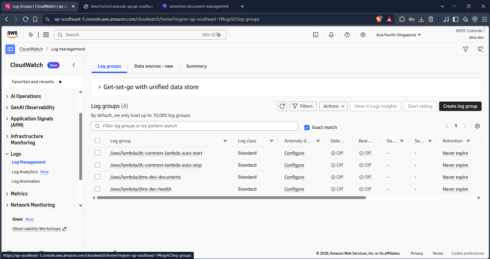
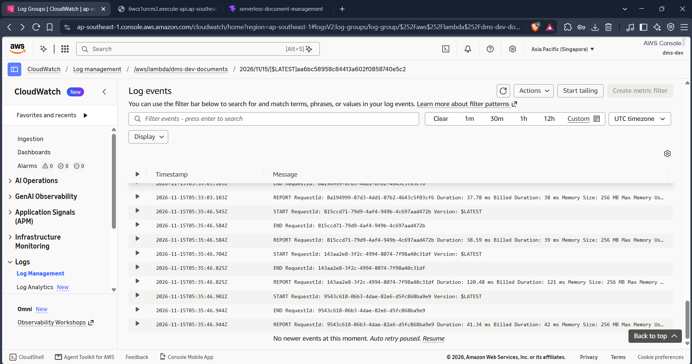
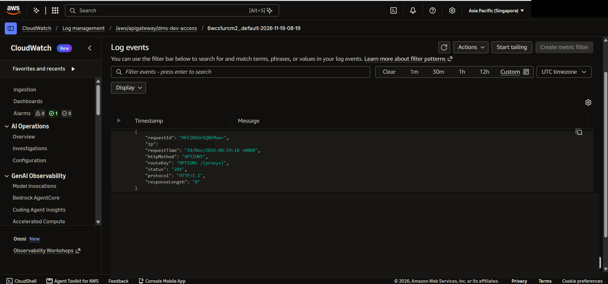
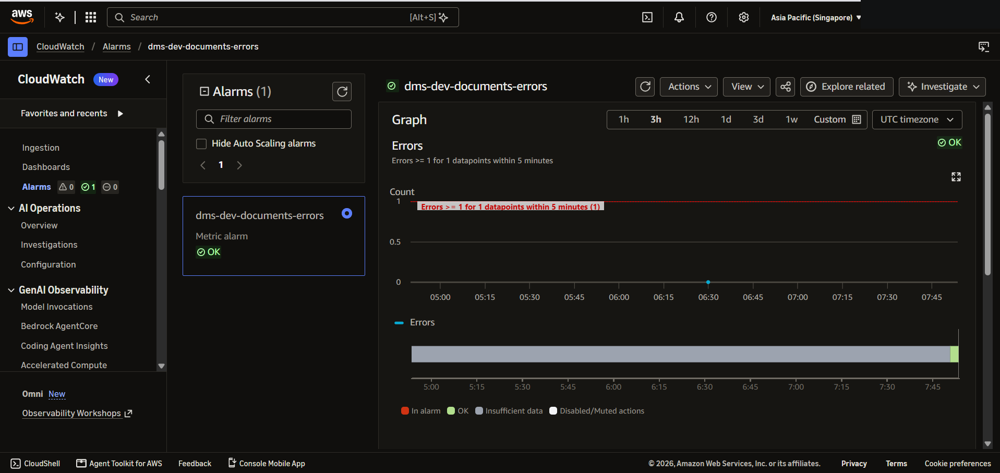
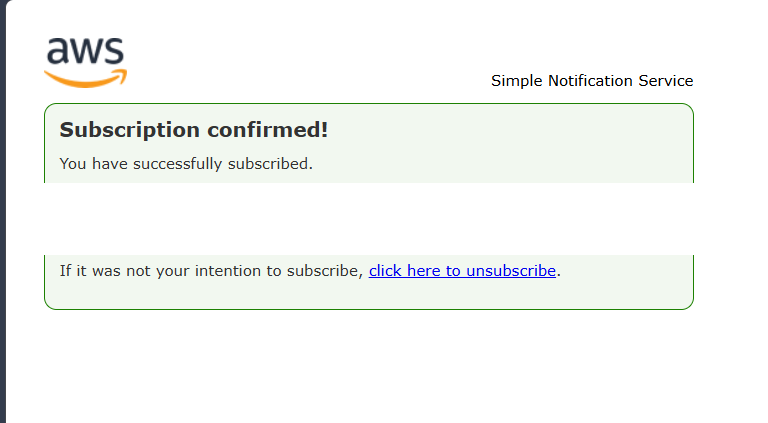

{}
The `dms-dev-documents` and `dms-dev-health` Lambda log groups in `ap-southeast-1` use **Never expire** retention. API Gateway writes access logs to a separate log group with 7-day retention.
{}

## Objective

Inspect API access logs, Lambda runtime logs/metrics, and error alarms without exposing secrets.

## Implementation steps

1. In the AWS Console, select `ap-southeast-1` → CloudWatch → Logs → Log groups; open `/aws/lambda/<stack>-documents` or `/aws/lambda/<stack>-health`.
2. Select the log stream around the operation time and read `START`, `END`, and `REPORT`; use time/function request ID to locate an invocation. Do not treat the Lambda request ID as the API Gateway request ID.
3. Set suitable retention in the Retention tab so logs are not stored indefinitely. Lambda publishes `Invocations`, `Errors`, and `Duration` in CloudWatch → Metrics → AWS/Lambda ([Lambda metrics guide](https://docs.aws.amazon.com/lambda/latest/dg/monitoring-metrics.html)).
4. To receive an email when Lambda errors occur, open CloudWatch → Alarms → Create alarm → select `AWS/Lambda` / FunctionName / `Errors`; use Sum, a suitable period, threshold `>= 1`, then select or create an SNS email topic. Recipients must confirm the email subscription ([SNS email alarm guide](https://docs.aws.amazon.com/sns/latest/dg/sns-monitoring-using-cloudwatch.html)). Alarms may incur charges.
5. Do not log authorization headers, full JWTs, presigned URLs, file contents, or sensitive personal data.
6. For an HTTP API, create a dedicated CloudWatch log group, for example `/aws/apigateway/<stack>-access`, and set its retention. In API Gateway, open the API → Monitor → Logging, select the `$default` stage → Select → Edit; enable Access logging, enter the log group ARN, and choose a JSON format containing `$context.requestId`, `$context.routeKey`, `$context.httpMethod`, and `$context.status`. Save the configuration. After the API receives a request, open the log group to inspect the access event. HTTP API access-log IDs and Lambda runtime request IDs are distinct and should not be treated as the same ID.

## Observed log evidence

The document-function stream contains Lambda runtime `START`, `END`, and `REPORT` records with Lambda request IDs and duration.

The `$default` HTTP API stage writes JSON access logs to `/aws/apigateway/dms-dev-access` with 7-day retention. A browser CORS preflight record for `OPTIONS /{proxy+}` has status `204` and includes a request ID and request time; the source IP is redacted in the screenshot. Lambda runtime logs and API Gateway access logs are recorded in separate log groups.

The `dms-dev-documents-errors` alarm monitors the `AWS/Lambda Errors` metric for `dms-dev-documents`, using Sum over each 5-minute period and triggering at one or more errors (`1 of 1 datapoint`). Its state was **OK** when captured; no threshold breach appears in the displayed datapoint. The alert email successfully confirmed its subscription to the `dms-dev-lambda-errors` SNS topic.

## Expected result

The screenshots confirm Lambda runtime logs, API Gateway access logs, the `dms-dev-documents-errors` alarm in OK state, a confirmed SNS email subscription, and an AWS Budget email alert.

## Troubleshooting

- If no logs appear, verify the function was invoked and the role can write logs.
- Log storage/ingestion can incur cost; set suitable retention.
