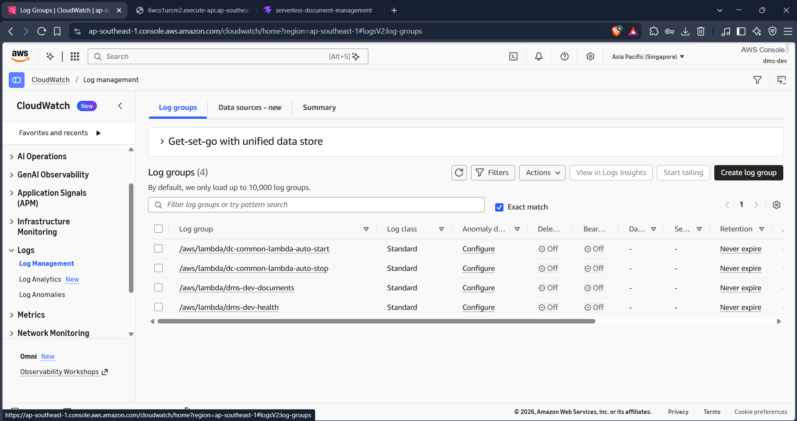
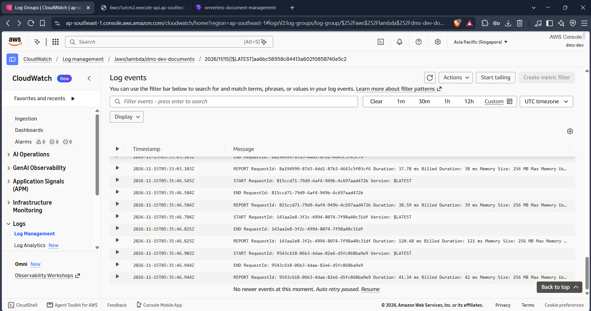
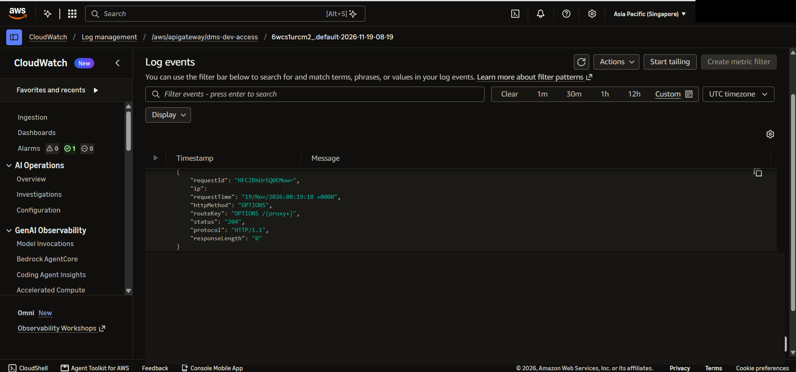
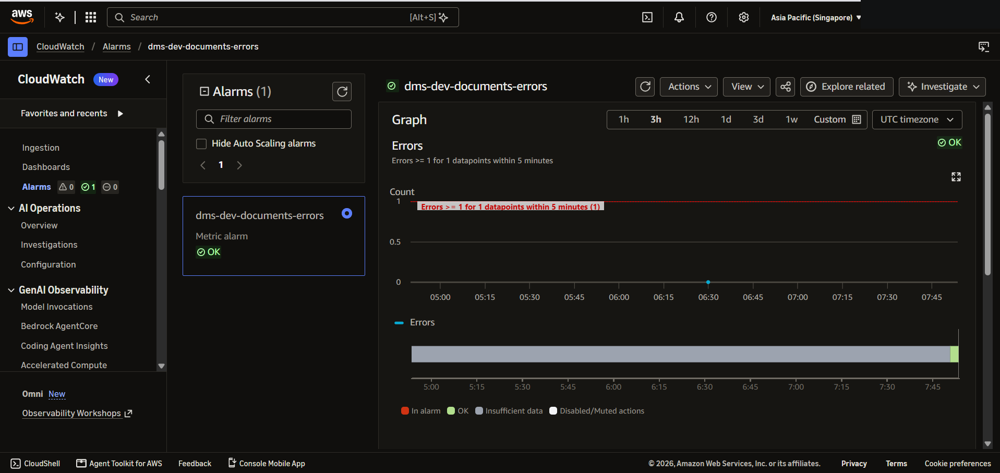
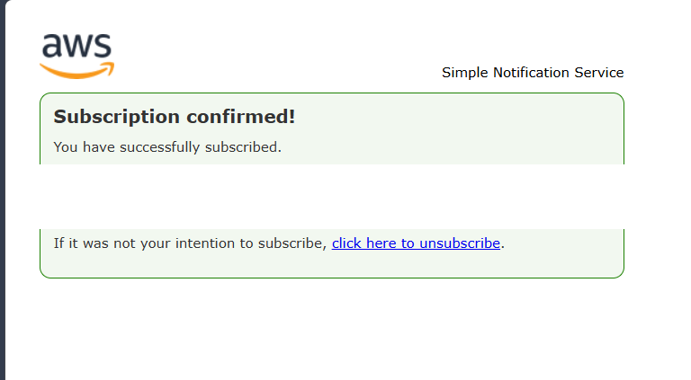

{}
Log group Lambda `dms-dev-documents` và `dms-dev-health` tại `ap-southeast-1` hiện đặt retention **Never expire**. API Gateway HTTP API đã ghi access log vào log group riêng với retention 7 ngày. Chưa thiết lập liên kết trực tiếp giữa request ID của API Gateway và Lambda runtime log.
{}

## Mục tiêu

Quan sát API access logs, Lambda runtime logs/metrics và cảnh báo lỗi mà không làm lộ secret.

## Các bước thực hiện

Hoàn thành từng bước theo thứ tự. Đọc thao tác, phần giải thích và kết quả cần xác nhận trước khi chuyển sang bước kế tiếp.

### Bước 1: Trong AWS Console chọn ap-southeast-1 → CloudWatch → Logs

Trong AWS Console chọn `ap-southeast-1` → CloudWatch → Logs → Log groups; mở `/aws/lambda/<stack>-documents` hoặc `/aws/lambda/<stack>-health`.

### Bước 2: Chọn log stream gần thời điểm thao tác và đọc START, END

Chọn log stream gần thời điểm thao tác và đọc `START`, `END`, `REPORT`; dùng thời gian/function request ID để tìm lượt chạy. Không coi Lambda request ID là API Gateway request ID.

### Bước 3: Đặt retention phù hợp ở tab Retention để log không lưu vô

Đặt retention phù hợp ở tab Retention để log không lưu vô thời hạn. Lambda tự xuất metrics `Invocations`, `Errors`, `Duration` trong CloudWatch → Metrics → AWS/Lambda ([tài liệu metrics Lambda](https://docs.aws.amazon.com/lambda/latest/dg/monitoring-metrics.html)).

### Bước 4: Để có email khi Lambda lỗi, mở CloudWatch → Alarms →

Để có email khi Lambda lỗi, mở CloudWatch → Alarms → Create alarm → chọn `AWS/Lambda` / FunctionName / `Errors`; đặt thống kê Sum, period phù hợp, ngưỡng `>= 1`, rồi chọn hoặc tạo SNS email topic. Người nhận phải xác nhận subscription email trước khi nhận thông báo ([hướng dẫn SNS email alarm](https://docs.aws.amazon.com/sns/latest/dg/sns-monitoring-using-cloudwatch.html)). Alarm có thể phát sinh chi phí.

### Bước 5: Không log authorization header, JWT đầy đủ, presigned

Không log authorization header, JWT đầy đủ, presigned URL, nội dung file hay dữ liệu cá nhân nhạy cảm.

### Bước 6: Với HTTP API, tạo CloudWatch log group riêng, ví dụ

Với HTTP API, tạo CloudWatch log group riêng, ví dụ `/aws/apigateway/<stack>-access`, và đặt retention. Trong API Gateway mở API → Monitor → Logging, chọn stage `$default` → Select → Edit; bật Access logging, nhập ARN của log group và chọn định dạng JSON có `$context.requestId`, `$context.routeKey`, `$context.httpMethod` và `$context.status`. Lưu cấu hình. Sau khi API nhận request, mở log group để xem access log. HTTP API access log ID và Lambda runtime request ID là hai ID khác nhau, không thể coi là cùng một ID.

## Vị trí ảnh chụp màn hình

Log stream của function documents ghi nhận các bản ghi runtime Lambda `START`, `END` và `REPORT`, kèm Lambda request ID cùng thời lượng.

API Gateway stage `$default` đã ghi access log dạng JSON vào `/aws/apigateway/dms-dev-access` với retention 7 ngày. Bản ghi CORS preflight `OPTIONS /{proxy+}` có status `204`, request ID và thời gian request; source IP đã được che trong ảnh. Lambda runtime logs và API Gateway access logs được ghi ở các log group riêng.

Alarm `dms-dev-documents-errors` theo dõi metric `AWS/Lambda Errors` của function `dms-dev-documents`, thống kê Sum trong mỗi 5 phút và chuyển sang ALARM khi có ít nhất một lỗi (`1 of 1 datapoint`). Trạng thái tại thời điểm chụp là **OK**; chưa có lỗi vượt ngưỡng trong datapoint đang hiển thị. Email nhận cảnh báo đã xác nhận đăng ký thành công với SNS topic `dms-dev-lambda-errors`.

## Kết quả mong đợi

Ảnh chụp xác nhận Lambda runtime logs, API Gateway access logs, alarm `dms-dev-documents-errors` ở trạng thái OK, SNS email subscription đã xác nhận và AWS Budget email alert.

## Khắc phục sự cố

- Nếu không có log, xác minh function đã được gọi và role được phép ghi log.
- Lưu/tiếp nhận log có thể tính phí; đặt retention phù hợp.
