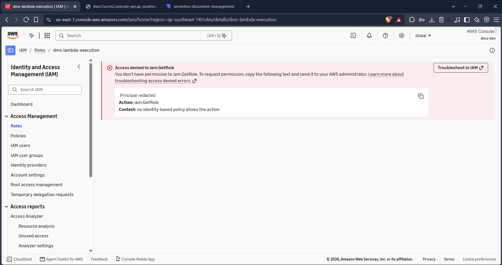

{}
S3 Block Public Access and SSE-S3 evidence is recorded in section 5.5.1. The `dms-dev` user cannot inspect the Lambda execution role because IAM denies `iam:GetRole`; least-privilege policy review remains unverified.
{}

## Objective

Follow a consistent diagnostic path and verify private storage and least-privilege IAM.

## Implementation steps

1. Start from the CloudFormation stack to identify resources and Region; compare API routes/authorizer, Lambda functions, DynamoDB tables/indexes, and Cognito Pool/Client with the template.
2. In S3 → Permissions, review Block Public Access, bucket policy, and CORS; in Properties, review SSE-S3. The bucket stays private; CORS does not grant object access.
3. In the IAM role, compare each Action/Resource with `backend/iam/lambda-runtime-policy.template.json`; review Lambda trust and scoped PassRole. If the lab identity lacks `iam:GetRole`, ask an administrator to review the policy instead of broadening the user's permissions to bypass the denial.
4. Confirm the frontend contains only public `VITE_*` settings, API Gateway validates JWTs, Lambda reads caller `sub` from claims, and Billing/Budget shows active resources.

## Observed access-denied evidence

No IAM permissions were changed. The role policy contents and least-privilege scope could not be verified with this session.

## Expected result

Security checks and troubleshooting evidence are recorded before cleanup.

## Troubleshooting

- Do not solve access failures by making S3 public or granting AdministratorAccess.
- A 401 often relates to authentication and a 403 to authorization; verify the real response.
