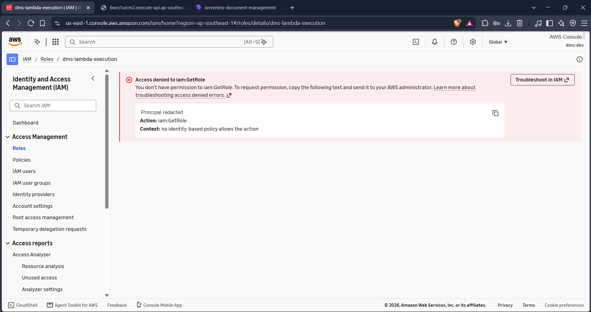

{}
Bằng chứng S3 Block Public Access và SSE-S3 được ghi ở mục 5.5.1. User `dms-dev` không thể xem Lambda execution role vì IAM từ chối `iam:GetRole`; chưa xác minh được policy có least-privilege hay không.
{}

## Mục tiêu

Theo trình tự chẩn đoán nhất quán và xác minh lưu trữ riêng tư cùng IAM đặc quyền tối thiểu.

## Các bước thực hiện

1. Kiểm tra Network panel, rồi API Gateway route/authorizer, Lambda log, key/index DynamoDB, CORS/signature S3 và issuer/audience Cognito.
2. Rà soát Block Public Access và bucket policy S3; xác nhận không object upload nào public.
3. Rà soát mỗi Lambda role để loại quyền wildcard thừa và xác nhận mọi document route đều kiểm tra owner/share.
4. Xem Billing/Cost Explorer và ghi lại resource được chủ động giữ sau workshop.

## Vị trí ảnh chụp màn hình

Không có quyền IAM nào bị thay đổi. Nội dung policy của role và phạm vi least-privilege chưa thể xác minh bằng phiên đăng nhập này.

## Kết quả mong đợi

Các kiểm tra bảo mật và minh chứng xử lý lỗi được ghi nhận trước cleanup.

## Khắc phục sự cố

- Không sửa lỗi truy cập bằng cách public S3 hoặc cấp AdministratorAccess.
- 401 thường liên quan xác thực, 403 liên quan phân quyền; hãy xác minh response thực tế.
