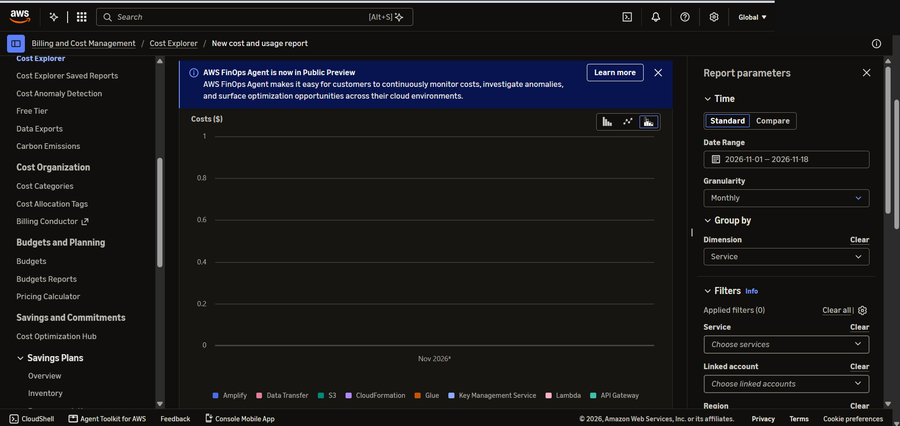

{}
This page records the deployed implementation and observed results. Any unverified behavior is identified explicitly.
{}

## Objective

Collect genuine screenshots and test records before deleting resources.

## Evidence collected

The report reuses screenshots captured during the work instead of repeating near-identical images. Configuration evidence is in sections 5.2–5.9; the production application and real-account workflows are in sections 5.8 and 5.10; CloudWatch observations are in section 5.11. Sensitive account identifiers, role ARNs, and document details are redacted in report copies where applicable.

Billing evidence was captured on November 18, 2026. Cost Explorer was grouped by service for November 1–18 and displayed a total of `-$0.00` with no visible cost bars. The November Bills page displayed an estimated total of `USD 0.00` with status `Pending`. These are the values displayed at the time of review, not a finalized invoice. Account identifiers are redacted in the screenshots below.

Screenshots captured on November 19, 2026 in section 5.12.2 document the project's actual cleanup actions: deleting the application stack, SAM artifact bucket and stack, Amplify app, log groups, alarm, SNS topic, IAM role, and USD 10 workshop budget. Success notices and resulting console states provide evidence for the corresponding actions, and the same screenshots illustrate the procedure.

## Final verification matrix

| Area | Result | Evidence / limitation |
|---|---|---|
| SAM validation/build and deployed stack | Verified | Sections 5.1.1, 5.2.2, and 5.9.2 |
| Cognito sign-up, confirmation, and sign-in | Verified | Sections 5.3.1, 5.3.2, and 5.8.2 |
| API authorization | Verified | Authenticated list `200`, missing-token request `401`, and unshared cross-account detail `404`; section 5.7.2 |
| Upload, download, metadata, sharing, Favorites, Trash/restore | Verified | Sections 5.8.2, 5.10.1–5.10.3 |
| VI/EN selection, category filter, tag search | Verified | Section 5.10.3; UI checks were performed on the local frontend where stated |
| CloudWatch logs and Lambda alarm | Verified | Lambda `START`/`END`/`REPORT` events, an API Gateway `OPTIONS` access-log record with status `204`, the `dms-dev-documents-errors` alarm, and its confirmed SNS email subscription are recorded in section 5.11.1 |
| Oversized-file rejection | Verified (frontend and deployed API) | The local UI rejected the oversized file; direct authenticated `POST /documents/upload-url` with 20 MiB + 1 byte returned HTTP `400` before issuing an S3 URL; section 5.10.1 |
| Unshared cross-account document read | Verified | Authenticated read-only `GET /documents/{documentId}` returned HTTP `404` for an owner's unshared document; section 5.10.2 |
| Post-deployment billing review | Partially completed | November 1–18 Cost Explorer showed `-$0.00`; November Bills showed `USD 0.00`, status `Pending`. This is provisional, not a final invoice; screenshots above |
| Project AWS resource cleanup | Verified | Screenshots captured on November 19, 2026 in section 5.12.2 document deletion actions and successful resulting states for each resource group |

No single composite dashboard was captured. The individual screenshots and linked evidence above are the record for this run.

## Expected result

The workshop report records the implemented architecture and observed application outcomes.

## Cleanup result

The `dms-dev` stack, SAM artifact bucket and `aws-sam-cli-managed-default` stack, Amplify app, project log groups and alarm, SNS topic, `dms-lambda-execution` IAM role, and USD 10 workshop budget were deleted. The post-cleanup budget list still showed an unrelated USD 200 budget, which was left in place.

Keep report images and source code after AWS resources are removed.
