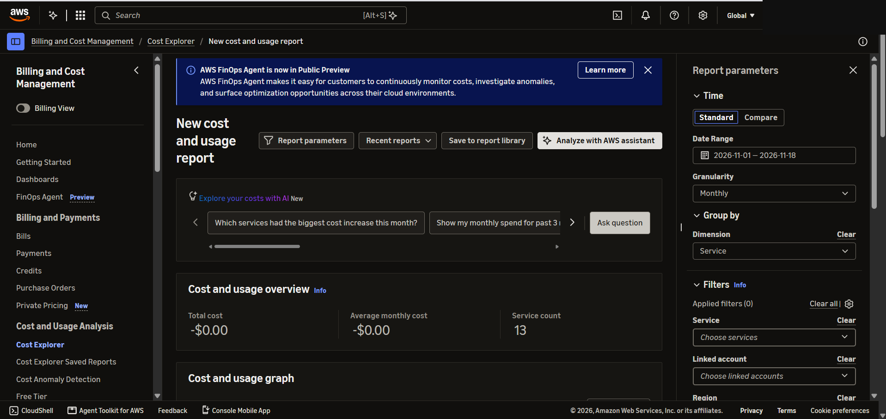
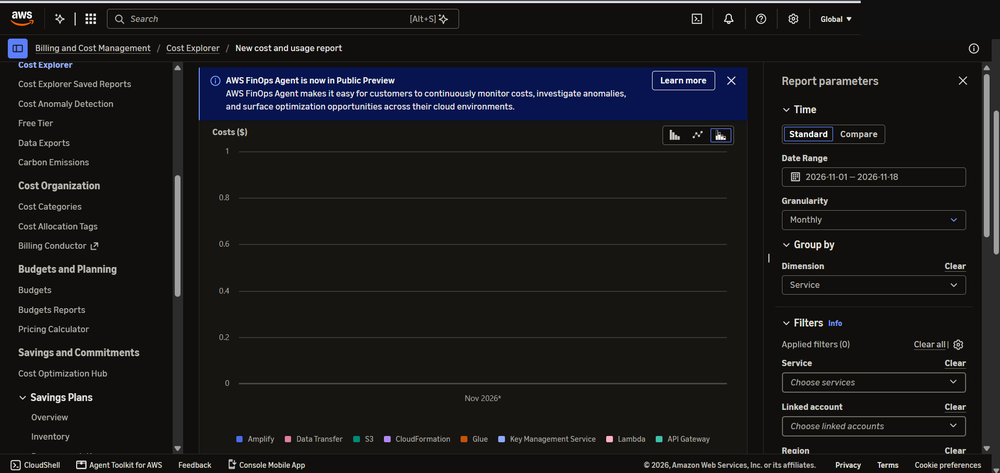
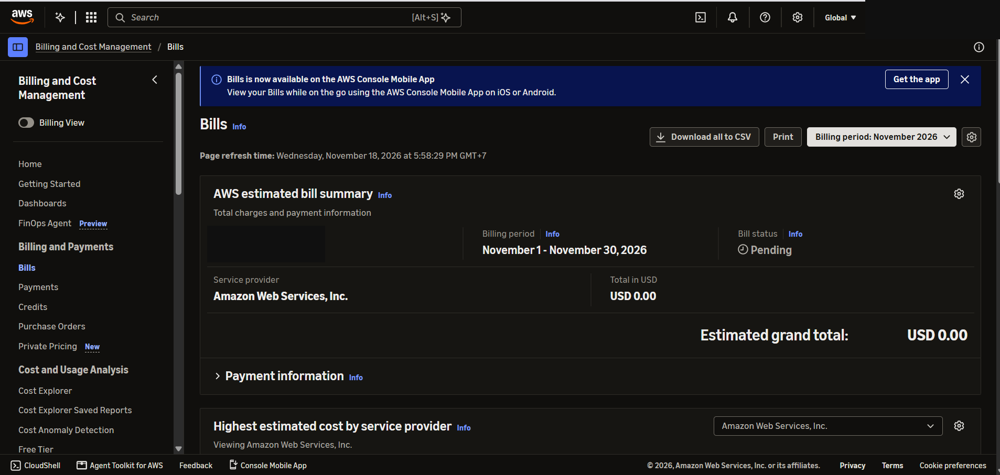

{}
Trang này ghi nhận cấu hình đã triển khai và kết quả đã quan sát; hành vi chưa xác minh được nêu rõ.
{}

## Mục tiêu

Thu thập ảnh thật và bản ghi kiểm thử trước khi xóa tài nguyên.

## Minh chứng đã thu thập

Báo cáo dùng lại ảnh chụp từ các bước đã làm thay vì lặp nhiều ảnh gần giống nhau. Minh chứng cấu hình nằm ở mục 5.2–5.9; giao diện ứng dụng và các luồng tài khoản thật nằm ở mục 5.8 và 5.10; quan sát CloudWatch ở mục 5.11. Một số thông tin tài khoản, role ARN và chi tiết tài liệu đã được che trong bản báo cáo khi cần.

Minh chứng billing được chụp ngày 18/11/2026. Cost Explorer được nhóm theo service cho khoảng 01–18/11 và hiển thị tổng `-$0.00`, biểu đồ không có cột chi phí nhìn thấy được. Trang Bills của kỳ tháng 11 hiển thị tổng ước tính `USD 0.00`, trạng thái `Pending`. Đây là số đang hiển thị tại thời điểm kiểm tra, chưa phải hóa đơn cuối cùng. Account ID đã được che trong các ảnh bên dưới.

Ảnh chụp ngày 19/11/2026 trong mục 5.12.2 ghi lại các thao tác cleanup thực tế của dự án, gồm xóa stack ứng dụng, bucket artifact SAM, stack SAM, Amplify app, log group, alarm, SNS topic, IAM role và budget 10 USD. Các ảnh có thông báo thành công hoặc trạng thái sau thao tác là minh chứng cho kết quả tương ứng; chúng đồng thời minh họa các bước để người đọc làm theo.

## Bảng tổng kết xác minh

| Hạng mục | Kết quả | Minh chứng / giới hạn |
|---|---|---|
| SAM validate/build và stack đã deploy | Đã xác minh | Mục 5.1.1, 5.2.2 và 5.9.2 |
| Cognito đăng ký, xác nhận email và đăng nhập | Đã xác minh | Mục 5.3.1, 5.3.2 và 5.8.2 |
| API authorization | Đã xác minh | List có đăng nhập `200`, thiếu token `401`, tài liệu của tài khoản khác chưa share trả `404`; mục 5.7.2 |
| Upload, download, sửa metadata, chia sẻ, Favorites, Trash/khôi phục | Đã xác minh | Mục 5.8.2 và 5.10.1–5.10.3 |
| VI/EN, lọc danh mục và tìm tag | Đã xác minh | Mục 5.10.3; frontend local được nêu rõ ở các bước tương ứng |
| CloudWatch logs và alarm Lambda | Đã xác minh | Đã thấy Lambda `START`/`END`/`REPORT`, API Gateway access log `OPTIONS` status `204`, alarm `dms-dev-documents-errors` và SNS email subscription đã xác nhận; mục 5.11.1 |
| Từ chối file quá dung lượng | Đã xác minh (frontend và API đã deploy) | UI local từ chối file quá giới hạn; request đã xác thực tới `POST /documents/upload-url` với 20 MiB + 1 byte trả HTTP `400` trước khi cấp S3 URL; mục 5.10.1 |
| Tài khoản khác đọc tài liệu chưa chia sẻ | Đã xác minh | Request chỉ đọc đã xác thực `GET /documents/{documentId}` trả HTTP `404` với tài liệu chưa chia sẻ của chủ sở hữu; mục 5.10.2 |
| Kiểm tra billing sau deploy | Đã kiểm tra bước đầu | Cost Explorer ngày 01–18/11 hiển thị `-$0.00`; Bills tháng 11 hiển thị `USD 0.00`, trạng thái `Pending`. Đây là dữ liệu tạm thời, chưa phải hóa đơn cuối; xem ảnh bên trên |
| Cleanup tài nguyên AWS của dự án | Đã xác minh | Ảnh chụp ngày 19/11/2026 trong mục 5.12.2 ghi nhận các thao tác xóa và trạng thái thành công của từng nhóm tài nguyên |

Không chụp một dashboard tổng hợp riêng. Các ảnh billing và minh chứng ở những mục được dẫn trên là hồ sơ của lần thực hiện này.

## Kết quả mong đợi

Báo cáo ghi lại kiến trúc đã triển khai và kết quả ứng dụng đã quan sát.

## Kết quả cleanup

Stack `dms-dev`, bucket artifact SAM, stack `aws-sam-cli-managed-default`, Amplify app, các log group và alarm của dự án, SNS topic, IAM role `dms-lambda-execution` và budget workshop 10 USD đã được xóa. Danh sách sau cleanup còn hiển thị budget `$200` không thuộc workshop; budget này được giữ nguyên.

Giữ ảnh báo cáo và mã nguồn sau khi xóa tài nguyên AWS.
