{}
This page explains how to clean up AWS resources after the demo. Console screenshots illustrate where to act and notices that may appear; they do not certify that any AWS environment has been fully cleaned up.
{}

## Objective

Safely remove resources created for this lab in dependency-aware order.

## Cleanup scope

The procedure below uses resource names from the workshop environment as examples. Before following it, confirm your own AWS account, Region, and resource names. Deleting a CloudFormation stack applies only to resources managed by that stack. Amplify, CloudWatch alarms/log groups, SNS, IAM, the AWS Budget, and SAM artifacts may be managed separately, so handle and verify them service by service. A success notice for one step does not establish that every resource has been removed.

An initial billing review was recorded on November 18, 2026: Cost Explorer for November 1–18 displayed `-$0.00` and no visible cost bars; the November Bills page displayed `USD 0.00` with status `Pending`. This is a provisional snapshot, not a finalized invoice. The USD 10 budget is an alert, not a spending cap.

## Resource names in the example

The example environment uses a `dms-dev` stack with logical IDs such as `DmsUserPool`, `DmsUserPoolClient`, `DocumentsApi`, `DocumentsFunction`, `HealthFunction`, DynamoDB tables, and `DocumentsBucket`. The screenshots below are references for identifying resource names in the console; when following the guide, compare them with the actual stack resources in your account.

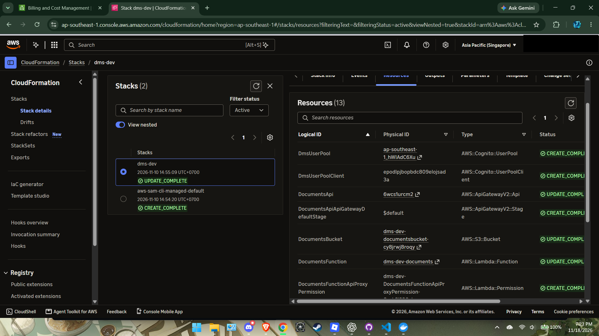

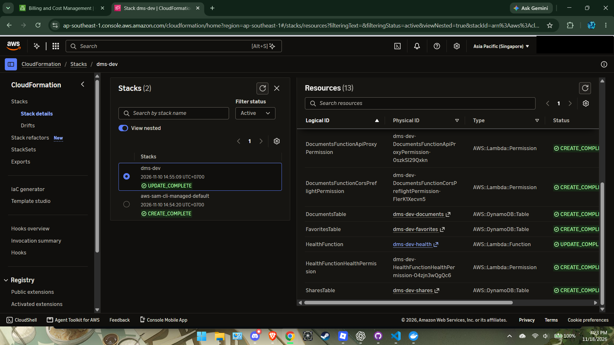

## Resource cleanup procedure

1. Perform cleanup only after recording the demo and when the application no longer needs to run. Save source code, reports, and any required data locally. Deleting the stack stops the backend and may permanently remove application data.
2. Open **CloudFormation → Stacks**, confirm the AWS account and `ap-southeast-1` Region, select `dms-dev`, and choose **Delete**. Check the stack name and deletion impact in the confirmation dialog before proceeding.

   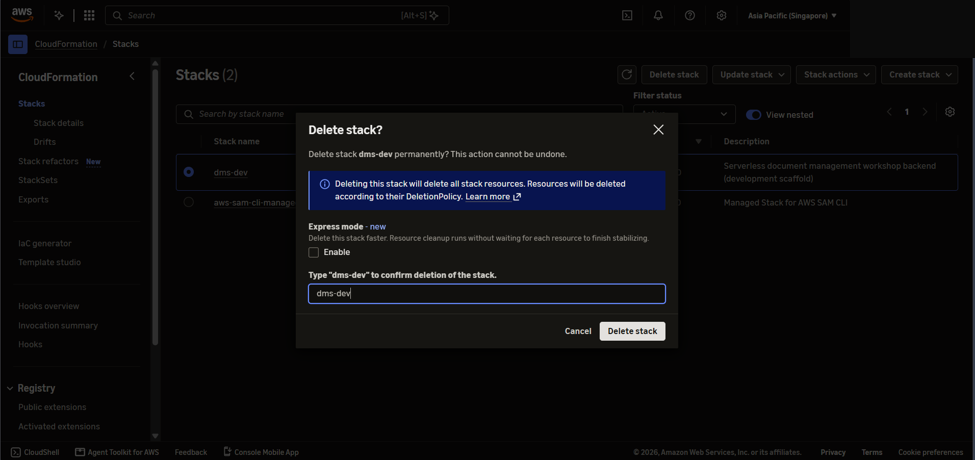

3. If Events reports `DELETE_FAILED` because of `DocumentsBucket`, open the bucket listed in the stack's **Resources** tab. From the bucket page, choose **Empty** to remove all contents. For a versioned bucket, remove all object versions and delete markers too. Do not confuse the document bucket with the SAM artifact bucket.

   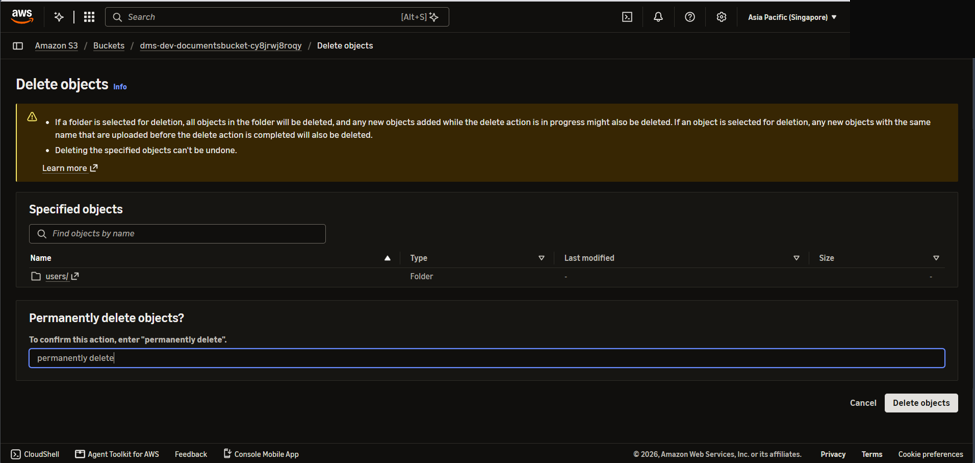

4. Wait for S3 to finish and verify no objects remain. Return to CloudFormation and choose **Retry delete** for `dms-dev`. If the bucket is empty, do not select it for retention. Use **Force delete this entire stack** only to finish a stack in `DELETE_FAILED`; AWS may retain resources that still cannot be deleted, so inspect for leftovers afterwards.
5. Wait for CloudFormation to refresh and confirm `dms-dev` no longer appears among active stacks. Check Events or deleted stacks if the final state needs confirmation.

   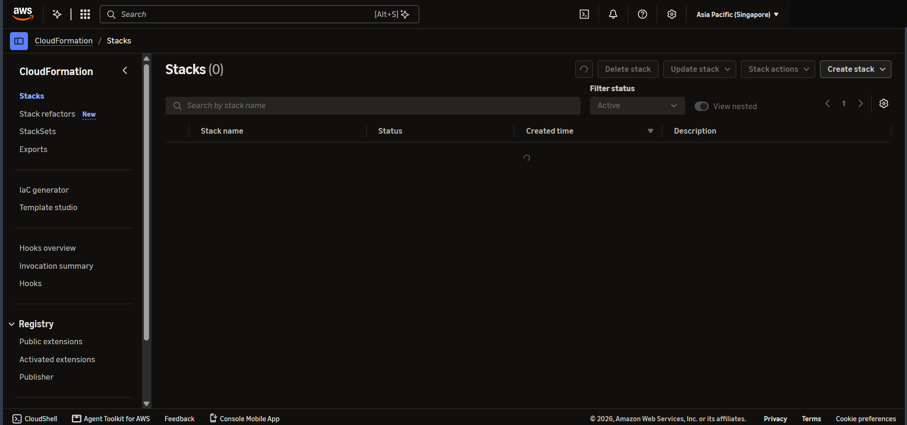

6. To remove the separately hosted frontend, open **AWS Amplify → All apps** and select the `serverless-document-management` app.

   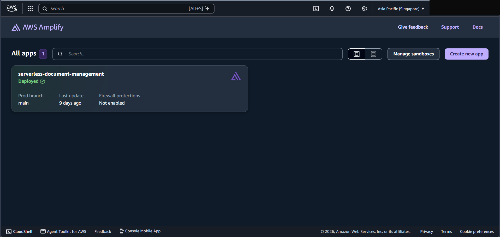

7. Open **App settings → General settings**, verify the app name, and choose **Delete app**. In the confirmation dialog, enter `delete` and confirm. This action cannot be undone.

   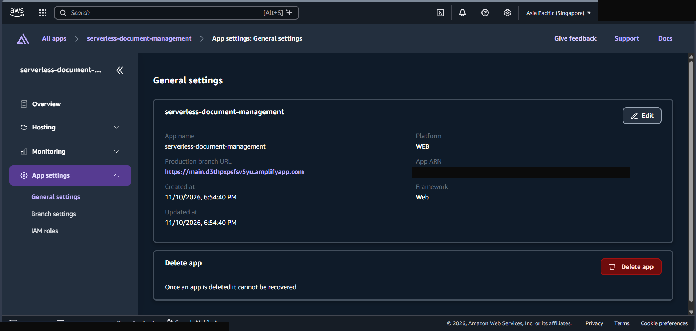

8. Wait for the success notice. AWS may report that backend resources associated with branches have been queued for deletion; verify that the app no longer appears in the Amplify app list.

   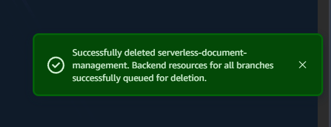

9. To delete the separately created alarm, open **CloudWatch → Alarms**, select `dms-dev-documents-errors`, then choose **Actions → Delete** and confirm.

   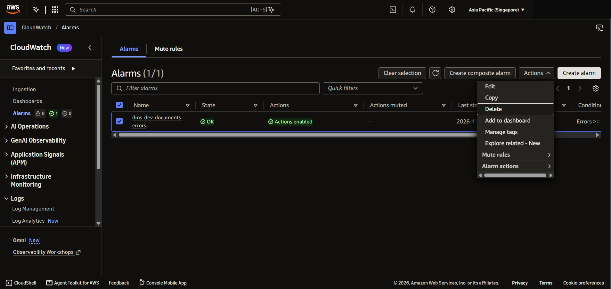

   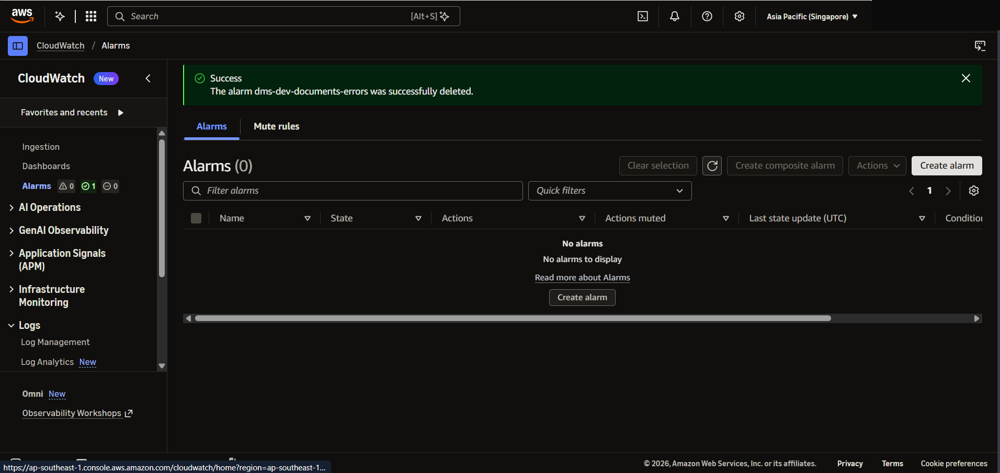

10. To delete the SNS topic created for alarm notifications, open **Amazon SNS → Topics**, select `dms-dev-lambda-errors`, and choose **Delete**. In the confirmation dialog, enter `delete me` and confirm. The topic cannot be recovered, and its subscriptions are deleted with it.

   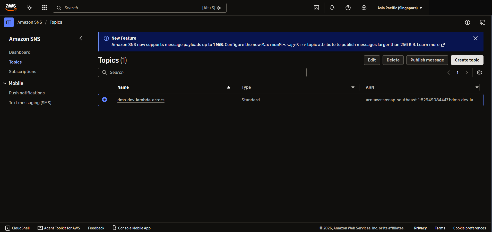

   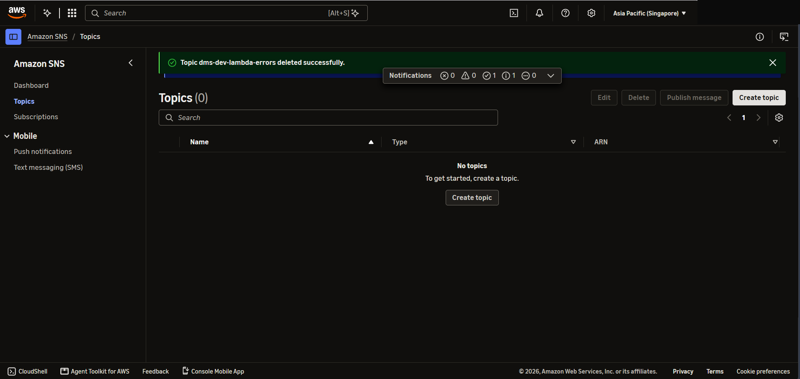

11. Remove the application log groups created separately from the stack: open **CloudWatch → Logs → Log Management → Log groups**, find and select `/aws/apigateway/dms-dev-access`, `/aws/lambda/dms-dev-documents`, and `/aws/lambda/dms-dev-health`. Choose **Actions → Delete log group(s)**, review the selected names, and confirm. Do not select log groups unrelated to the application, such as `dc-common-lambda-auto-start` and `dc-common-lambda-auto-stop` in the example screenshots.

   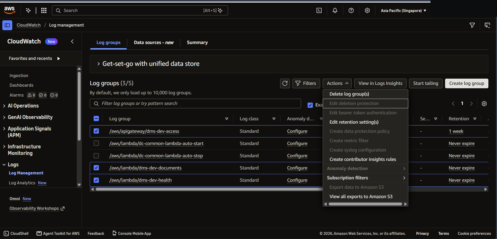

   The screenshot illustrates the console selections; compare the log group names in your own account before confirming.

   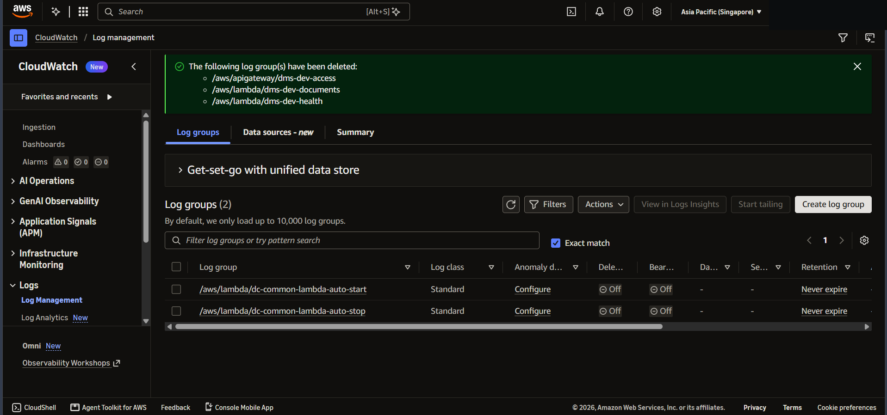

   This screenshot illustrates the notice and list after an operation; it does not certify cleanup status in the reader's account.

12. After confirming that the workshop's Lambda functions have been deleted, open **IAM → Roles**, find and select the `dms-lambda-execution` role, then choose **Delete**. Verify the role name in the confirmation dialog before proceeding. IAM roles are account-level resources; do not delete service roles or other roles.

   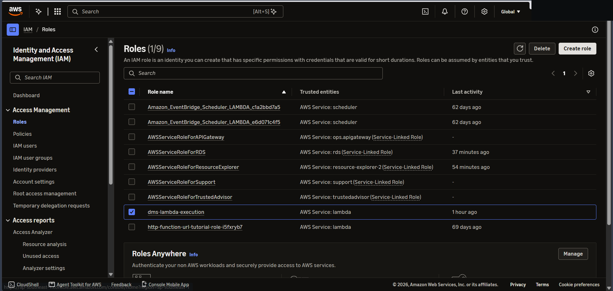

   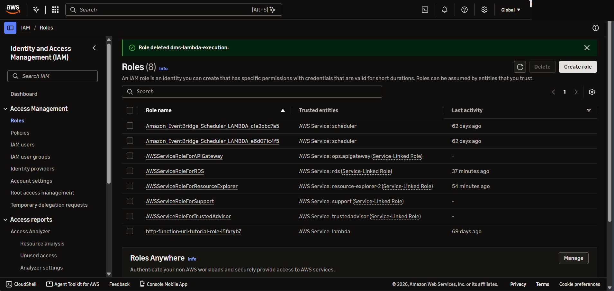

   These screenshots illustrate a console selection and a possible notice; they do not certify the reader's IAM cleanup status.

13. To remove the SAM artifact bucket, match the Physical ID `aws-sam-cli-managed-default-samclisourcebucket-...` to the `SamCliSourceBucket` resource in the `aws-sam-cli-managed-default` stack. After emptying the bucket, open **Amazon S3 → Buckets**, select this exact bucket, choose **Delete**, enter its exact name, and confirm. The suffix varies by account, so always match the actual Physical ID.

   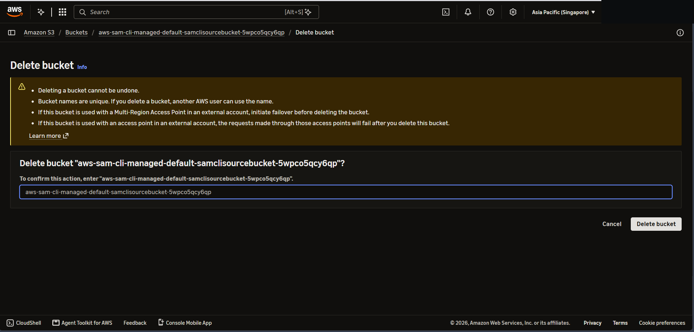

   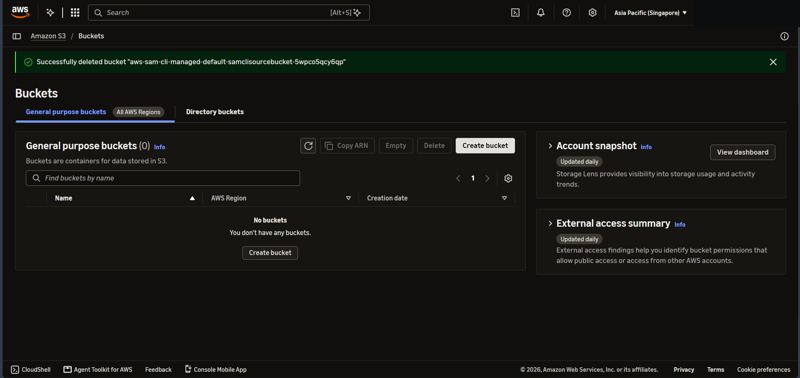

   These screenshots illustrate a possible confirmation page and notice; they do not certify that the reader's bucket has been deleted.

14. Return to **CloudFormation → Stacks**, select `aws-sam-cli-managed-default`, and choose **Delete stack**. Enter the exact stack name in the confirmation dialog and choose **Delete stack** again.

   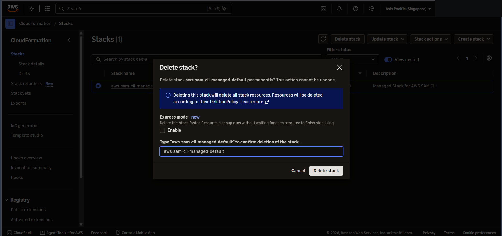

   Wait for CloudFormation to finish and check **Events** or the stack status. When the status is `DELETE_COMPLETE`, stack deletion has finished. If an error occurs, review Events to identify the remaining resource before retrying.

   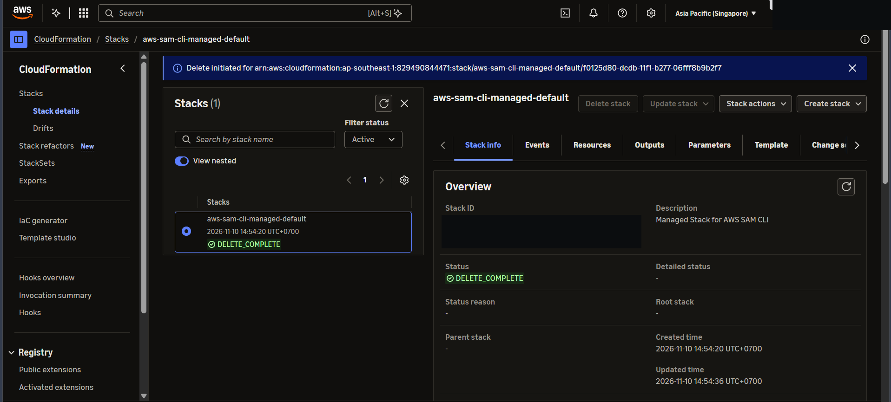

   These screenshots illustrate a possible confirmation dialog and status; they do not certify that the reader's stack has been deleted.

15. To delete the budget created for the workshop, open **Billing and Cost Management → Budgets**, select `My Monthly Cost Budget` with an amount of `$10.00`, then choose **Actions → Delete** and confirm. Do not select `My-200$-budget` in the example unless you have verified that it belongs to this workshop. A budget sends alerts; it does not cap spending.

   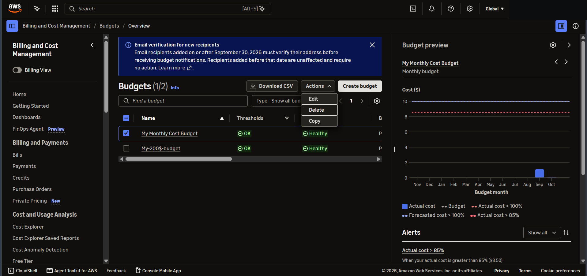

   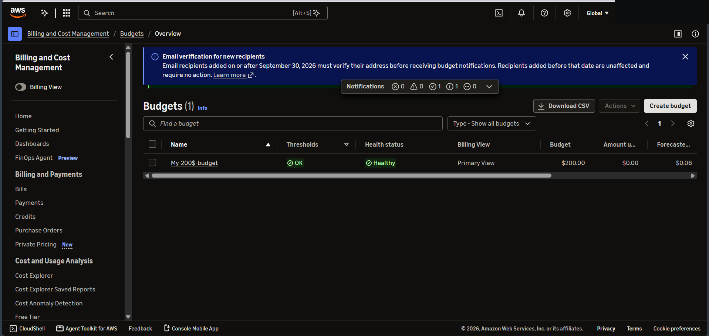

   These screenshots illustrate selecting a budget and a possible list/notice after the operation; they do not certify that the reader's budget was deleted.
16. Review S3 buckets, CloudFormation stacks, CloudWatch log groups/alarms, SNS topics, Amplify apps, and Billing/Cost Explorer after cleanup. Cost data can be delayed; a Bills page for an open month is not a final invoice.

## Troubleshooting

- If the stack reports `DELETE_FAILED` because a bucket is not empty, empty the correct document bucket, including object versions and delete markers.
- If force delete is used, some resources can be retained. Look for `DELETE_SKIPPED` in the deleted stack resources or inspect the relevant service, then remove leftovers manually when safe.
- Deleting a Cognito User Pool can permanently remove test accounts. Verify it is the workshop pool.
