{}
Trang này vừa hướng dẫn quy trình cleanup, vừa ghi lại lần dọn dẹp AWS thực tế của dự án ngày 19/11/2026. Ảnh chụp thể hiện các thao tác đã thực hiện và trạng thái AWS hiển thị sau đó.
{}

## Mục tiêu

Xóa an toàn resource tạo cho lab theo thứ tự phụ thuộc.

## Phạm vi dọn dẹp

Quy trình dưới đây dùng tên tài nguyên trong môi trường workshop. Khi áp dụng cho môi trường khác, hãy xác nhận đúng AWS account, Region và tên tài nguyên. Xóa CloudFormation stack chỉ áp dụng cho tài nguyên do stack quản lý. Amplify, CloudWatch alarm/log group, SNS, IAM, AWS Budget và SAM artifact được xử lý riêng theo từng dịch vụ. Ảnh trong mục này là ảnh chụp từ lần cleanup của dự án; thông báo và trạng thái sau thao tác là minh chứng cho các bước tương ứng.

Đã kiểm tra billing bước đầu ngày 18/11/2026: Cost Explorer cho khoảng 01–18/11 hiển thị `-$0.00` và không có cột chi phí nhìn thấy được; trang Bills tháng 11 hiển thị `USD 0.00`, trạng thái `Pending`. Đây là ảnh chụp dữ liệu tạm thời, chưa phải hóa đơn cuối cùng. Budget 10 USD chỉ gửi cảnh báo, không giới hạn chi tiêu.

## Tài nguyên của dự án

Stack `dms-dev` có các logical ID như `DmsUserPool`, `DmsUserPoolClient`, `DocumentsApi`, `DocumentsFunction`, `HealthFunction`, các bảng DynamoDB và `DocumentsBucket`. Ảnh inventory bên dưới ghi lại các resource của stack trước khi cleanup.

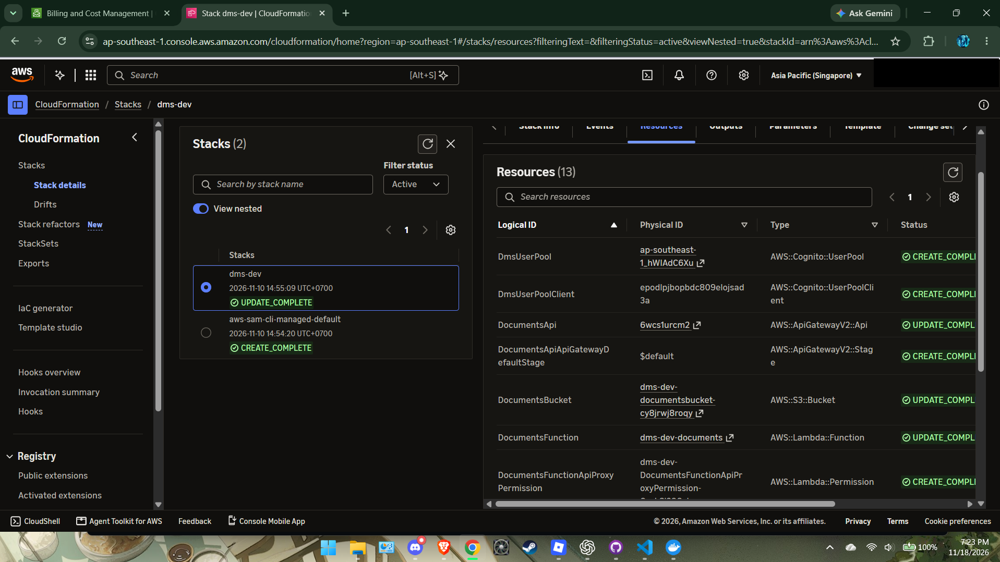

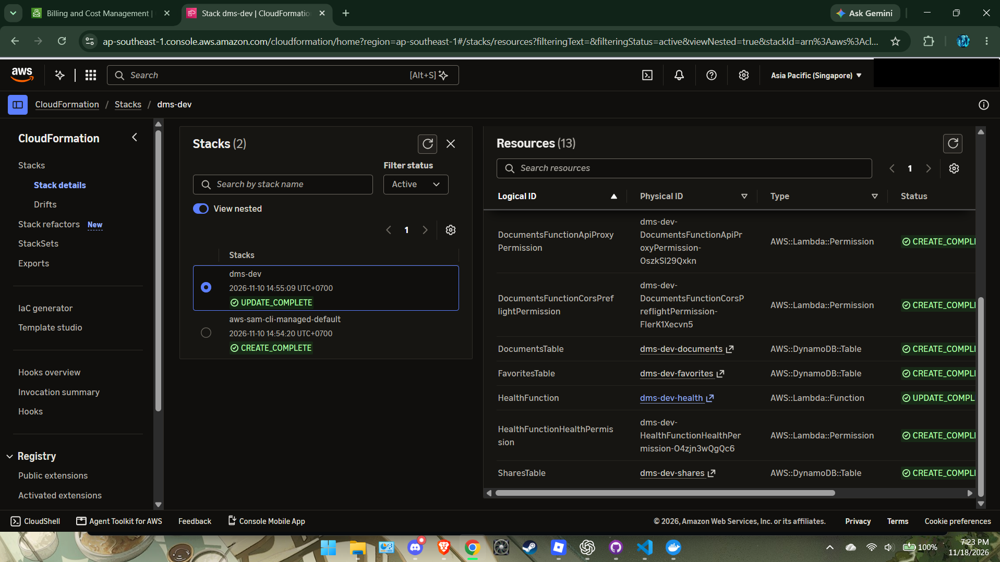

## Quy trình dọn dẹp tài nguyên

Hoàn thành từng bước theo thứ tự. Đọc thao tác, phần giải thích và kết quả cần xác nhận trước khi chuyển sang bước kế tiếp.

### Bước 1: Chỉ thực hiện sau khi đã quay demo và không còn cần ứng

Chỉ thực hiện sau khi đã quay demo và không còn cần ứng dụng hoạt động. Lưu mã nguồn, báo cáo và dữ liệu cần giữ ở máy cá nhân. Xóa stack sẽ làm backend ngừng hoạt động và có thể xóa vĩnh viễn dữ liệu ứng dụng.

### Bước 2: Mở CloudFormation → Stacks, xác nhận đúng AWS account

Mở **CloudFormation → Stacks**, xác nhận đúng AWS account, Region `ap-southeast-1`, rồi chọn stack `dms-dev` và bấm **Delete**. Ở hộp thoại xác nhận, kiểm tra tên stack và tác động trước khi xác nhận.

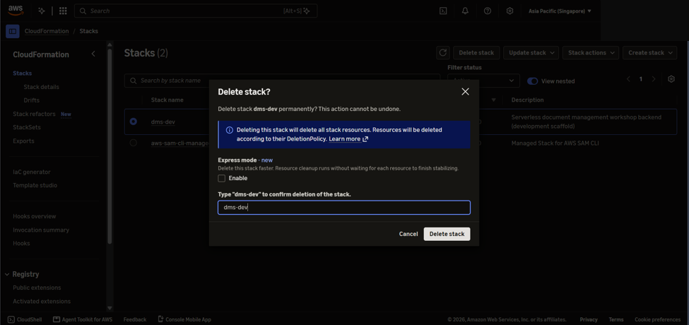

### Bước 3: Nếu Events báo DELETE_FAILED do DocumentsBucket, mở

Nếu Events báo `DELETE_FAILED` do `DocumentsBucket`, mở bucket tài liệu được liệt kê ở tab **Resources** của stack. Từ trang bucket, chọn thao tác **Empty** để xóa toàn bộ nội dung. Nếu bucket bật versioning, phải xóa cả object versions và delete markers. Không nhầm bucket tài liệu với bucket artifact SAM.

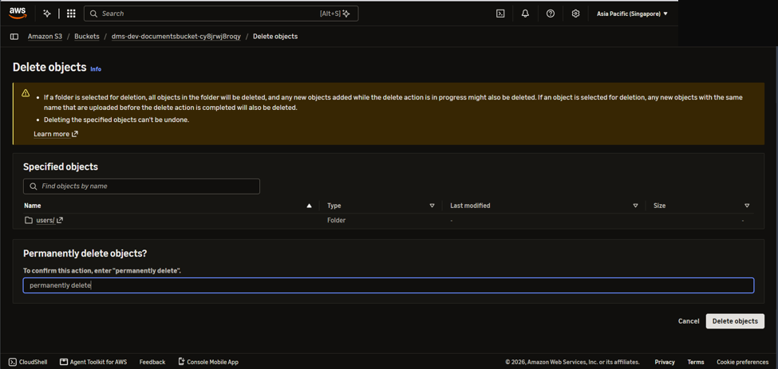

### Bước 4: Chờ thao tác S3 hoàn tất và xác nhận không còn object

Chờ thao tác S3 hoàn tất và xác nhận không còn object. Quay lại CloudFormation, chọn **Retry delete** cho `dms-dev`. Nếu bucket đã trống, để tùy chọn retain resource không chọn bucket. Dùng **Force delete this entire stack** chỉ để kết thúc stack đang ở `DELETE_FAILED`; AWS có thể giữ lại tài nguyên vẫn không xóa được, vì vậy phải kiểm tra các tài nguyên còn sót sau đó.

### Bước 5: Chờ CloudFormation làm mới danh sách và xác nhận dms-dev

Chờ CloudFormation làm mới danh sách và xác nhận `dms-dev` không còn trong các stack đang hoạt động. Kiểm tra Events/Deleted stacks nếu cần xác nhận trạng thái cuối cùng.

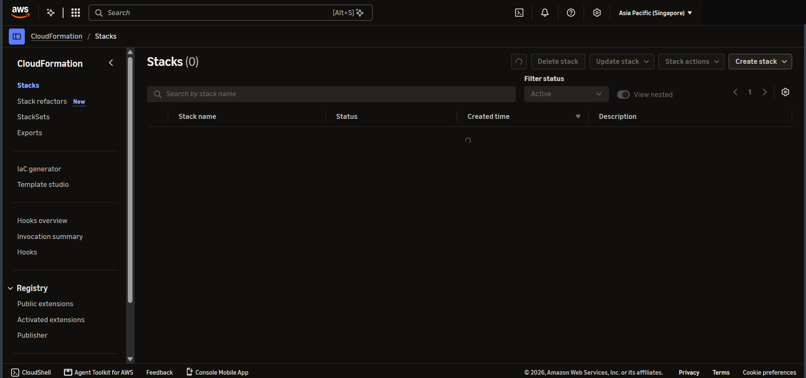

### Bước 6: Để xóa frontend được host độc lập, mở AWS Amplify → All

Để xóa frontend được host độc lập, mở **AWS Amplify → All apps**, chọn đúng app `serverless-document-management`.

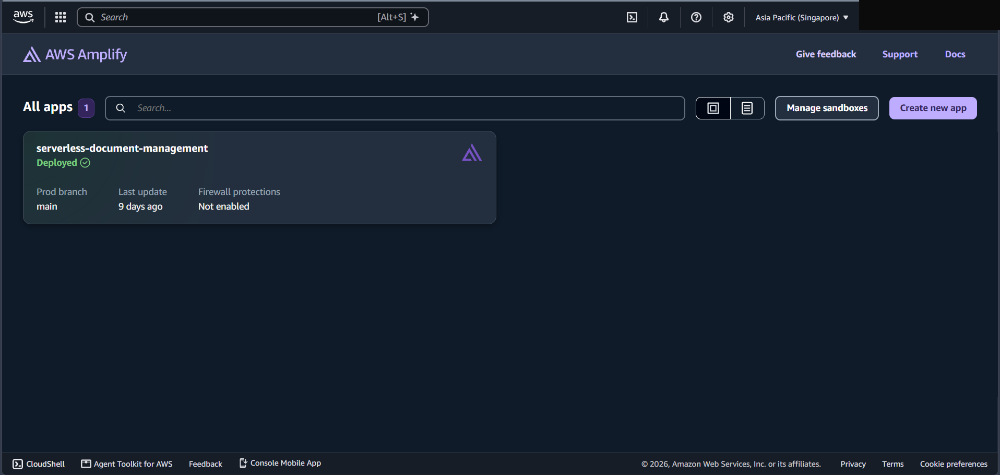

### Bước 7: Mở App settings → General settings, kiểm tra tên app rồi

Mở **App settings → General settings**, kiểm tra tên app rồi chọn **Delete app**. Trong hộp thoại xác nhận, nhập `delete` và xác nhận. Đây là thao tác không thể khôi phục.

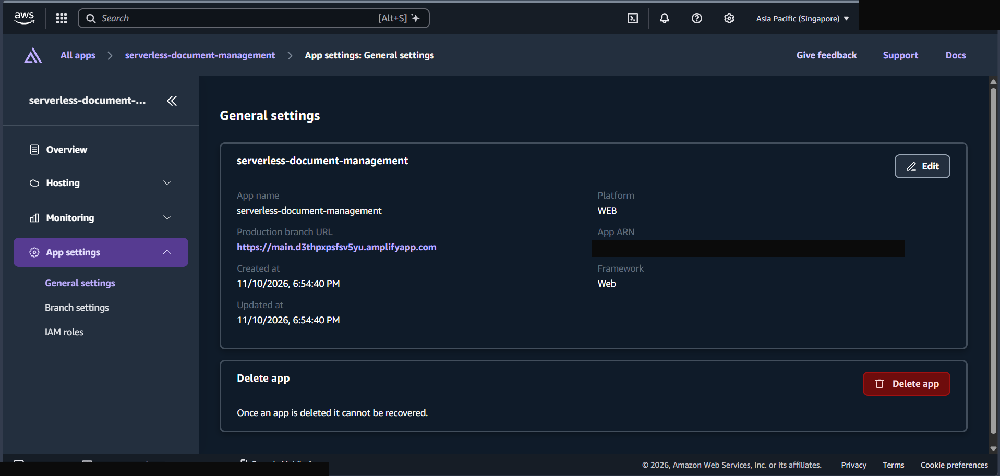

### Bước 8: Chờ thông báo xóa thành công

Chờ thông báo xóa thành công. AWS có thể báo tài nguyên backend liên kết với các branch đã được đưa vào hàng đợi xóa; kiểm tra lại app không còn trong danh sách Amplify.

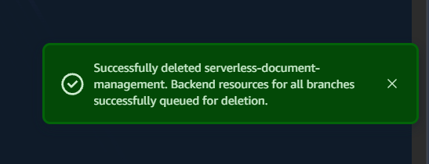

### Bước 9: Để xóa alarm tạo riêng, mở CloudWatch → Alarms, chọn đúng

Để xóa alarm tạo riêng, mở **CloudWatch → Alarms**, chọn đúng `dms-dev-documents-errors`, rồi chọn **Actions → Delete** và xác nhận.

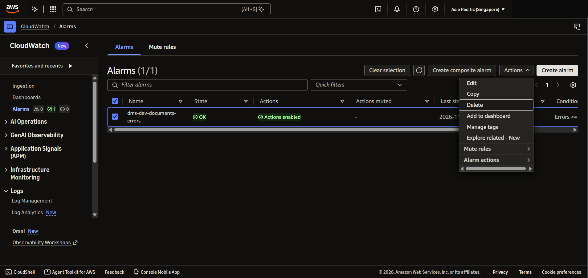

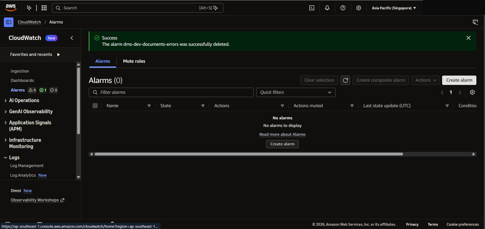

### Bước 10: Để xóa SNS topic được tạo cho cảnh báo, mở Amazon SNS →

Để xóa SNS topic được tạo cho cảnh báo, mở **Amazon SNS → Topics**, chọn đúng `dms-dev-lambda-errors`, rồi chọn **Delete**. Trong hộp thoại xác nhận, nhập `delete me` và xác nhận. Topic không thể khôi phục; các subscription gắn với topic cũng bị xóa.

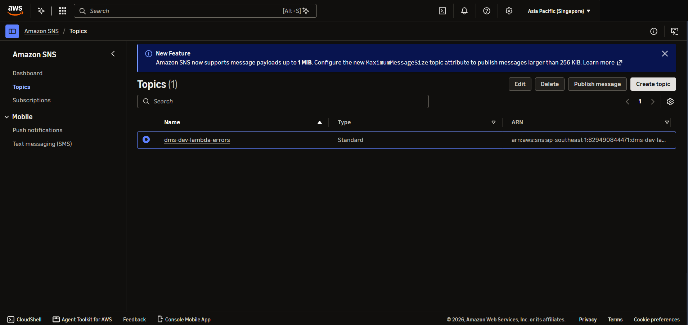

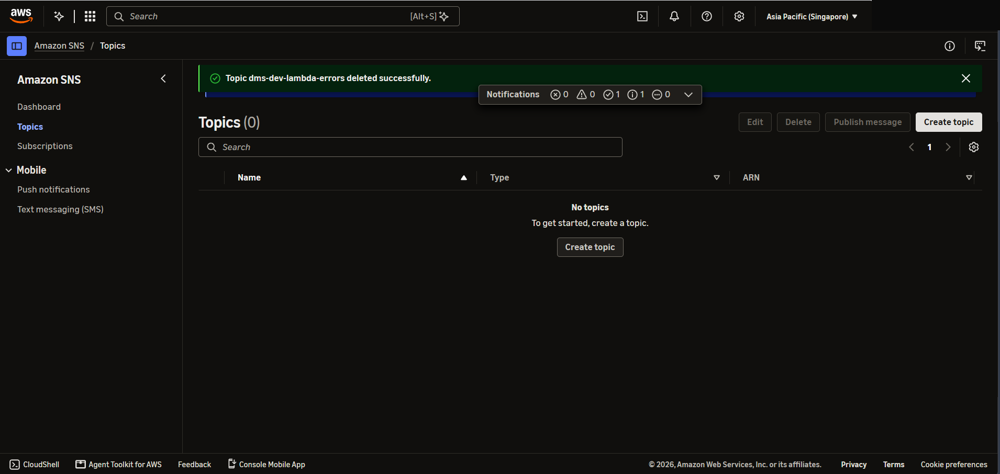

### Bước 11: Xóa các log group do ứng dụng tạo riêng: mở CloudWatch →

Xóa các log group do ứng dụng tạo riêng: mở **CloudWatch → Logs → Log Management → Log groups**, tìm và chọn đúng `/aws/apigateway/dms-dev-access`, `/aws/lambda/dms-dev-documents` và `/aws/lambda/dms-dev-health`. Chọn **Actions → Delete log group(s)**, kiểm tra lại danh sách rồi xác nhận. Không chọn các log group không thuộc ứng dụng, chẳng hạn `dc-common-lambda-auto-start` và `dc-common-lambda-auto-stop` trong ảnh ví dụ.

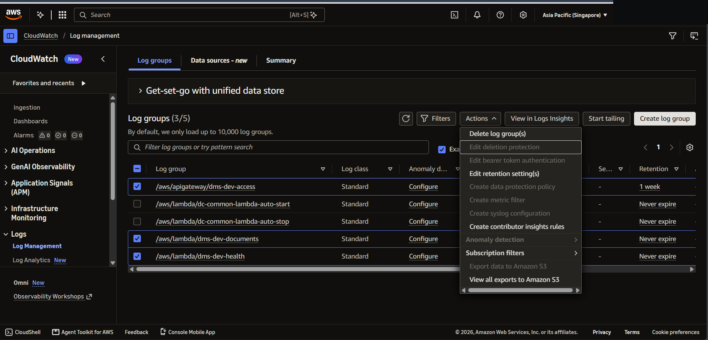

Ảnh trên minh họa các lựa chọn trong giao diện; hãy đối chiếu tên log group trong account của mình trước khi xác nhận.

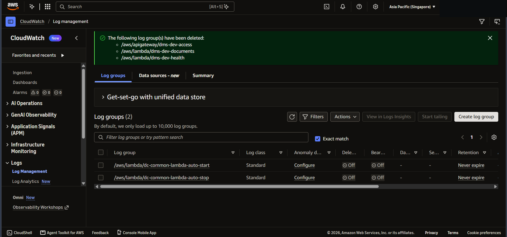

### Bước 12: Sau khi xác nhận các Lambda function của workshop đã được

Sau khi xác nhận các Lambda function của workshop đã được xóa, mở **IAM → Roles**, tìm và chọn đúng role `dms-lambda-execution`, rồi chọn **Delete**. Kiểm tra tên role trong hộp thoại trước khi xác nhận. Role IAM là tài nguyên dùng chung cấp account; không xóa các role hệ thống hoặc role khác.

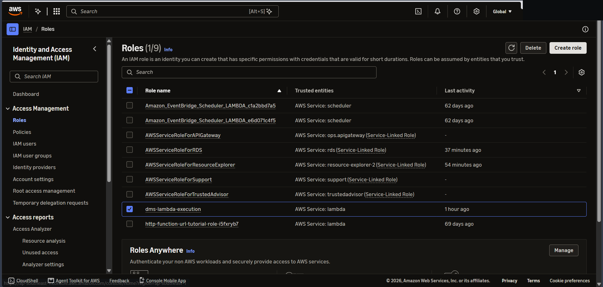

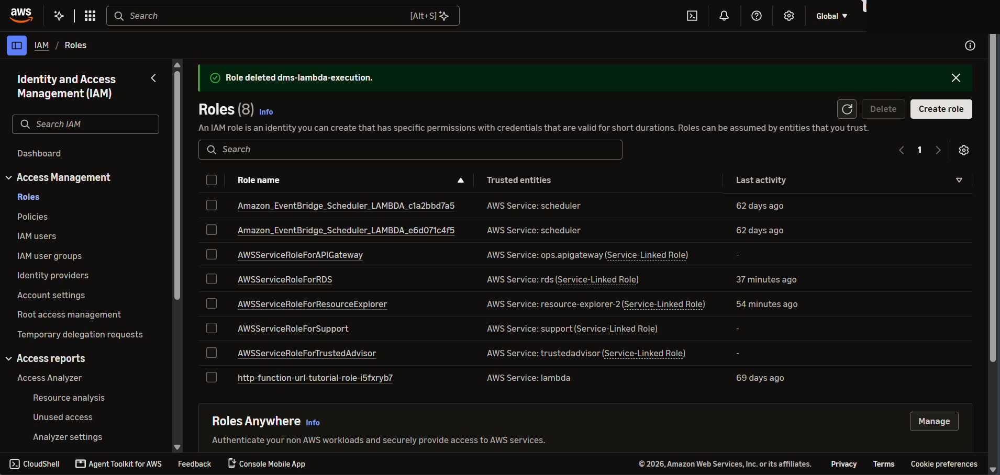

### Bước 13: Để xóa bucket artifact SAM, đối chiếu Physical ID

Để xóa bucket artifact SAM, đối chiếu Physical ID `aws-sam-cli-managed-default-samclisourcebucket-...` với resource `SamCliSourceBucket` trong stack `aws-sam-cli-managed-default`. Sau khi đã Empty bucket, mở **Amazon S3 → Buckets**, chọn đúng bucket này, bấm **Delete**, nhập chính xác tên bucket rồi xác nhận. Tên bucket có hậu tố khác nhau theo account, nên luôn đối chiếu Physical ID thực tế.

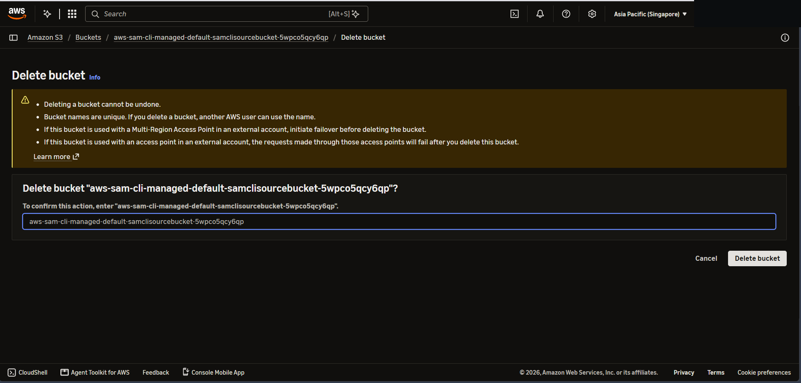

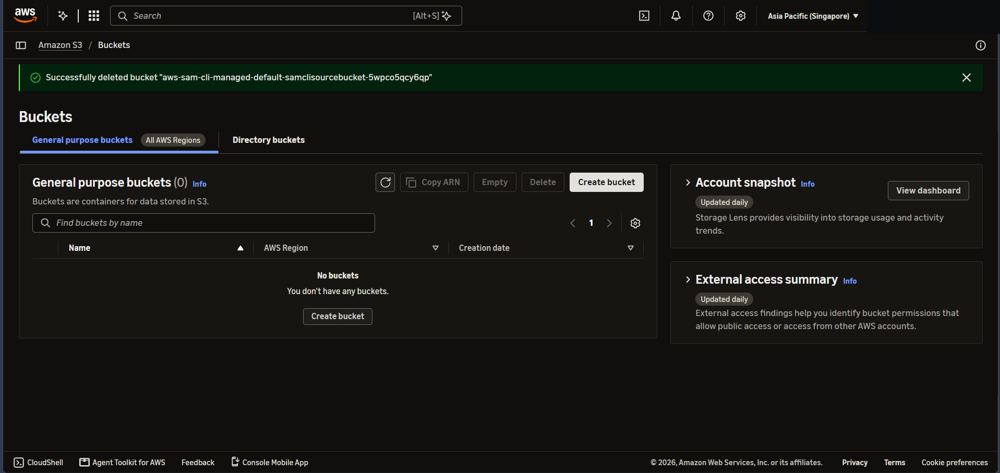

### Bước 14: Quay lại CloudFormation → Stacks, chọn stack

Quay lại **CloudFormation → Stacks**, chọn stack `aws-sam-cli-managed-default` rồi bấm **Delete stack**. Nhập chính xác tên stack trong hộp thoại xác nhận và bấm **Delete stack** lần nữa.

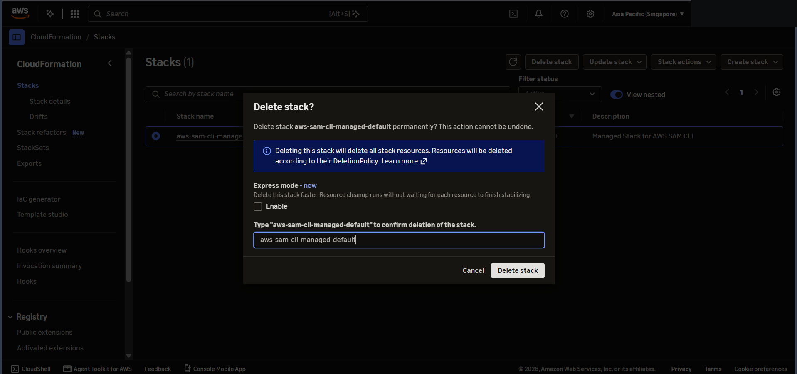

Chờ CloudFormation xử lý và kiểm tra **Events** hoặc trạng thái stack. Khi trạng thái là `DELETE_COMPLETE`, stack đã xóa xong. Nếu có lỗi, đọc Events để xác định resource còn lại trước khi retry.

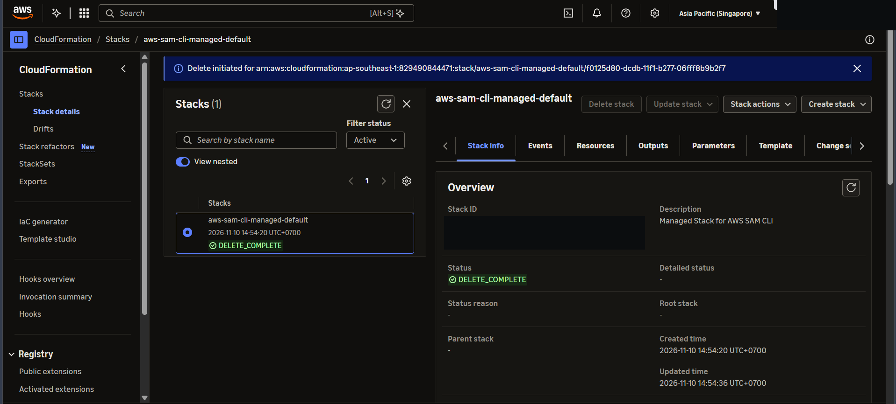

### Bước 15: Để xóa budget tạo cho workshop, mở Billing and Cost

Để xóa budget tạo cho workshop, mở **Billing and Cost Management → Budgets**, chọn `My Monthly Cost Budget` có mức `$10.00`, rồi chọn **Actions → Delete** và xác nhận. Không chọn `My-200$-budget` trong ví dụ nếu chưa xác định budget đó thuộc workshop hay không. Budget chỉ gửi cảnh báo, không giới hạn chi tiêu.

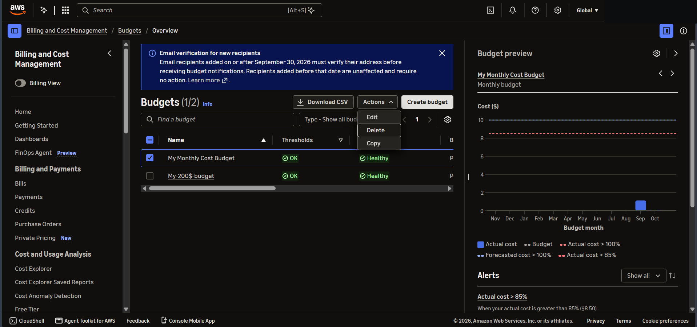

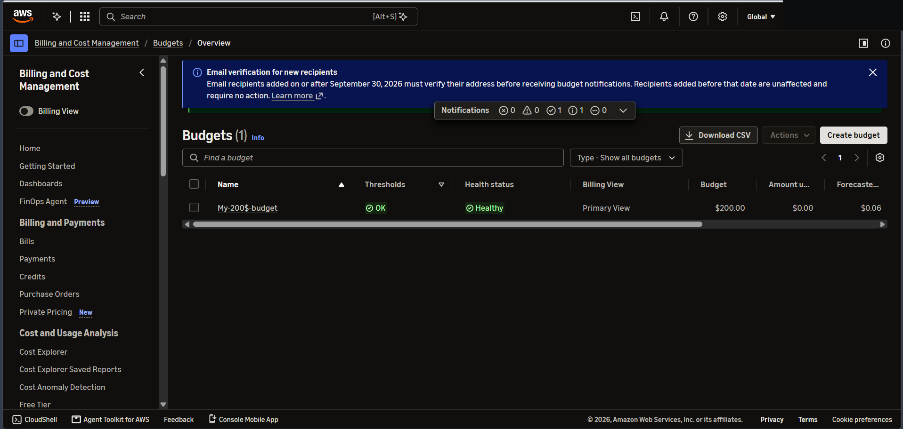

### Bước 16: Sau khi dọn dẹp, xem lại S3 buckets, CloudFormation

Sau khi dọn dẹp, xem lại S3 buckets, CloudFormation stacks, CloudWatch log groups/alarms, SNS topics, Amplify apps và Billing/Cost Explorer. Dữ liệu chi phí có thể cập nhật trễ; Bills trong tháng đang mở chưa phải hóa đơn cuối cùng.

## Khắc phục sự cố

- Nếu stack báo `DELETE_FAILED` vì bucket không rỗng, dùng thao tác **Empty** ở đúng bucket tài liệu, bao gồm object versions và delete markers.
- Nếu chọn force delete, một số resource có thể được giữ lại. Tìm trạng thái `DELETE_SKIPPED` trong tài nguyên của deleted stack hoặc kiểm tra trực tiếp dịch vụ tương ứng rồi xóa thủ công khi an toàn.
- Xóa Cognito User Pool có thể xóa vĩnh viễn tài khoản thử nghiệm. Xác minh đúng pool của workshop.
