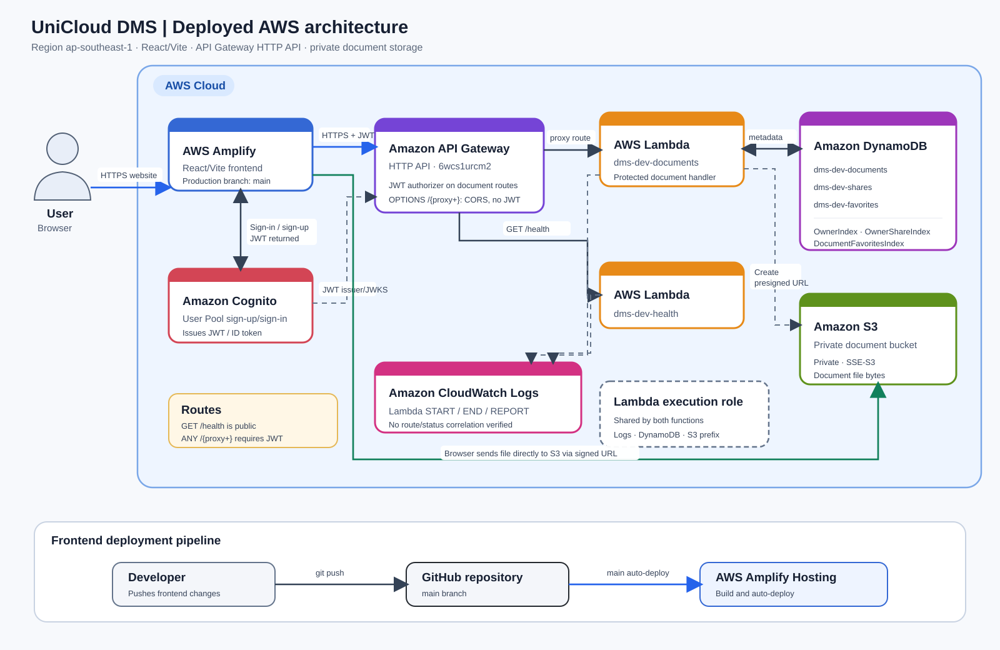

{}
This is the proposed target design for the UniCloud DMS workshop. The architecture diagram must be drawn and explained by the student, then updated to match the resources that are actually deployed. Do not present this target as a deployed system before verification.
{}

## Objective

Define the identity, API, metadata, file-transfer, and monitoring paths before creating AWS resources.

## Proposed components

| Component | Responsibility |
|---|---|
| AWS Amplify Hosting | Host the React/Vite single-page frontend and provide HTTPS delivery. |
| Amazon Cognito User Pool | Register and authenticate users; issue tokens to the frontend. |
| Amazon API Gateway HTTP API | Expose document routes and validate Cognito JWTs with a JWT authorizer. |
| AWS Lambda | Enforce per-document authorization, manage metadata, and issue short-lived S3 presigned URLs. |
| Amazon DynamoDB | Store document metadata, document shares, and per-user favorites. Use on-demand capacity for the workshop workload. |
| Amazon S3 | Store file bytes in a private bucket. Browsers transfer files directly using authorized presigned URLs. |
| AWS IAM | Give each Lambda execution role only the table, bucket-prefix, and logging actions it needs. |
| Amazon CloudWatch | Collect Lambda/API logs and metrics; add alarms after the core workflow is stable. |

## Implementation status

The AWS SAM template and Lambda source are in `backend/`. Stack `dms-dev` was deployed and updated in `ap-southeast-1` with a Cognito User Pool/client, HTTP API, private S3 bucket, two Lambda functions, and three on-demand DynamoDB tables. The frontend is hosted on Amplify. The deployed routes and document workflows are verified in sections 5.7 through 5.10. SAM also created the separate managed artifact bucket `aws-sam-cli-managed-default-samclisourcebucket-5wpco5qcy6qp`.

The API choice is an HTTP API with a Cognito JWT authorizer. API Gateway validates the token before invoking a protected route, and the verified claims are passed to Lambda. See [HTTP API JWT authorizers](https://docs.aws.amazon.com/apigateway/latest/developerguide/http-api-jwt-authorizer.html).

## Main data flows

### Sign-in and API request

1. The user signs up or signs in through the React app and the Cognito User Pool.
2. Cognito returns tokens to the frontend. The app sends the access token as `Authorization: Bearer <token>` to protected API routes.
3. API Gateway validates the JWT issuer, signature, expiry, and configured app-client audience before invoking Lambda.
4. Lambda reads the verified Cognito `sub` claim from the API event. It never trusts an `ownerId` supplied by the browser.

### Upload

1. The frontend sends file metadata to `POST /documents/upload-url`.
2. Lambda validates the authenticated user, filename, allowed file type, and size limit; it creates a document ID and an S3 key derived from the verified user `sub`.
3. Lambda returns a short-lived presigned `PUT` URL. The browser uploads the bytes directly to the private S3 bucket.
4. The frontend calls `POST /documents/{documentId}/complete`. Lambda verifies that the object exists and records metadata in DynamoDB.
5. If completion fails after the object upload, the object is treated as an orphan and can be retried or removed by a documented cleanup process.

S3 presigned URLs provide time-limited access to a specific object without making the bucket public. See [S3 presigned URLs](https://docs.aws.amazon.com/AmazonS3/latest/userguide/using-presigned-url.html).

### List, view, and download

1. The frontend requests the user's documents or a document detail using a valid Cognito token.
2. Lambda queries metadata using the authenticated `sub` and checks owner or active Viewer-share access for document-specific requests.
3. For an authorized download, Lambda returns a short-lived presigned `GET` URL. The browser downloads directly from S3.

### Share, favorite, and Trash

- The owner can create or revoke a Viewer share. The recipient can list, view, and download the document while it is active.
- A favorite is stored as a relationship between a Cognito `sub` and a document, not as a client-controlled list of emails.
- Moving a document to Trash is a soft delete in metadata. A trashed document is hidden from normal and shared views. Restore makes the document active again; permanent deletion is a separate owner-only operation.

### Monitoring

Lambda writes structured application logs to CloudWatch. API Gateway access logs and service metrics are used to validate requests, errors, and latency. Logs must not contain passwords, tokens, presigned URLs, or file contents.

## Security boundaries to draw

- The browser is an untrusted client. All authorization decisions happen in Lambda using API Gateway verified claims.
- The S3 bucket blocks public access. Only Lambda's execution role can access the required bucket prefix; the browser receives time-limited object access through presigned URLs.
- API Gateway only invokes the configured Lambda integrations. Lambda roles are scoped to the specific DynamoDB tables and S3 bucket prefix.
- Cognito app-client identifiers may be used in frontend configuration; AWS secret keys and other server credentials must never be shipped to the browser.
- S3 CORS permits only the local development origin and the final Amplify site origin, with the upload/download methods and headers actually required.

## Deployed architecture diagram

[Open the editable draw.io source](/images/5-Workshop/5.2-Backend-Design/5.2.1-architecture-deployed.drawio)

The diagram distinguishes user traffic from the GitHub-to-Amplify deployment path. It shows Cognito-issued JWTs, the API Gateway HTTP API routes, the documents and health Lambda functions, all three DynamoDB tables, private S3 with direct browser transfers using presigned URLs, the shared Lambda execution role, and the observed CloudWatch runtime logs.

## Expected result

The written architecture and editable diagram describe the deployed system. Review the diagram labels against the deployment before submitting the report.

## Troubleshooting

- A JWT authorizer authenticates the token, but Lambda still has to check document ownership or share permissions.
- A presigned URL is a bearer capability. Keep its expiry short and never log or store the URL in DynamoDB.
- Do not route file bytes through Lambda. If the browser cannot upload to S3, check the URL method, signed content type, bucket CORS, and the Lambda role.
