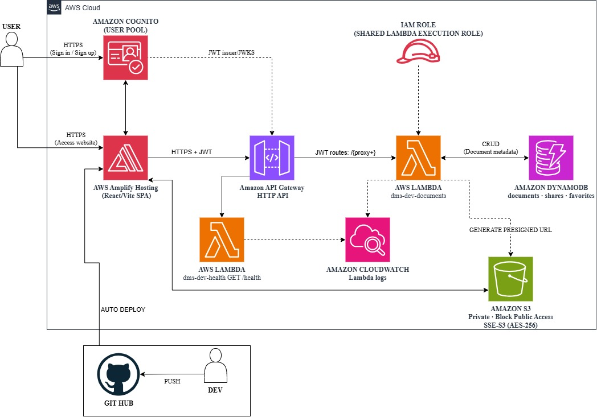

{}
Đây là thiết kế mục tiêu đề xuất cho workshop UniCloud DMS. Sinh viên phải tự vẽ và giải thích sơ đồ kiến trúc, sau đó cập nhật theo các tài nguyên đã triển khai thực tế. Không trình bày thiết kế mục tiêu như hệ thống đã triển khai khi chưa xác minh.
{}

## Mục tiêu

Xác định luồng danh tính, API, metadata, truyền file và giám sát trước khi tạo tài nguyên AWS.

## Các thành phần đề xuất

| Thành phần | Trách nhiệm |
|---|---|
| AWS Amplify Hosting | Host frontend React/Vite dạng SPA và phân phối qua HTTPS. |
| Amazon Cognito User Pool | Đăng ký, xác thực người dùng và cấp token cho frontend. |
| Amazon API Gateway HTTP API | Cung cấp các route tài liệu và xác thực Cognito JWT bằng JWT authorizer. |
| AWS Lambda | Kiểm tra quyền từng tài liệu, quản lý metadata và tạo S3 presigned URL có thời hạn ngắn. |
| Amazon DynamoDB | Lưu metadata tài liệu, quan hệ chia sẻ và favorites theo người dùng. Dùng on-demand cho workload workshop. |
| Amazon S3 | Lưu bytes của file trong bucket private. Trình duyệt truyền file trực tiếp bằng presigned URL đã được cấp quyền. |
| AWS IAM | Chỉ cấp cho Lambda quyền trên các bảng, prefix bucket và hoạt động ghi log cần thiết. |
| Amazon CloudWatch | Thu thập log và metric từ Lambda/API; bổ sung alarm sau khi luồng chính ổn định. |

## Trạng thái hiện thực hóa

Template AWS SAM và mã Lambda nằm trong `backend/`. Stack `dms-dev` đã được triển khai/cập nhật tại `ap-southeast-1`, gồm Cognito User Pool/client, HTTP API, S3 riêng tư, hai Lambda và ba bảng DynamoDB on-demand. Frontend được host trên Amplify. Các route và luồng tài liệu đã triển khai được xác minh tại mục 5.7 đến 5.10. SAM cũng tạo managed artifact bucket riêng `aws-sam-cli-managed-default-samclisourcebucket-5wpco5qcy6qp`.

Thiết kế chọn HTTP API với Cognito JWT authorizer. API Gateway xác thực token trước khi gọi route được bảo vệ và chuyển claims đã xác thực cho Lambda. Tham khảo [HTTP API JWT authorizer](https://docs.aws.amazon.com/apigateway/latest/developerguide/http-api-jwt-authorizer.html).

## Các luồng dữ liệu chính

### Đăng nhập và gọi API

1. Người dùng đăng ký hoặc đăng nhập từ React app qua Cognito User Pool.
2. Cognito trả token cho frontend. Ứng dụng gửi access token trong header `Authorization: Bearer <token>` tới các API được bảo vệ.
3. API Gateway kiểm tra issuer, chữ ký, thời hạn và audience của app client trước khi gọi Lambda.
4. Lambda lấy claim Cognito `sub` đã xác thực từ API event. Lambda không tin `ownerId` do trình duyệt gửi.

### Upload

1. Frontend gửi metadata của file tới `POST /documents/upload-url`.
2. Lambda kiểm tra người dùng đã xác thực, tên file, loại file cho phép và giới hạn kích thước; Lambda tạo document ID và S3 key dựa trên `sub` đã xác thực.
3. Lambda trả presigned `PUT` URL ngắn hạn. Trình duyệt upload bytes trực tiếp lên bucket S3 private.
4. Frontend gọi `POST /documents/{documentId}/complete`. Lambda xác nhận object tồn tại rồi ghi metadata vào DynamoDB.
5. Nếu bước complete lỗi sau khi file đã lên S3, object được xem là orphan để retry hoặc dọn theo quy trình cleanup đã tài liệu hóa.

S3 presigned URL cấp quyền tạm thời cho một object cụ thể mà không cần public bucket. Tham khảo [S3 presigned URL](https://docs.aws.amazon.com/AmazonS3/latest/userguide/using-presigned-url.html).

### Danh sách, xem và tải xuống

1. Frontend yêu cầu danh sách hoặc chi tiết tài liệu với Cognito token hợp lệ.
2. Lambda query metadata theo `sub` đã xác thực và kiểm tra quyền sở hữu hoặc quyền Viewer còn hiệu lực khi thao tác một tài liệu cụ thể.
3. Nếu có quyền download, Lambda trả presigned `GET` URL ngắn hạn. Trình duyệt tải trực tiếp từ S3.

### Chia sẻ, yêu thích và Thùng rác

- Owner có thể tạo hoặc thu hồi quyền Viewer. Người nhận có thể liệt kê, xem và tải tài liệu khi tài liệu còn active.
- Favorite được lưu thành quan hệ giữa Cognito `sub` và document, không dùng danh sách email do client kiểm soát.
- Chuyển vào Trash là soft delete trong metadata. Tài liệu trong Trash bị ẩn khỏi danh sách thông thường và danh sách shared. Khôi phục đưa tài liệu về active; xóa vĩnh viễn là thao tác riêng chỉ dành cho Owner.

### Giám sát

Lambda ghi application log có cấu trúc vào CloudWatch. Access log và metric API Gateway dùng để xác minh request, lỗi và độ trễ. Không ghi password, token, presigned URL hay nội dung file vào log.

## Ranh giới bảo mật cần thể hiện trên sơ đồ

- Trình duyệt là client không tin cậy. Mọi quyết định phân quyền được thực hiện ở Lambda bằng claims đã được API Gateway xác thực.
- S3 bucket chặn public access. Chỉ execution role của Lambda được truy cập prefix cần thiết; trình duyệt nhận quyền object có thời hạn qua presigned URL.
- API Gateway chỉ gọi các Lambda integration đã cấu hình. Lambda role giới hạn vào đúng DynamoDB table và S3 bucket prefix.
- App client ID của Cognito có thể nằm trong cấu hình frontend; AWS secret key và credentials phía server tuyệt đối không được đóng gói vào trình duyệt.
- S3 CORS chỉ cho phép origin phát triển local và origin Amplify sau này, cùng các method/header upload/download thực sự cần.

## Sơ đồ kiến trúc đã triển khai

[Mở file draw.io để chỉnh sửa](/images/5-Workshop/5.2-Backend-Design/5.2.1-architecture-deployed.drawio)

Sơ đồ tách luồng người dùng khỏi luồng deploy GitHub-to-Amplify. Sơ đồ thể hiện JWT do Cognito cấp, các route của API Gateway HTTP API, Lambda documents và health, cả ba DynamoDB table, S3 private với trình duyệt truyền file trực tiếp qua presigned URL, Lambda execution role dùng chung và runtime log CloudWatch đã quan sát. Báo cáo không khẳng định đã đối chiếu API Gateway access log với từng route.

## Kết quả mong đợi

Mô tả và sơ đồ kiến trúc thể hiện hệ thống đã triển khai. Hãy rà lại nhãn trong sơ đồ với cấu hình thực tế trước khi nộp báo cáo.

## Khắc phục sự cố

- JWT authorizer xác thực token, nhưng Lambda vẫn phải kiểm tra quyền sở hữu hoặc quyền chia sẻ của từng tài liệu.
- Presigned URL là bearer capability. Giữ thời hạn ngắn, không ghi URL vào log hoặc DynamoDB.
- Không chuyển bytes file qua Lambda. Nếu trình duyệt không upload được lên S3, kiểm tra HTTP method, content type đã ký, CORS của bucket và quyền Lambda role.
