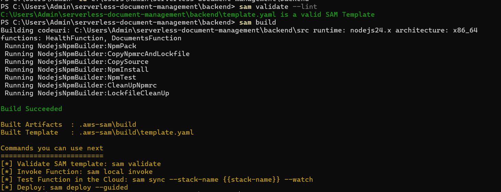
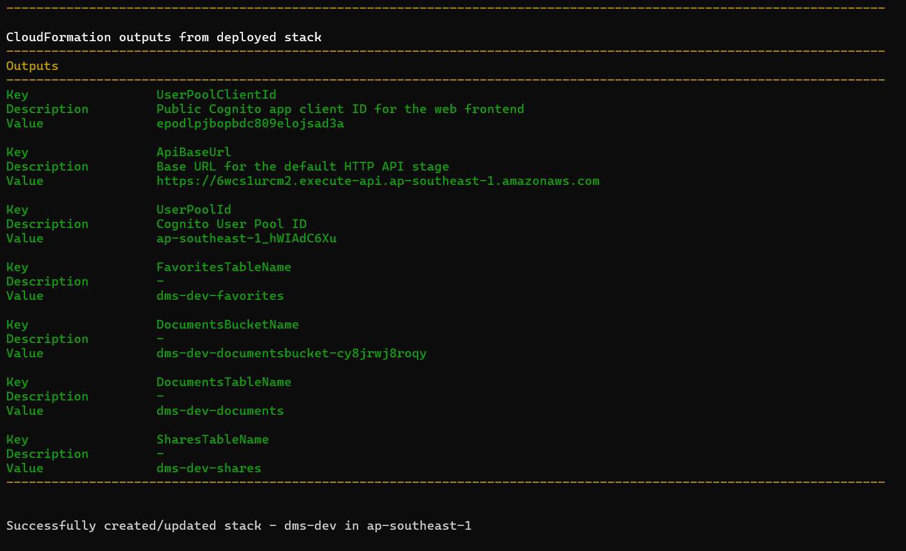
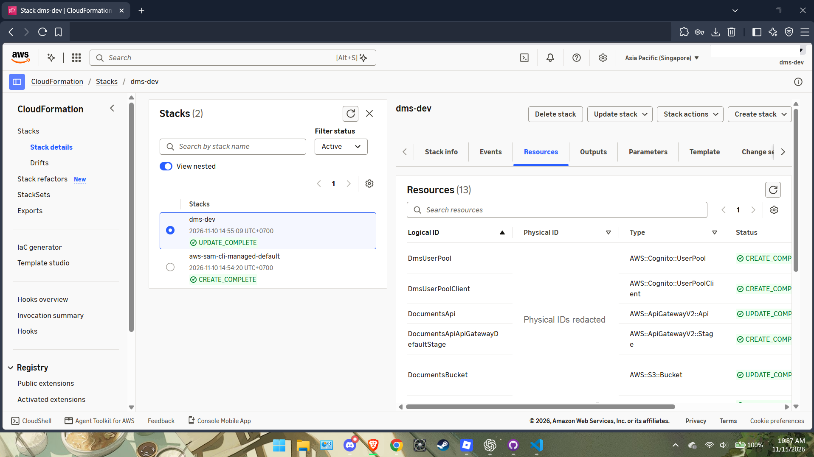
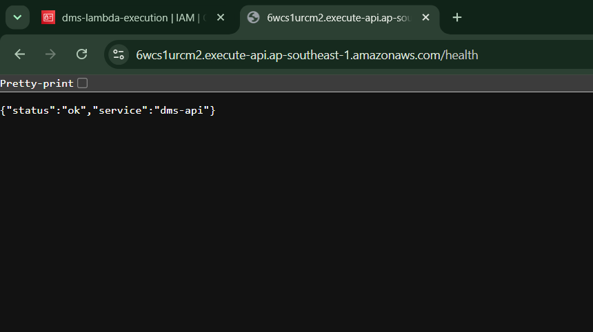

{}
This section records the data model and API behavior observed in the deployed `dms-dev` stack. The example item and route catalog describe the implementation contract.
{}

## Objective

Replace browser-only mock data with stable identifiers, explicit access patterns, and API routes that both frontend and Lambda can implement.

## Identity and authorization rules

- Cognito `sub` is the stable internal user identifier. Email is used for sign-in and share-recipient lookup, not as the authorization key.
- The frontend never sends `ownerSub` as an authority. Lambda derives the caller identity from verified API Gateway JWT claims.
- Every document read, download, update, share, trash, restore, or delete checks ownership or active share permission in Lambda.
- A Viewer can read and download an active shared document and manage their own favorite. A Viewer cannot edit metadata, share, trash, restore, or delete it.
- On share creation, Lambda resolves the recipient email to a Cognito `sub`. Do not expose an unrestricted user-enumeration route.

## DynamoDB tables

Use three small on-demand tables for clear access patterns. File bytes remain in S3; DynamoDB stores only metadata and relationships. Key and index design should follow application access patterns. See [DynamoDB data modeling](https://docs.aws.amazon.com/amazondynamodb/latest/developerguide/data-modeling.html).

| Table | Primary key | Index | Purpose |
|---|---|---|---|
| `dms-dev-documents` | `documentId` (String) | `OwnerIndex`: partition `ownerSub`, sort `createdAtDocumentId` | Document metadata and owner listing. Sort value is ISO timestamp plus `#documentId` for stable ordering. |
| `dms-dev-shares` | `recipientSub` (String), `documentId` (String) | `OwnerShareIndex`: partition `ownerSub`, sort `documentIdRecipientSub` | Viewer relationships, Shared With Me listing, and owner share management. |
| `dms-dev-favorites` | `userSub` (String), `documentId` (String) | `DocumentFavoritesIndex`: partition `documentId`, sort `documentIdUserSub` | Per-user favorite queries and efficient cleanup when a document is permanently deleted. |

### Document item

```json
{
  "documentId": "server-generated-id",
  "ownerSub": "cognito-user-sub",
  "fileName": "original-name.pdf",
  "fileType": "pdf",
  "fileSize": 245760,
  "s3Key": "users/<ownerSub>/documents/<documentId>",
  "category": "coursework",
  "tags": ["aws", "report"],
  "description": "Project report",
  "uploadStatus": "ACTIVE",
  "createdAt": "ISO-8601 UTC timestamp",
  "updatedAt": "ISO-8601 UTC timestamp",
  "deletedAt": null,
  "createdAtDocumentId": "<createdAt>#<documentId>"
}
```

The deployed `OwnerIndex` uses `ownerSub` and `createdAtDocumentId` as separate attributes. Lambda generates the S3 key; never concatenate an unsanitized client path into it.

### Share and favorite items

- `dms-dev-shares`: `recipientSub`, `documentId`, `ownerSub`, `permission` (`VIEWER`), `sharedAt`, and an optional recipient email snapshot for display. Each user-document pair is unique.
- `dms-dev-favorites`: `userSub`, `documentId`, `documentIdUserSub`, and `favoritedAt`. A user can favorite an owned or actively shared document. The reverse index supports cleanup by document ID.
- Trashed documents are excluded from active owner and shared views. Restore re-enables existing shares. Revoking a share removes the relationship but does not delete the S3 object.

## Access patterns

| Operation | Data access |
|---|---|
| List the caller's active documents or Trash | Query `dms-dev-documents.OwnerIndex` by verified `ownerSub`; separate views by `deletedAt`. |
| Read or update one document | Get by `documentId`; compare `ownerSub` with the verified caller, or query `dms-dev-shares` for active Viewer access to read-only routes. |
| List Shared With Me | Query `dms-dev-shares` by `recipientSub`, batch-get metadata, and return only non-trashed documents. |
| List shares created by an owner | Query `dms-dev-shares.OwnerShareIndex` by `ownerSub`. |
| List favorites | Query `dms-dev-favorites` by `userSub`, batch-get documents, and include only documents still accessible to the caller. |
| Search/filter a small personal list | Initially filter authorized results by filename, category, tags, and dates. This is not full-text search. Revisit if data grows. |

## API contract

All routes below use the Cognito JWT authorizer. No unauthenticated document route is provided. `sub` always comes from verified authorizer claims.

| Method and route | Purpose | Main authorization |
|---|---|---|
| `POST /documents/upload-url` | Validate upload and return a presigned S3 `PUT` URL plus `documentId` | Authenticated caller; server creates `ownerSub` and `s3Key` |
| `POST /documents/{documentId}/complete` | Verify the S3 object and save metadata | Requesting owner only |
| `GET /documents?view=owned&status=active\|trash` | List owned active or trashed documents | Query only caller's `ownerSub` |
| `GET /documents/shared` | List active documents shared with caller | Query only caller's `recipientSub` |
| `GET /documents/{documentId}` | Read metadata | Owner or active Viewer |
| `GET /documents/{documentId}/download-url` | Return a presigned S3 `GET` URL | Owner or active Viewer |
| `PATCH /documents/{documentId}` | Update description, category, or tags | Owner only; allow-list editable fields |
| `POST /documents/{documentId}/trash` | Soft-delete the document | Owner only |
| `POST /documents/{documentId}/restore` | Restore a trashed document | Owner only |
| `DELETE /documents/{documentId}` | Permanently delete S3 object and related metadata | Owner only; separate UI confirmation |
| `POST /documents/{documentId}/shares` | Create Viewer share using recipient email | Owner only; resolve email to Cognito `sub` |
| `DELETE /documents/{documentId}/shares/{recipientSub}` | Revoke a share | Owner only |
| `GET /favorites` | List caller's favorite accessible documents | Query only caller's `userSub` |
| `PUT /documents/{documentId}/favorite` | Add a favorite relationship | Owner or active Viewer |
| `DELETE /documents/{documentId}/favorite` | Remove caller's favorite relationship | Caller’s own favorite only |

Use consistent error responses: `400` invalid input, `401` missing or invalid token, `403` authenticated but not authorized, `404` missing document or recipient, `409` duplicate or invalid state transition, and `5xx` unexpected server error. Do not reveal whether another user's private document exists when rejecting an unauthorized request.

## Upload and deletion consistency

- Upload has two steps because S3 and DynamoDB do not share a transaction. `complete` must be idempotent for the document ID and verify the object before writing `ACTIVE` metadata.
- Permanent delete spans S3 and DynamoDB. Mark the document `DELETING`, remove the S3 object, then remove metadata and related shares/favorites. Make this retryable; failures must not leave the document downloadable.
- Soft delete retains the S3 object and metadata for restore. Cleanup instructions must distinguish Trash from permanent deletion.

## Deployed implementation and verification

The deployed table names and key/index schemas are confirmed in sections 5.4.1 and 5.4.2. API Gateway uses a JWT-protected `ANY /{proxy+}` route to invoke `dms-dev-documents`; `GET /health` is public, and `OPTIONS /{proxy+}` handles CORS preflight. Authenticated listing returned HTTP `200`, while an unshared cross-account detail request returned HTTP `404` (section 5.7.2). Upload, download, metadata, Favorites, Trash/restore, and sharing were exercised through the application (sections 5.8.2 and 5.10).

The CloudFormation change set was reviewed before deployment and the stack was deployed successfully. A separate change-set screenshot and student-authored data-model diagram were not retained.

## Expected result and verification status

The deployed table/index design and observed access behavior are recorded above. Authenticated listing returned HTTP `200`; an unshared cross-account detail request returned `404`.

## Implementation progress

The SAM template defines the three deployed tables, and Lambda implements authenticated presigned S3 upload/download, owner/Viewer checks, soft delete, sharing, and Favorites. `sam validate --lint` and `sam build` succeeded. The reviewed CloudFormation change set completed successfully; the stack was deployed in `ap-southeast-1`. Deployed outputs and current resource evidence are recorded in section 5.9.2. The public `/health` endpoint returned `{"status":"ok","service":"dms-api"}`. Authenticated document workflows were subsequently verified in sections 5.7 through 5.10.



The change set was reviewed before deployment; a separate screenshot of the change-set review screen was not retained.



The current CloudFormation resource view lists 13 resources in the `dms-dev` stack. The visible entries include the Cognito user pool and client, API Gateway API and stage, and the S3 documents bucket. Physical resource IDs are redacted in the report copy.





## Troubleshooting

- If a normal list view needs a table scan, revisit the key and index design.
- If the frontend sends an email as `ownerSub`, stop and derive identity from authorizer claims.
- If full-text search is required, document it as a future extension; DynamoDB metadata queries do not search file contents.
