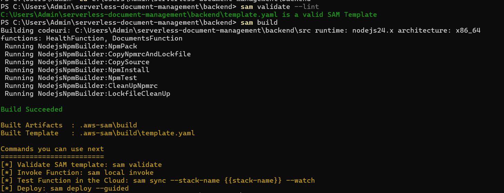
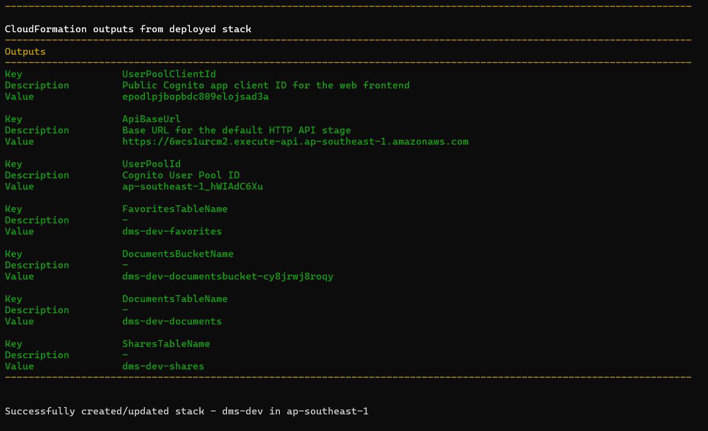
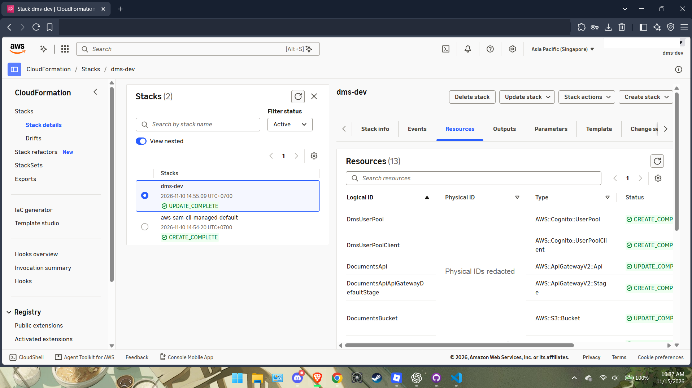
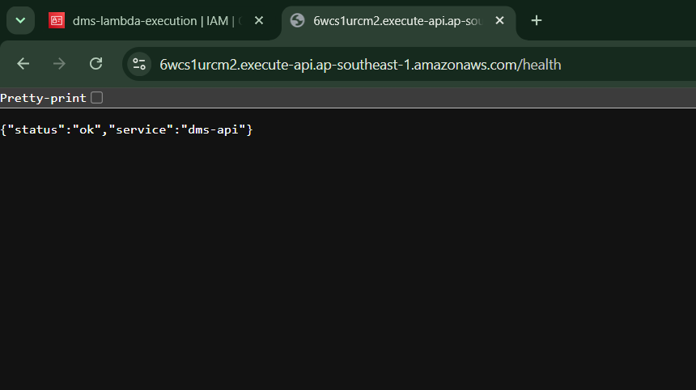

{}
Đây là contract đề xuất cho workshop. Xác nhận tên bảng, giới hạn và route theo implementation thực tế trước khi trình bày như thiết kế cuối cùng.
{}

## Mục tiêu

Thay dữ liệu mock chỉ chạy trong trình duyệt bằng định danh ổn định, access pattern rõ ràng và API route mà frontend cùng Lambda có thể triển khai.

## Quy tắc định danh và phân quyền

- Cognito `sub` là định danh nội bộ ổn định. Email dùng để đăng nhập và tìm người nhận chia sẻ, không làm khóa phân quyền.
- Frontend không tự gửi `ownerSub` làm căn cứ quyền. Lambda lấy danh tính caller từ claim JWT đã xác minh bởi API Gateway.
- Mọi thao tác đọc, tải, cập nhật, chia sẻ, chuyển Trash, khôi phục hoặc xóa đều được Lambda kiểm tra quyền sở hữu hoặc share đang hiệu lực.
- Viewer được đọc/tải tài liệu active đã chia sẻ và quản lý favorite của chính họ. Viewer không được sửa metadata, chia sẻ, chuyển Trash, khôi phục hoặc xóa.
- Khi tạo share, Lambda resolve email người nhận thành Cognito `sub`. Không tạo route tra cứu user không giới hạn.

## Các bảng DynamoDB

Dùng ba bảng on-demand nhỏ để access pattern rõ ràng. Bytes của file nằm trong S3; DynamoDB chỉ lưu metadata và quan hệ. Thiết kế key/index cần dựa vào access pattern ứng dụng. Tham khảo [DynamoDB data modeling](https://docs.aws.amazon.com/amazondynamodb/latest/developerguide/data-modeling.html).

| Bảng | Khóa chính | Index | Mục đích |
|---|---|---|---|
| `dms-dev-documents` | `documentId` (String) | `OwnerIndex`: partition `ownerSub`, sort `createdAtDocumentId` | Metadata và danh sách của owner. Sort value là ISO timestamp cộng `#documentId` để sắp xếp ổn định. |
| `dms-dev-shares` | `recipientSub` (String), `documentId` (String) | `OwnerShareIndex`: partition `ownerSub`, sort `documentIdRecipientSub` | Quan hệ Viewer, danh sách Được chia sẻ với tôi và quản lý share phía owner. |
| `dms-dev-favorites` | `userSub` (String), `documentId` (String) | `DocumentFavoritesIndex`: partition `documentId`, sort `documentIdUserSub` | Query favorite theo người dùng và dọn dữ liệu hiệu quả khi xóa tài liệu vĩnh viễn. |

### Item tài liệu

```json
{
  "documentId": "server-generated-id",
  "ownerSub": "cognito-user-sub",
  "fileName": "original-name.pdf",
  "fileType": "pdf",
  "fileSize": 245760,
  "s3Key": "users/<ownerSub>/documents/<documentId>",
  "category": "coursework",
  "tags": ["aws", "report"],
  "description": "Project report",
  "uploadStatus": "ACTIVE",
  "createdAt": "ISO-8601 UTC timestamp",
  "updatedAt": "ISO-8601 UTC timestamp",
  "deletedAt": null,
  "createdAtDocumentId": "<createdAt>#<documentId>"
}
```

`OwnerIndex` dùng hai thuộc tính riêng `ownerSub` và `createdAtDocumentId`. Lambda tự tạo S3 key; không ghép đường dẫn client gửi chưa được làm sạch vào key.

### Item share và favorite

- `dms-dev-shares`: `recipientSub`, `documentId`, `ownerSub`, `permission` (`VIEWER`), `sharedAt` và email snapshot tùy chọn để hiển thị. Mỗi cặp user-document là duy nhất.
- `dms-dev-favorites`: `userSub`, `documentId`, `documentIdUserSub`, `favoritedAt`. User có thể favorite tài liệu của mình hoặc tài liệu shared còn active. Reverse index hỗ trợ dọn quan hệ favorite theo document ID.
- Tài liệu trong Trash bị loại khỏi danh sách active của owner và người nhận. Khôi phục kích hoạt lại share còn lưu. Thu hồi share xóa quan hệ, không xóa object S3.

## Access pattern

| Thao tác | Cách truy cập dữ liệu |
|---|---|
| Liệt kê tài liệu active hoặc Trash của caller | Query `dms-dev-documents.OwnerIndex` theo `ownerSub` đã xác thực; tách view bằng `deletedAt`. |
| Đọc hoặc sửa một tài liệu | Get theo `documentId`; so sánh `ownerSub` với caller đã xác thực, hoặc query `dms-dev-shares` để kiểm tra Viewer active cho route chỉ đọc. |
| Liệt kê Được chia sẻ với tôi | Query `dms-dev-shares` theo `recipientSub`, batch-get metadata và chỉ trả tài liệu chưa vào Trash. |
| Liệt kê share do owner tạo | Query `dms-dev-shares.OwnerShareIndex` theo `ownerSub`. |
| Liệt kê favorites | Query `dms-dev-favorites` theo `userSub`, batch-get tài liệu và chỉ giữ tài liệu caller còn quyền truy cập. |
| Tìm/lọc danh sách cá nhân nhỏ | Ban đầu lọc kết quả caller được phép xem theo tên file, category, tags và ngày. Đây không phải tìm kiếm toàn văn. Xem lại nếu dữ liệu tăng. |

## API contract

Tất cả route dưới đây dùng Cognito JWT authorizer. Không có route tài liệu unauthenticated. `sub` luôn lấy từ authorizer claims đã xác thực.

| Method và route | Mục đích | Phân quyền chính |
|---|---|---|
| `POST /documents/upload-url` | Kiểm tra upload và trả presigned S3 `PUT` URL cùng `documentId` | Caller đã xác thực; server tạo `ownerSub` và `s3Key` |
| `POST /documents/{documentId}/complete` | Xác nhận object S3 và lưu metadata | Chỉ owner tạo request |
| `GET /documents?view=owned&status=active\|trash` | Liệt kê tài liệu active hoặc Trash của owner | Chỉ query `ownerSub` của caller |
| `GET /documents/shared` | Liệt kê tài liệu active được chia sẻ với caller | Chỉ query `recipientSub` của caller |
| `GET /documents/{documentId}` | Đọc metadata | Owner hoặc Viewer có share active |
| `GET /documents/{documentId}/download-url` | Trả presigned S3 `GET` URL | Owner hoặc Viewer có share active |
| `PATCH /documents/{documentId}` | Sửa description, category hoặc tags | Chỉ owner; allow-list trường được sửa |
| `POST /documents/{documentId}/trash` | Soft-delete tài liệu | Chỉ owner |
| `POST /documents/{documentId}/restore` | Khôi phục tài liệu Trash | Chỉ owner |
| `DELETE /documents/{documentId}` | Xóa vĩnh viễn object S3 và metadata liên quan | Chỉ owner; UI yêu cầu xác nhận riêng |
| `POST /documents/{documentId}/shares` | Tạo Viewer share bằng email người nhận | Chỉ owner; resolve email thành Cognito `sub` |
| `DELETE /documents/{documentId}/shares/{recipientSub}` | Thu hồi share | Chỉ owner |
| `GET /favorites` | Liệt kê favorite mà caller còn quyền xem | Chỉ query `userSub` của caller |
| `PUT /documents/{documentId}/favorite` | Thêm quan hệ favorite | Owner hoặc Viewer có share active |
| `DELETE /documents/{documentId}/favorite` | Bỏ favorite của caller | Chỉ favorite của caller |

Thống nhất lỗi trả về: `400` input sai, `401` thiếu/token sai, `403` đã xác thực nhưng không có quyền, `404` thiếu document hoặc recipient, `409` trùng hoặc chuyển trạng thái không hợp lệ, `5xx` lỗi server ngoài dự kiến. Khi từ chối, không tiết lộ tài liệu riêng của user khác có tồn tại hay không.

## Nhất quán khi upload và xóa

- Upload gồm hai bước vì S3 và DynamoDB không dùng chung transaction. `complete` phải idempotent theo document ID và xác nhận object tồn tại trước khi ghi metadata `ACTIVE`.
- Xóa vĩnh viễn đi qua S3 và DynamoDB. Đánh dấu document `DELETING`, xóa object S3, rồi xóa metadata và share/favorite liên quan. Thao tác phải retry được; lỗi không để tài liệu tiếp tục tải xuống.
- Soft delete giữ object S3 và metadata để khôi phục. Hướng dẫn cleanup phải phân biệt Trash với xóa vĩnh viễn.

## Triển khai và xác minh

Tên bảng cùng key/index đang triển khai được xác nhận tại mục 5.4.1 và 5.4.2. API Gateway dùng route `ANY /{proxy+}` có JWT authorizer để gọi `dms-dev-documents`; `GET /health` public và `OPTIONS /{proxy+}` phục vụ CORS preflight. Request liệt kê có đăng nhập trả HTTP `200`, còn tài khoản khác gọi tài liệu chưa chia sẻ nhận HTTP `404` (mục 5.7.2). Upload, download, metadata, Favorites, Thùng rác/khôi phục và sharing đã được thao tác qua ứng dụng (mục 5.8.2 và 5.10).

CloudFormation change set đã được rà soát trước khi deploy và stack triển khai thành công. Không lưu ảnh riêng màn hình change set và sơ đồ data model do sinh viên thực hiện.

## Kết quả mong đợi

Thiết kế bảng/index triển khai và quy tắc truy cập đã kiểm thử được ghi ở trên. Contract đã cập nhật khớp ứng dụng; các kiểm thử còn thiếu được nêu tại mục 5.10.

## Tiến độ hiện thực hóa

Template SAM định nghĩa ba bảng đang triển khai; Lambda source có route xác thực cho presigned S3 upload/download, kiểm tra Owner/Viewer, soft delete, sharing và Favorites. `sam validate --lint` và `sam build` thành công. CloudFormation change set đã được rà soát và stack triển khai tại `ap-southeast-1`. Outputs và minh chứng tài nguyên hiện hành được ghi ở mục 5.9.2. Public `/health` trả `{"status":"ok","service":"dms-api"}`. Các luồng tài liệu có xác thực đã được kiểm thử sau đó tại mục 5.7 đến 5.10.



Change set đã được rà soát trước khi deploy; không lưu ảnh riêng màn hình rà soát change set.



Danh sách tài nguyên CloudFormation hiện tại ghi nhận 13 tài nguyên trong stack `dms-dev`. Các mục đang thấy gồm Cognito user pool và client, API Gateway API và stage, cùng S3 documents bucket. Physical ID đã được che trong bản ảnh của báo cáo.





## Khắc phục sự cố

- Nếu view danh sách thông thường cần scan table, xem lại thiết kế key/index.
- Nếu frontend gửi email làm `ownerSub`, dừng và lấy identity từ authorizer claims.
- Nếu cần tìm kiếm toàn văn, ghi thành phần mở rộng tương lai; DynamoDB metadata query không tìm nội dung bên trong file.
