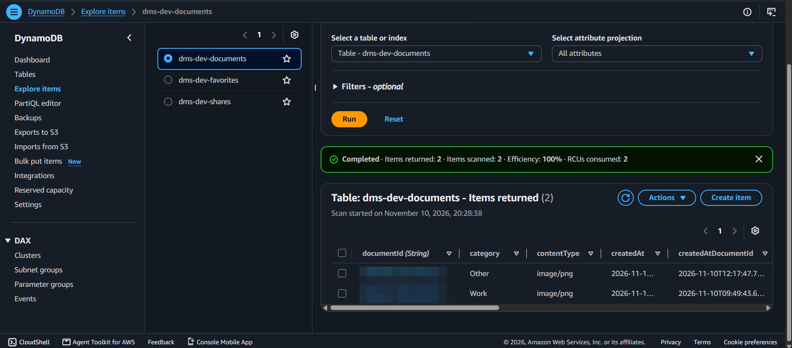
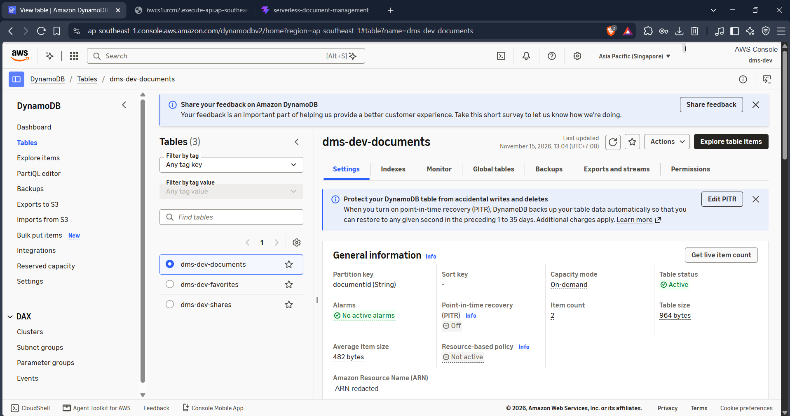
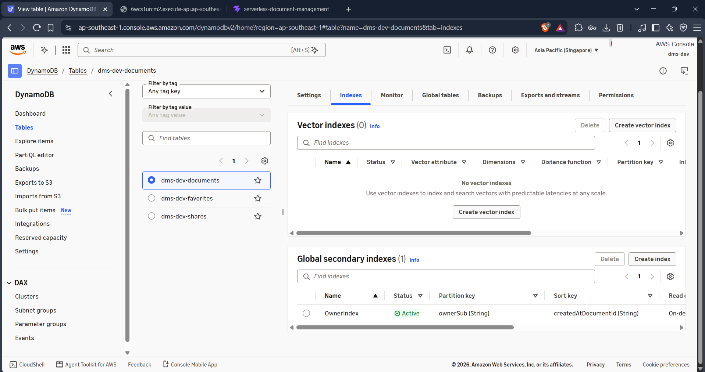

{}
This page records the deployed implementation and observed results. Any unverified behavior is identified explicitly.
{}

## Objective

Create the main metadata table using the approved key design.

## Implementation steps

1. Deploy the SAM template from section 5.1.3; do not manually create a duplicate table. The template names it `<stack-name>-documents`, uses `PAY_PER_REQUEST`, and creates `OwnerIndex`.
2. Open CloudFormation → the lab stack → Resources and select `DocumentsTable` to open DynamoDB. Alternatively, open DynamoDB → Tables and find `<stack-name>-documents` in the same Region.
3. In Table details, confirm String partition key `documentId`, no sort key, On-demand capacity, and Active status. Open Indexes and confirm `OwnerIndex` has String partition key `ownerSub` and String sort key `createdAtDocumentId`.
4. Record the table and index names for Lambda. Owner listings use Query on the GSI, not a full table Scan.

## Screenshot and remaining evidence

The deployed `dms-dev-documents` table uses partition key `documentId` (String), has no sort key, uses on-demand capacity, and is Active.

The `OwnerIndex` GSI is **Active**, with `ownerSub` (String) as its partition key and `createdAtDocumentId` (String) as its sort key.

## Expected result

The main table and owner query index are ready for synthetic test data.

## Troubleshooting

- DynamoDB key names and types are case-sensitive.
- Check index status before debugging query behavior.
