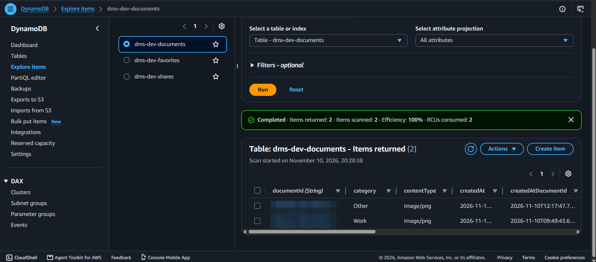
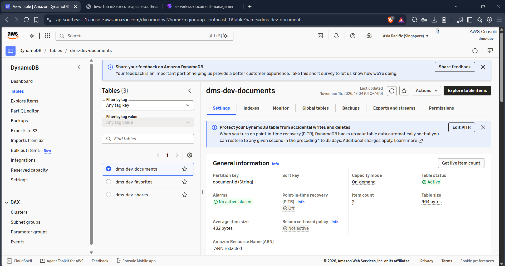
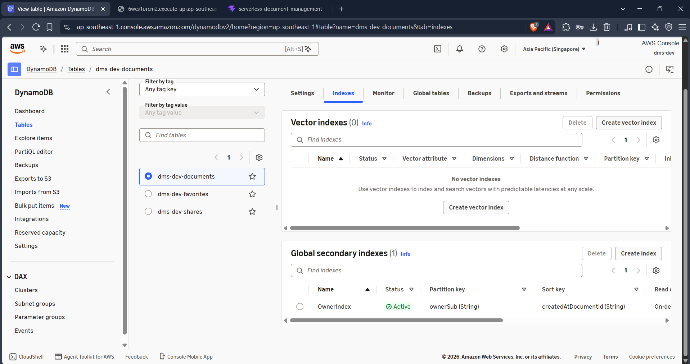

{}
Trang này ghi nhận cấu hình đã triển khai và kết quả đã quan sát; hành vi chưa xác minh được nêu rõ.
{}

## Mục tiêu

Tạo bảng metadata chính theo thiết kế khóa đã duyệt.

## Các bước thực hiện

1. Tạo `UniCloudDMS-Documents-dev` tại Region đã chọn, dùng partition key String `documentId`.
2. Dùng on-demand cho lab nhỏ có tải biến động nếu thiết kế không quy định khác; giữ bật mã hóa.
3. Thêm GSI `OwnerIndex` với partition key `ownerSub`, sort key `createdAtDocumentId`, khớp truy vấn danh sách theo owner đang triển khai.
4. Chờ bảng và index chuyển sang Active trước khi test. Tránh scan toàn bảng khi liệt kê theo người dùng.

## Vị trí ảnh chụp màn hình

Bảng `dms-dev-documents` đang triển khai dùng partition key `documentId` kiểu String, không có sort key, dùng capacity on-demand và có trạng thái Active.

GSI `OwnerIndex` đang **Active**, có partition key `ownerSub` (String) và sort key `createdAtDocumentId` (String).

## Kết quả mong đợi

Bảng chính và index truy vấn theo owner sẵn sàng cho dữ liệu thử nghiệm.

## Khắc phục sự cố

- Tên và kiểu khóa DynamoDB phân biệt hoa/thường.
- Kiểm tra trạng thái index trước khi xử lý lỗi query.
