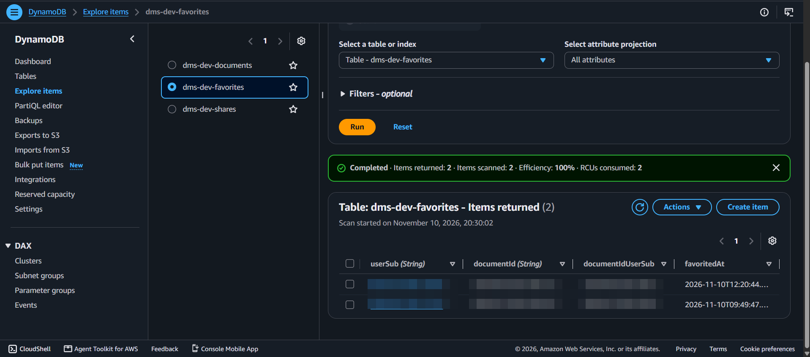
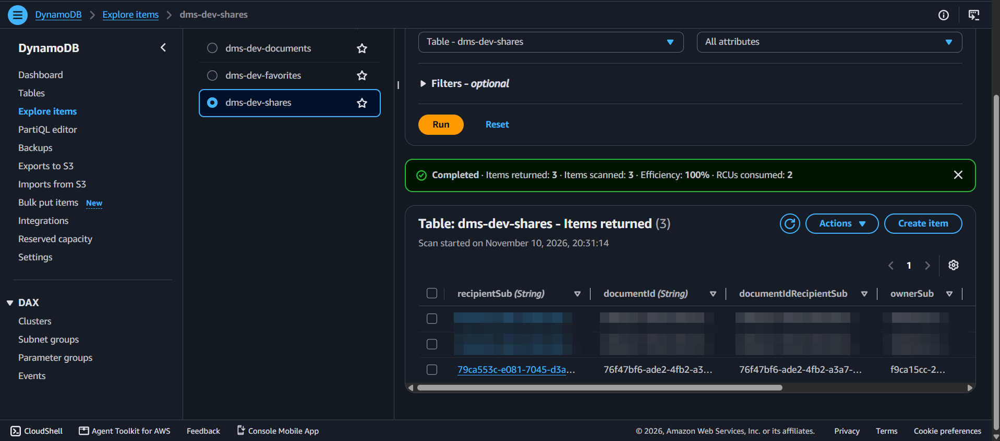
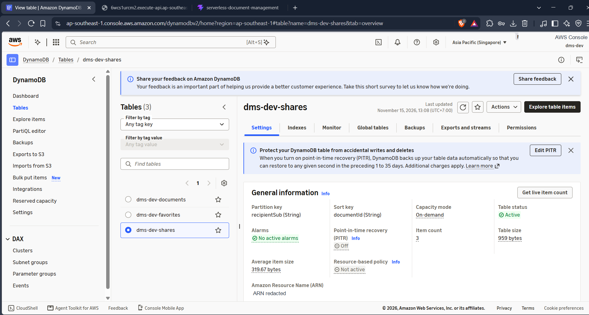
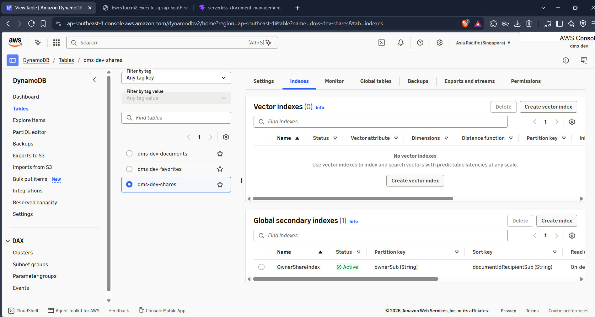
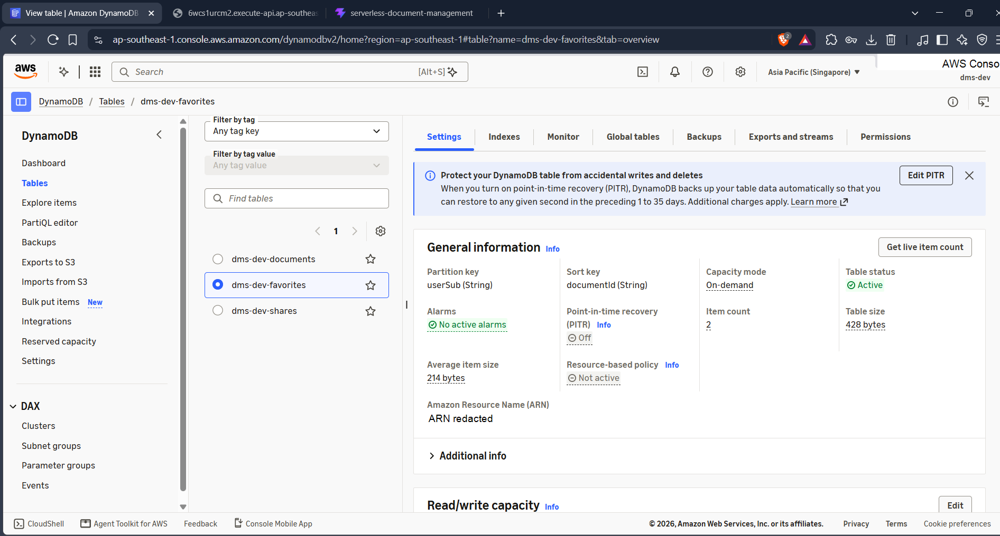

{}
This page records the deployed implementation and observed results. Any unverified behavior is identified explicitly.
{}

## Objective

Store shares and favorites as user-specific relationships and verify the query paths.

## Implementation steps

1. Deploy the same SAM stack from section 5.1.3; the template creates both relationship tables, so do not create duplicates manually.
2. In CloudFormation → stack → Resources, select `SharesTable`. Confirm `<stack-name>-shares` has `recipientSub` partition key, `documentId` sort key, and On-demand capacity. In Indexes, confirm `OwnerShareIndex` uses `ownerSub` and `documentIdRecipientSub`.
3. Open `FavoritesTable` and confirm `<stack-name>-favorites` has `userSub` partition key, `documentId` sort key, and On-demand capacity. `DocumentFavoritesIndex` uses `documentId` and `documentIdUserSub` to query favorites by document.
4. Record table/index names from stack outputs/template for Lambda configuration. Cognito `sub` values are used as identity keys; email is not an authorization key.

## Screenshots and remaining evidence

The deployed Shares table is Active and uses on-demand capacity. Its primary key is `recipientSub` (partition key) plus `documentId` (sort key). Its active `OwnerShareIndex` uses `ownerSub` as the partition key and `documentIdRecipientSub` as the sort key. The deployed Favorites table is also Active and uses on-demand capacity, with `userSub` as the partition key and `documentId` as the sort key.

## Expected result

Relationship tables support the application's shared and favorite views.

## Troubleshooting

- Extra indexes can add storage/write cost; tie each one to a query requirement.
- Do not use email as a substitute for the Cognito sub in authorization.
