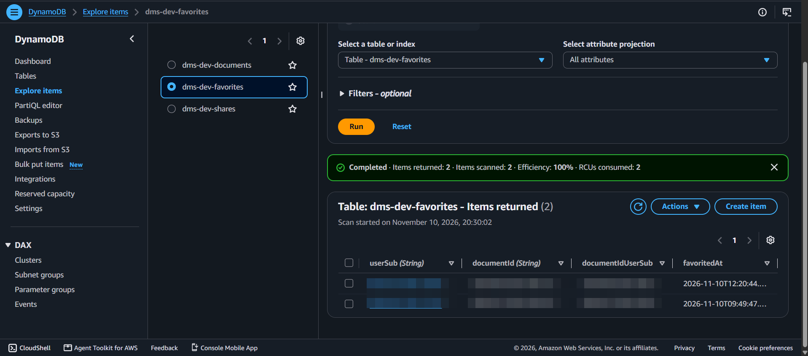
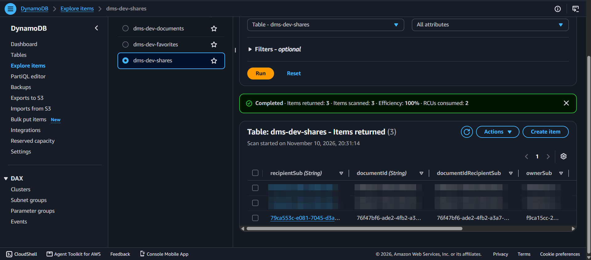
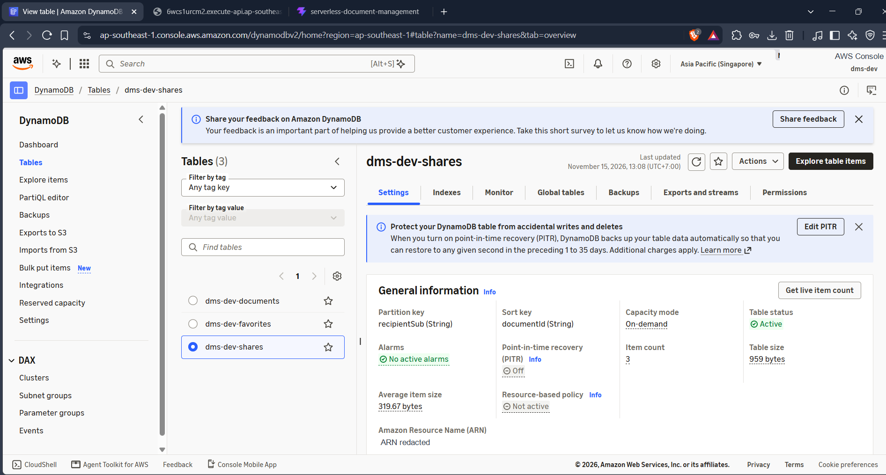
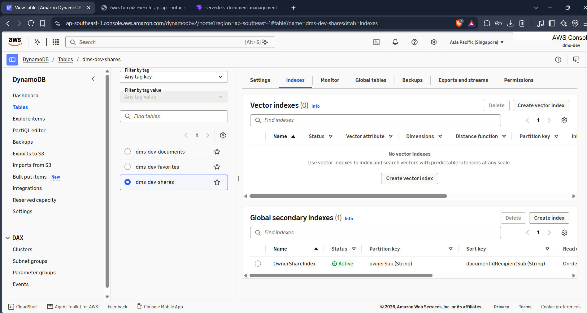
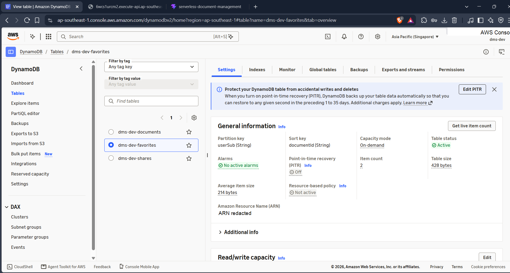

{}
Trang này ghi nhận cấu hình đã triển khai và kết quả đã quan sát; hành vi chưa xác minh được nêu rõ.
{}

## Mục tiêu

Lưu share và favorite dưới dạng quan hệ riêng từng người dùng, rồi xác minh đường truy vấn.

## Các bước thực hiện

1. Kiểm tra bảng `dms-dev-shares` đang triển khai có partition key `recipientSub` và sort key `documentId`. Cấu trúc này cho phép ứng dụng truy vấn trực tiếp các tài liệu được chia sẻ với người nhận, không cần recipient GSI riêng.
2. Tạo Favorites với partition key `userSub`, sort key `documentId`.
3. Dùng bản ghi tổng hợp để kiểm tra người dùng chỉ query favorite/share của mình.
4. Ghi tên bảng/index cuối vào ghi chú cấu hình API và Lambda. Chỉ tạo index phục vụ truy vấn thực tế.

## Vị trí ảnh chụp màn hình

Bảng Shares đang triển khai có trạng thái Active và dùng capacity On-demand. Khóa chính gồm `recipientSub` (partition key) và `documentId` (sort key). `OwnerShareIndex` đang Active, dùng `ownerSub` làm partition key và `documentIdRecipientSub` làm sort key. Bảng Favorites cũng đang Active, dùng capacity On-demand, với `userSub` là partition key và `documentId` là sort key.

## Kết quả mong đợi

Bảng quan hệ hỗ trợ các màn hình chia sẻ và yêu thích.

## Khắc phục sự cố

- Index thừa có thể tăng chi phí lưu/ghi; cần gắn mỗi index với yêu cầu truy vấn.
- Không dùng email thay Cognito sub trong phân quyền.
