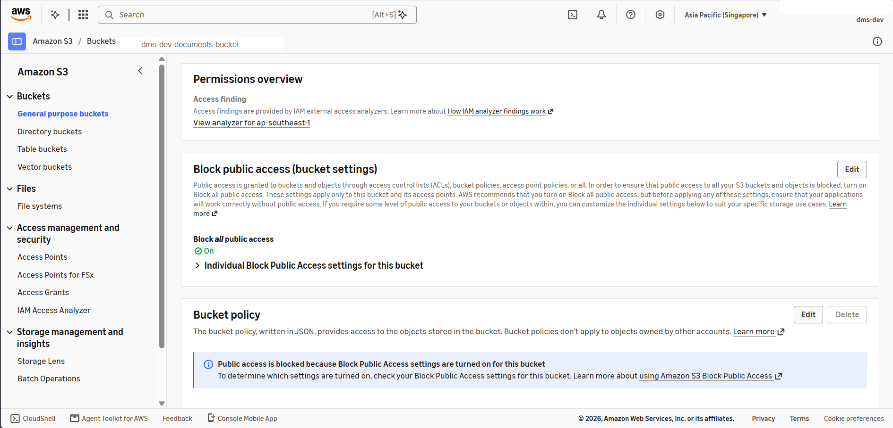
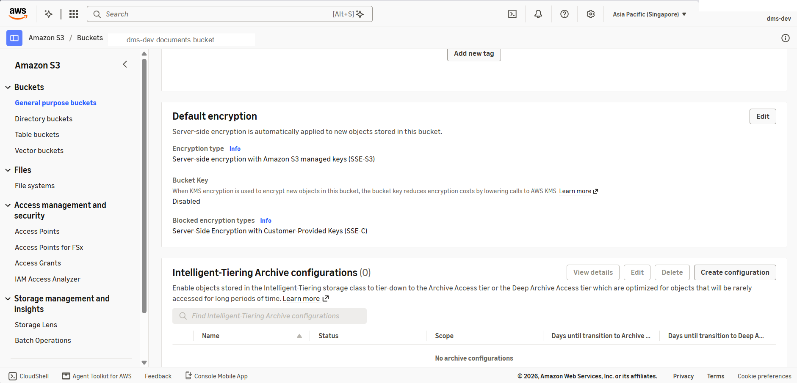

{}
This page records the deployed implementation and observed results. Any unverified behavior is identified explicitly.
{}

## Objective

Create the file bucket with public access blocked and encryption enabled.

## Implementation steps

1. Deploy the SAM stack from section 5.1.3; the template creates the Documents bucket and generates its unique name. Do not create a duplicate bucket or use the example name.
2. In CloudFormation → stack → Outputs, get `DocumentsBucketName`; use Resources to open `DocumentsBucket` in the S3 Console.
3. In Permissions, confirm all four Block Public Access controls are enabled and there is no public bucket policy/ACL. In Properties, confirm default SSE-S3 (AES-256) encryption.
4. Keep the bucket private. Enable versioning only if version lifecycle and deletion of all object versions/delete markers are also planned.

## Deployment evidence

The deployed bucket uses server-side encryption with Amazon S3 managed keys (SSE-S3). These screenshots confirm the Singapore Region, Block Public Access, and default encryption. Upload/download through presigned URLs is recorded in section 5.8.2.

## Expected result

The deployed documents bucket remains private with Block Public Access and SSE-S3 enabled.

## Troubleshooting

- Add a random suffix if the bucket name is already taken.
- Do not disable public access controls to work around upload errors.
