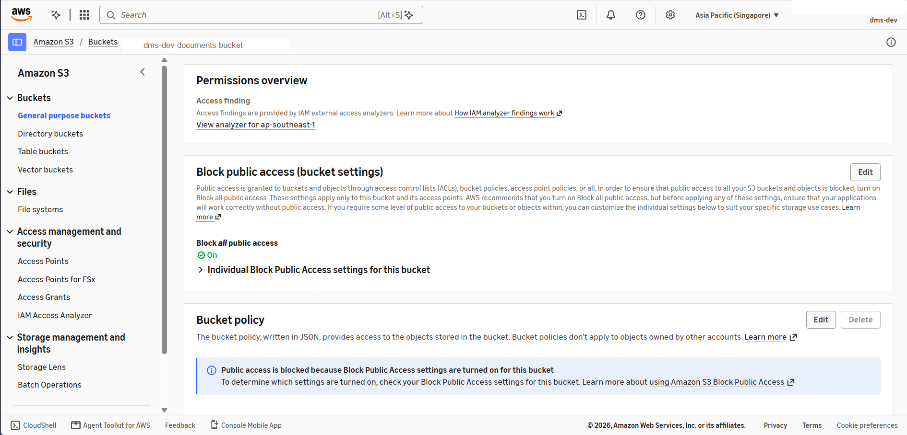
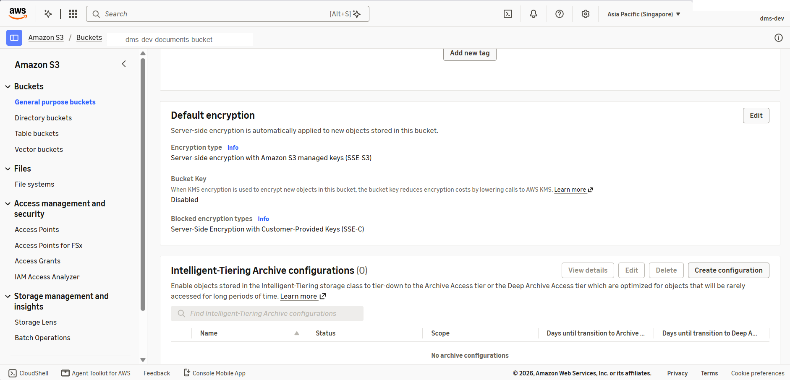

{}
Trang này ghi nhận cấu hình đã triển khai và kết quả đã quan sát; hành vi chưa xác minh được nêu rõ.
{}

## Mục tiêu

Tạo bucket file với public access bị chặn và mã hóa được bật.

## Các bước thực hiện

1. Tạo bucket duy nhất toàn cầu như `unicloud-dms-dev-your-unique-suffix` tại Region đã chọn.
2. Giữ bật toàn bộ Block Public Access và mã hóa mặc định.
3. Không thêm public-read ACL hay bucket policy công khai. Giữ object tài liệu riêng tư.
4. Chỉ bật versioning nếu ứng dụng và quy trình cleanup đã tính đến version cũ.

## Minh chứng triển khai

Bucket đang triển khai dùng mã hóa phía máy chủ bằng khóa Amazon S3 quản lý (SSE-S3). Ảnh xác nhận Region Singapore, Block Public Access và mã hóa mặc định. Upload/download bằng presigned URL được ghi ở mục 5.8.2.

## Kết quả mong đợi

Documents bucket đã triển khai vẫn riêng tư, bật Block Public Access và SSE-S3.

## Khắc phục sự cố

- Thêm suffix ngẫu nhiên nếu tên bucket đã được sử dụng.
- Không tắt chặn public access để né lỗi upload.
