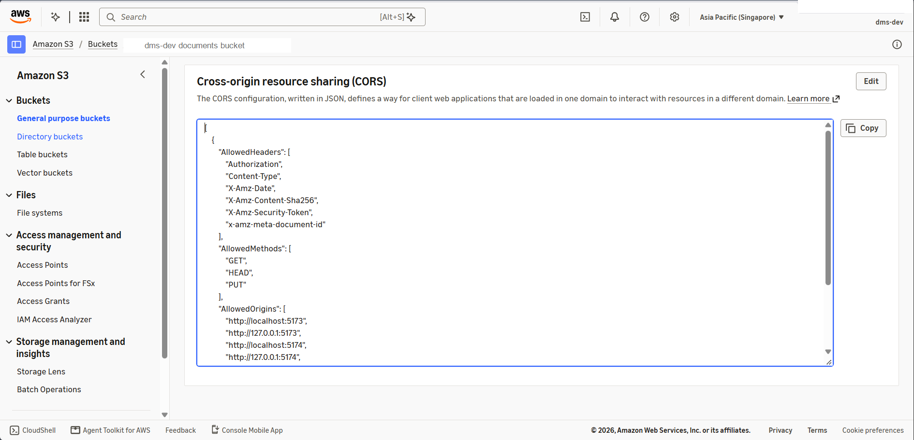

{}
The deployed bucket CORS configuration is captured below. The frontend's presigned upload and download flows are recorded in section 5.8.2.
{}

## Objective

Allow only the frontend origins needed for direct browser upload/download while keeping S3 private.

## Implementation steps

1. Add exact origins to the SAM stack's `AllowedFrontendOrigins`: local Vite and `https://<amplify-domain>`. Update the stack after the Amplify domain exists; the template applies the list to the HTTP API and bucket CORS.
2. In S3 Console → bucket → Permissions → CORS, compare GET/HEAD/PUT and the required signing/content-type headers. Do not use `*` for the production origin.
3. Upload flow: the frontend sends file details to Lambda; Lambda verifies the Cognito caller, creates the key server-side, and returns a short-lived PUT presigned URL. The browser PUTs directly to S3 using the signed Content-Type, then calls the complete API; Lambda uses HeadObject before writing DynamoDB metadata.
4. Download flow: the API verifies owner or active-share access, then returns a short-lived GET presigned URL. Never log or share the URL.

## Evidence

The S3 CORS configuration allows `GET`, `HEAD`, and `PUT`, with the required authorization, content-type, and signing headers. Its deployed `AllowedFrontendOrigins` parameter, including the Amplify origin, is shown in section 5.9.2. Upload and download results are documented in section 5.8.2.

## Expected result

The browser can transfer a test file through presigned URLs without making the bucket public.

## Troubleshooting

- Check origin, method, headers, URL expiration, and signed content type for failures.
- CORS is not authorization; the backend must still verify permissions.
