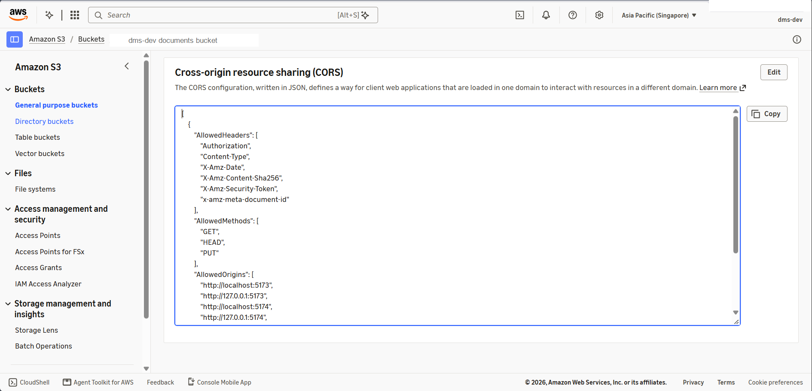

{}
Cấu hình CORS của bucket đang triển khai được chụp bên dưới. Luồng upload/download bằng presigned URL từ frontend được ghi nhận ở mục 5.8.2.
{}

## Mục tiêu

Chỉ cho phép frontend origin cần thiết upload/download trực tiếp từ trình duyệt, đồng thời giữ S3 riêng tư.

## Các bước thực hiện

1. Cấu hình S3 CORS cho đúng Vite origin cục bộ và Amplify origin triển khai; chỉ cho phép method/header cần thiết.
2. Lambda xác minh danh tính, dung lượng, loại file và metadata trước khi trả PUT URL ngắn hạn với key do server tạo.
3. Trình duyệt upload với content type đã ký; endpoint hoàn tất xác minh object trước khi chốt metadata.
4. Khi download, Lambda kiểm tra quyền owner/share còn hiệu lực rồi cấp GET URL ngắn hạn. Không log hay công khai URL.

## Minh chứng

Cấu hình CORS S3 cho phép `GET`, `HEAD`, `PUT` cùng các header authorization, content type và signing cần thiết. Parameter `AllowedFrontendOrigins` đang triển khai, gồm origin Amplify, được chụp ở mục 5.9.2. Kết quả upload/download được ghi nhận tại mục 5.8.2.

## Kết quả mong đợi

Trình duyệt truyền được file thử nghiệm qua presigned URL mà không public bucket.

## Khắc phục sự cố

- Khi lỗi, kiểm tra origin, method, header, thời hạn URL và content type đã ký.
- CORS không phải phân quyền; backend vẫn phải xác minh quyền.
