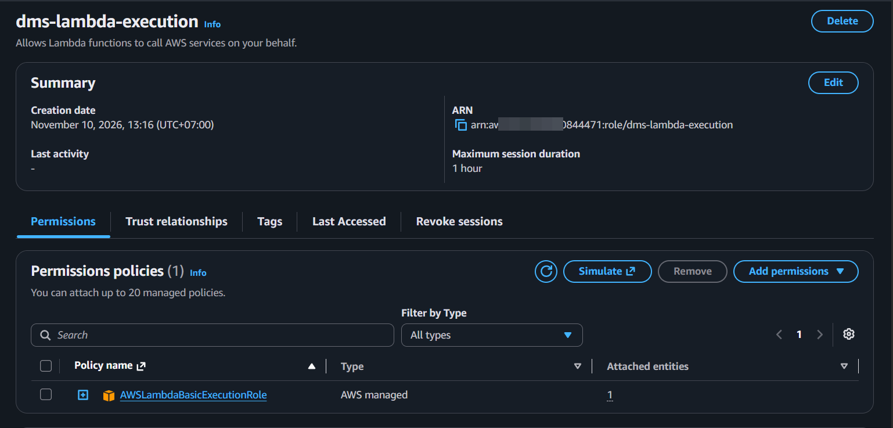
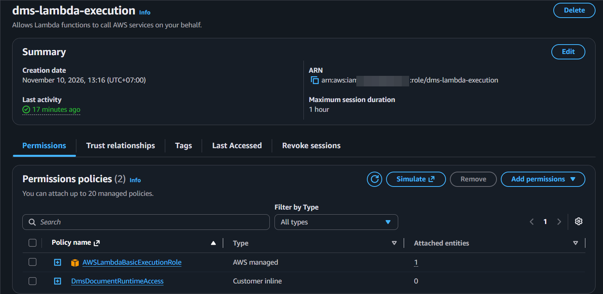

{}
This page records the deployed implementation and observed results. Any unverified behavior is identified explicitly.
{}

## Objective

Create a dedicated Lambda execution role and grant permissions according to the function's actual needs.

## Implementation steps

1. In IAM, create `dms-lambda-execution` with Lambda as its trusted entity.
2. Attach the AWS managed `AWSLambdaBasicExecutionRole` policy so functions can write to CloudWatch Logs.
3. The role permissions page showed the inline policy `DmsDocumentRuntimeAccess`. The policy source in `backend/iam/lambda-runtime-policy.ap-southeast-1.json` scopes DynamoDB tables/indexes, the document object prefix in S3, and Cognito recipient lookup. The `dms-dev` user was later denied `iam:GetRole`, so the live policy contents could not be independently re-opened during this review.
4. The deployment group's inline `DmsPassLambdaExecutionRole` policy allows passing only this role to Lambda; it does not grant `iam:PassRole` on every role.

## Screenshots

## Expected result

The captured role permissions page shows `AWSLambdaBasicExecutionRole` and `DmsDocumentRuntimeAccess`. The local policy source is resource-scoped. Protected document operations were subsequently exercised; live policy contents remain unverified because IAM denied `iam:GetRole`.

## Troubleshooting

- Verify Region and resource ARN when a valid operation is denied.
- Do not share workshop roles with unrelated production workloads.
