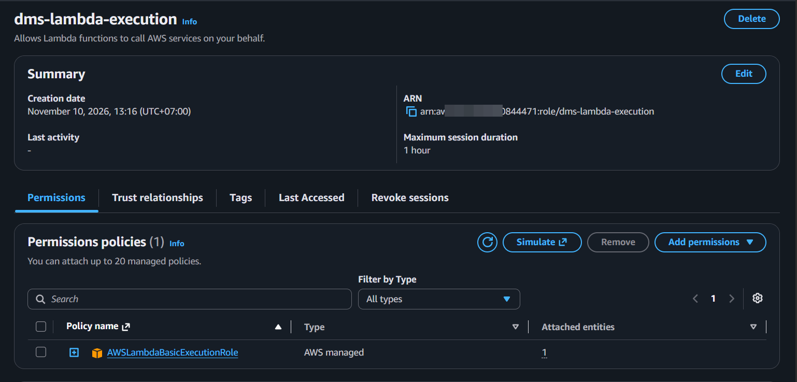
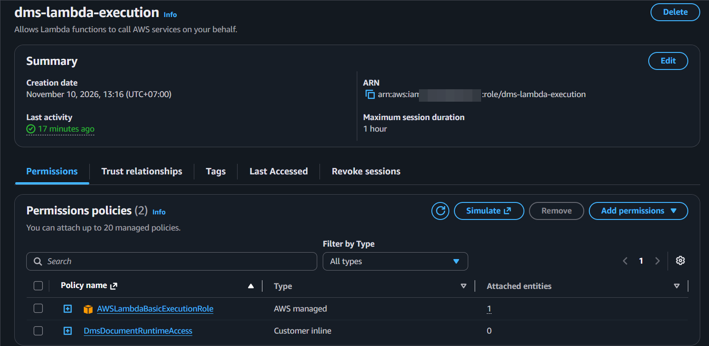

{}
Trang này ghi nhận cấu hình đã triển khai và kết quả đã quan sát; hành vi chưa xác minh được nêu rõ.
{}

## Mục tiêu

Tạo execution role riêng cho Lambda và cấp quyền theo nhu cầu thực tế của function.

## Các bước thực hiện

1. Tạo execution role theo mục 5.1.3 với trusted entity Lambda và policy `AWSLambdaBasicExecutionRole` để ghi CloudWatch Logs. Lấy ARN vì SAM yêu cầu parameter `LambdaExecutionRoleArn`.
2. Deploy stack trước để sinh tên bảng, bucket và User Pool. Sau đó thay placeholder trong `backend/iam/lambda-runtime-policy.template.json` bằng đúng ARN/tên resource lấy từ Outputs và gắn policy runtime vào role.
3. Mở IAM → Roles → role của Lambda → Permissions để xem policy. Giữ quyền ở đúng ba DynamoDB table/index, prefix tài liệu trong S3 và User Pool của project.
4. Danh tính triển khai cần `iam:PassRole` giới hạn cho role này và Lambda. Không gắn quyền IAM rộng vào Lambda role.

## Vị trí ảnh chụp màn hình

## Kết quả mong đợi

Ảnh trang quyền role xác nhận `AWSLambdaBasicExecutionRole` và `DmsDocumentRuntimeAccess` đã được gắn vào `dms-lambda-execution`. File policy runtime trong repo giới hạn quyền theo resource. Các thao tác tài liệu có kiểm tra quyền đã được thực hiện và ghi ở mục 5.7.2, 5.8.2 và 5.10.

## Khắc phục sự cố

- Kiểm tra Region và ARN khi thao tác hợp lệ bị từ chối.
- Không dùng chung role workshop cho workload production không liên quan.
