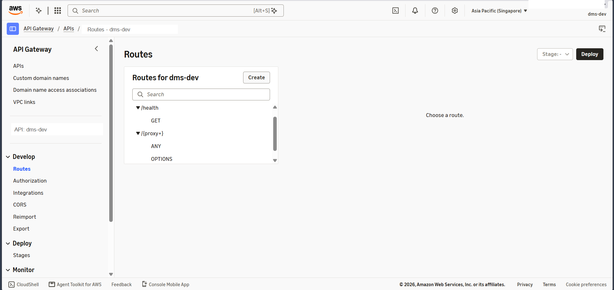
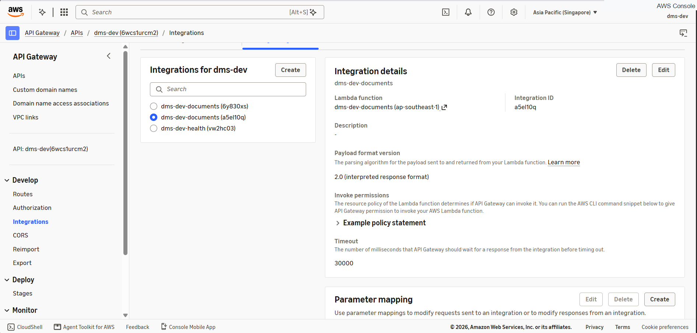

{}
This page records the deployed implementation and observed results. Any unverified behavior is identified explicitly.
{}

## Objective

Connect API Gateway routes to their intended Lambda integrations.

## Implementation steps

1. Create an HTTP API in the same Region as Lambda and Cognito.
2. Add integrations/routes matching section 5.2.2 and the service layer. Record the API invoke URL and stage.
3. Ensure API Gateway has permission to invoke the selected Lambda functions.
4. Keep route methods, path parameters, and response expectations consistent with frontend code.

## Deployed routes and integrations

The deployed API exposes `GET /health` through its dedicated `dms-dev-health` Lambda integration; document routes are dispatched through `ANY /{proxy+}` to `dms-dev-documents`, and `OPTIONS /{proxy+}` serves CORS preflight. Both Lambda integrations use payload format `2.0` and a 30,000 ms timeout.

## Expected result

The deployed `$default` stage routes health checks to `dms-dev-health` and document requests to `dms-dev-documents`; browser/API results are recorded in section 5.7.2 and 5.8.2.

## Troubleshooting

- Inspect stage, method, route key, and integration when a request returns 404 or 500.
- Do not create undocumented routes that the frontend never uses.
