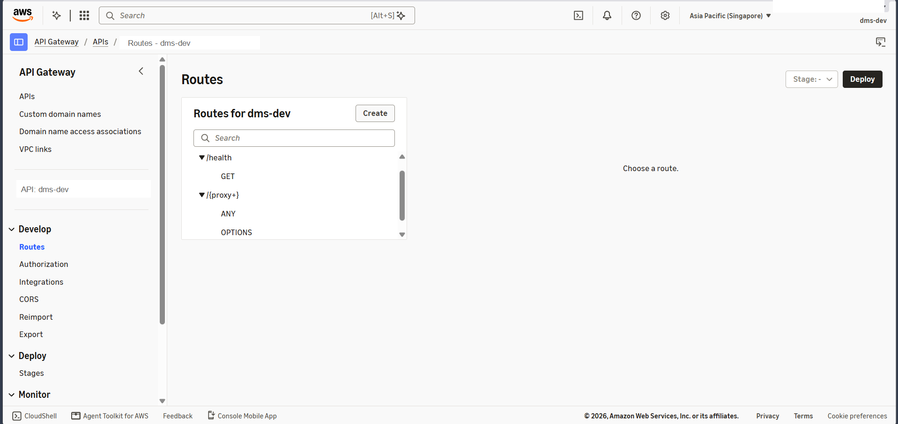
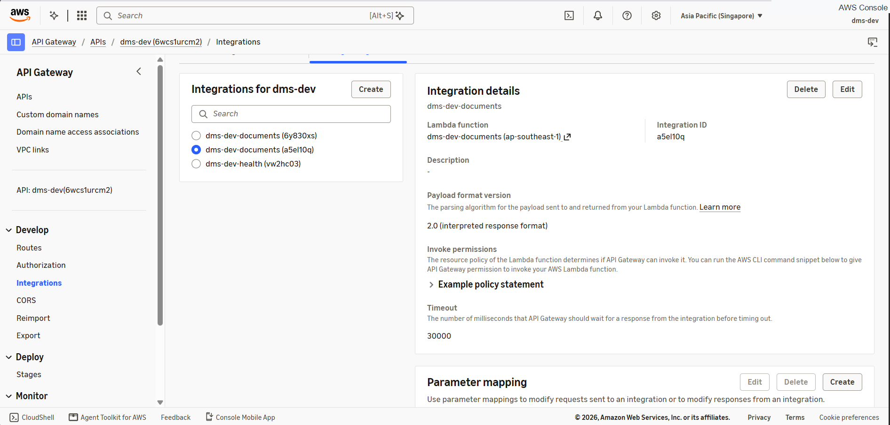

## Mục tiêu

Kiểm tra API Gateway routes và Lambda integrations do SAM tạo.

## Các bước thực hiện

Hoàn thành từng bước theo thứ tự. Đọc thao tác, phần giải thích và kết quả cần xác nhận trước khi chuyển sang bước kế tiếp.

### Bước 1: Deploy SAM stack tại mục 5.1.3

Deploy SAM stack tại mục 5.1.3; template tạo HTTP API, stage và Lambda integrations, không tạo API thủ công trùng.

### Bước 2: Trong CloudFormation → stack → Resources, mở DocumentsApi

Trong CloudFormation → stack → Resources, mở `DocumentsApi` để vào API Gateway. Trong Routes, đối chiếu `GET /health`, `ANY /{proxy+}` và `OPTIONS /{proxy+}`; trong Integrations xác nhận health và document Lambda riêng.

### Bước 3: Mở Stages, xác nhận $default

Mở Stages, xác nhận `$default`; lấy `ApiBaseUrl` từ Outputs. Template dùng payload format 2.0 và cấu hình timeout theo SAM.

### Bước 4: Nếu thay route hoặc handler, sửa backend/template.yaml

Nếu thay route hoặc handler, sửa `backend/template.yaml`, validate/build/deploy lại bằng SAM và xem change set. Giữ route khớp với `src/services`.

## Route và integration đang triển khai

API đã triển khai có `GET /health` gọi Lambda integration riêng `dms-dev-health`; các document route được dispatch qua `ANY /{proxy+}` đến `dms-dev-documents`, còn `OPTIONS /{proxy+}` xử lý CORS preflight. Cả hai Lambda integration dùng payload format `2.0` và timeout 30.000 ms.

## Kết quả mong đợi

Stage `$default` đang định tuyến health check tới `dms-dev-health`, document request tới `dms-dev-documents`; kết quả trình duyệt/API được ghi ở mục 5.7.2 và 5.8.2.

## Khắc phục sự cố

- Kiểm tra stage, method, route key và integration khi request trả 404/500.
- Không tạo route ngoài tài liệu mà frontend không dùng.
