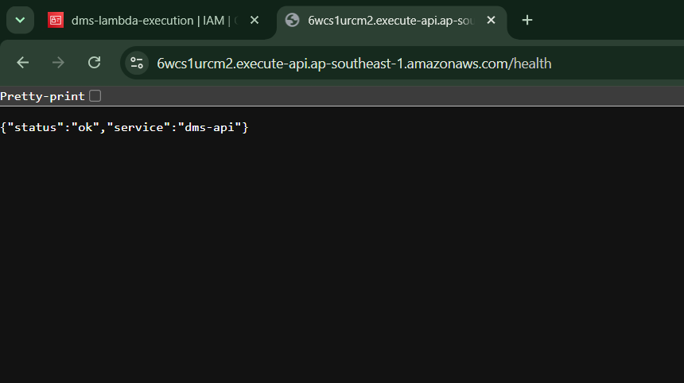
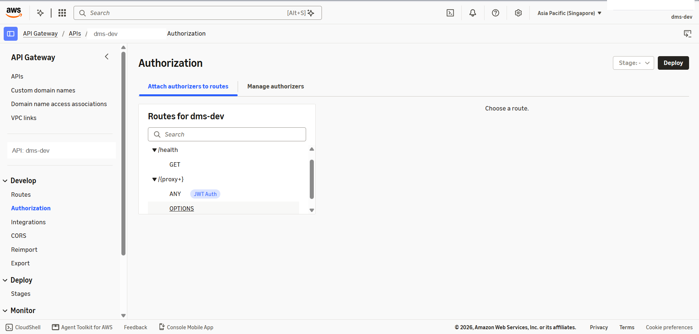
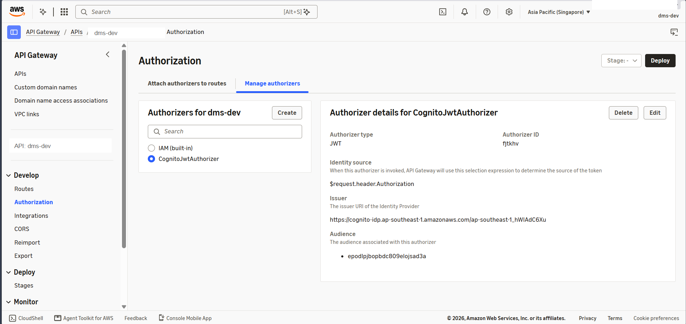
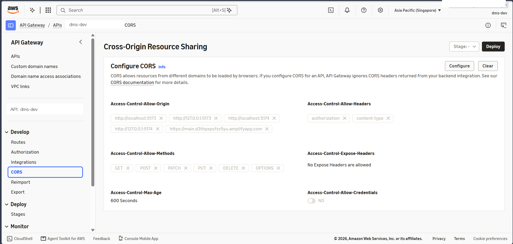
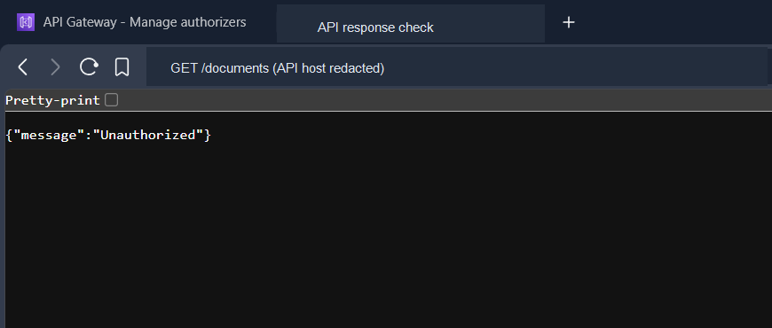
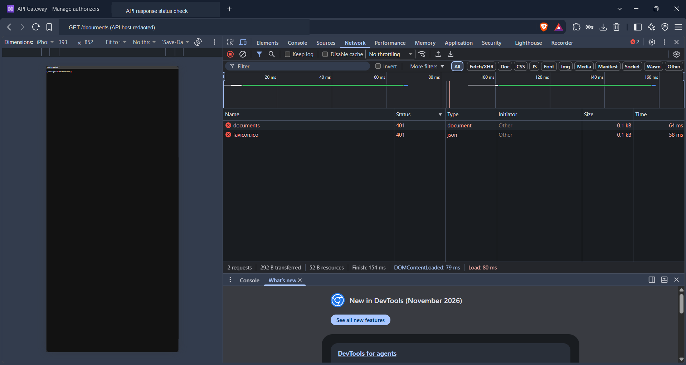
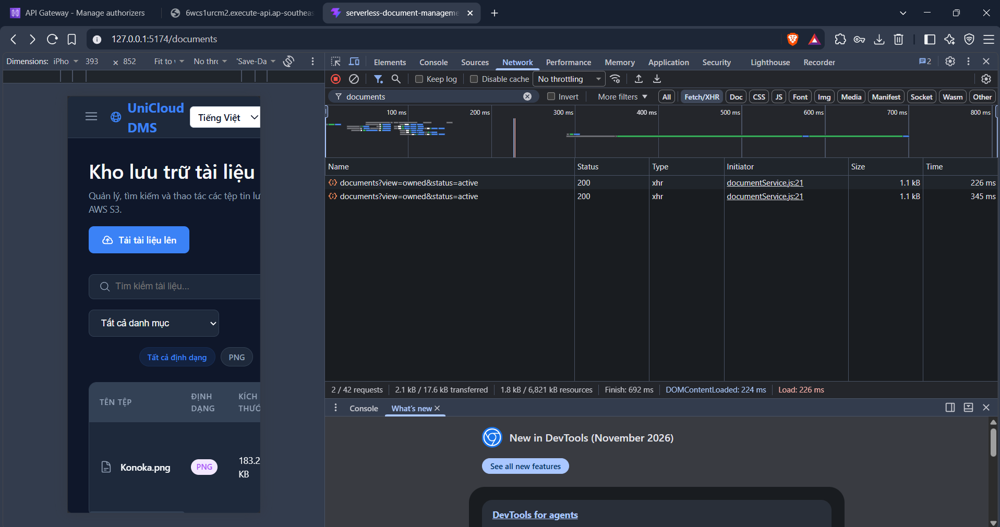
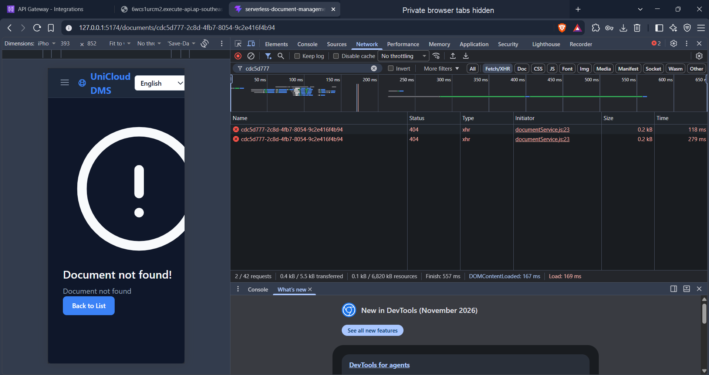

{}
The deployed Cognito JWT authorizer, API Gateway CORS settings, unauthenticated rejection, authenticated document listing, and cross-account document access denial have been verified.
{}

## Objective

Require valid Cognito tokens and check CORS without confusing it with authorization.

## Implementation steps

Follow the steps in order. Read the action, its explanation, and the expected check before moving to the next step.

### Step 1: Review Auth in backend/template.yaml: the JWT issuer is

Review `Auth` in `backend/template.yaml`: the JWT issuer is built from the Region/User Pool, and the audience is the Cognito web App Client ID. SAM applies the default authorizer to the proxy route.

### Step 2: In API Gateway → API → Authorization/Routes, confirm the

In API Gateway → API → Authorization/Routes, confirm the document proxy requires Cognito JWT. Only `GET /health` and `OPTIONS /{proxy+}` are unauthenticated by design.

### Step 3: Keep AllowedFrontendOrigins limited to local Vite and the

Keep `AllowedFrontendOrigins` limited to local Vite and the actual Amplify domain; the template allows Authorization/Content-Type and the methods used by the app.

### Step 4: Change the template and redeploy with SAM

Change the template and redeploy with SAM; review routes/auth/CORS after the stack update. Do not enable CORS credentials when the frontend does not use cookies.

## Screenshot and remaining evidence

The `ANY /{proxy+}` route has the Cognito JWT authorizer attached. `GET /health` and `OPTIONS /{proxy+}` are unauthenticated for health checks and CORS preflight, respectively.

The authorizer reads the bearer token from the `Authorization` header, uses the deployed Cognito User Pool issuer, and checks the web app client as its audience.

API Gateway CORS allows the local Vite origins and production Amplify origin, the required HTTP methods and `authorization`/`content-type` headers, with a 600-second max age and credentials disabled.

The deployed `AllowedFrontendOrigins` parameter is also shown in section 5.9.2.

An unauthenticated `GET /documents` request returned `{"message":"Unauthorized"}`.

The Network panel confirmed this unauthenticated request returned HTTP `401`.

The signed-in local frontend made two `GET /documents?view=owned&status=active` requests; both returned HTTP `200` and the document list showed `Konoka.png`.

Signed in as the other Cognito user, a direct request for the owner's unshared document returned HTTP `404`; the UI displayed “Document not found.” The same request appeared twice in Network, both with status `404`. The API intentionally uses not-found responses for documents outside the caller's access to avoid confirming whether they exist.

## Expected result

Protected routes reject missing/invalid tokens and Lambda denies unauthorized resource access.

## Troubleshooting

- 401 usually concerns authentication; 403 usually concerns authorization—check the actual response.
- CORS permits browser cross-origin calls but does not grant access to a document.
