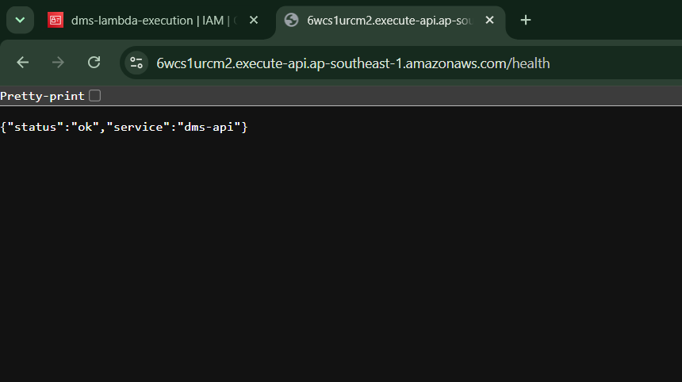
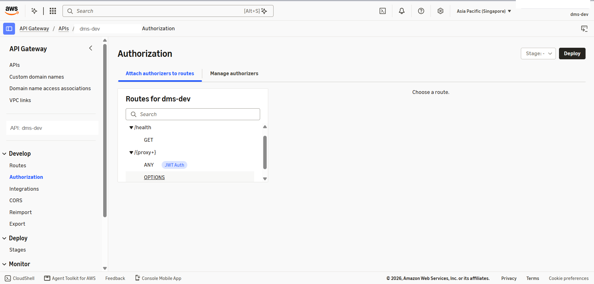
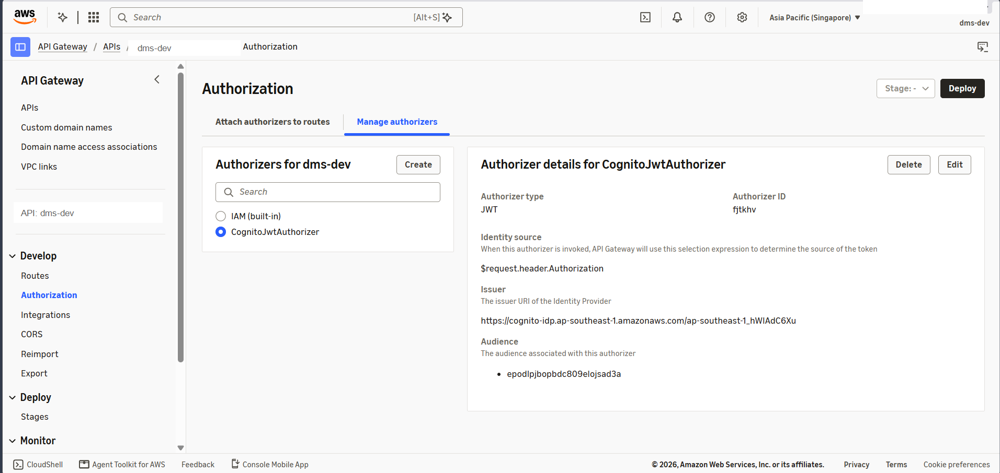
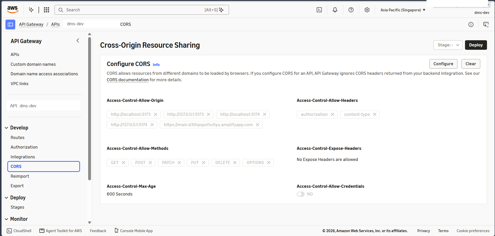
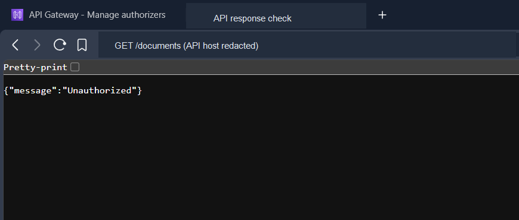
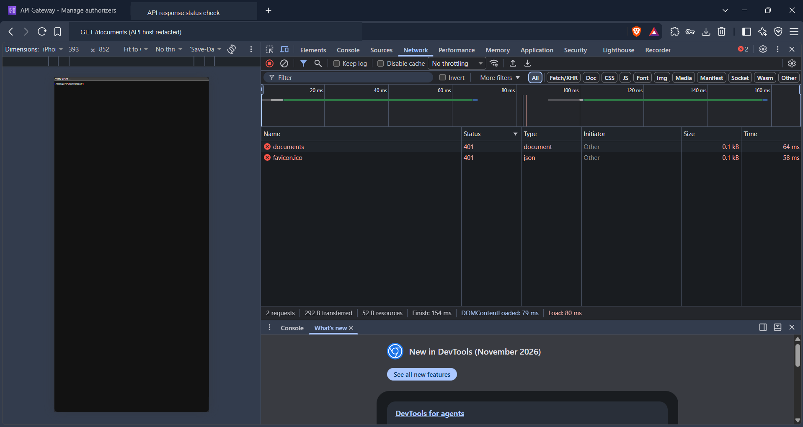
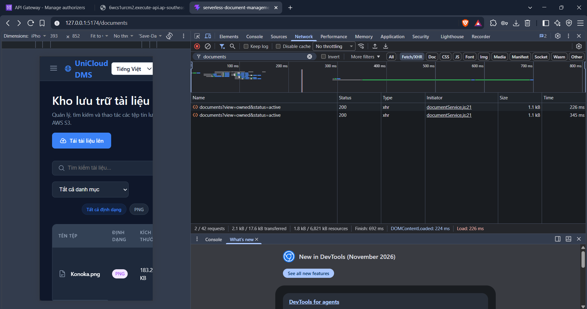
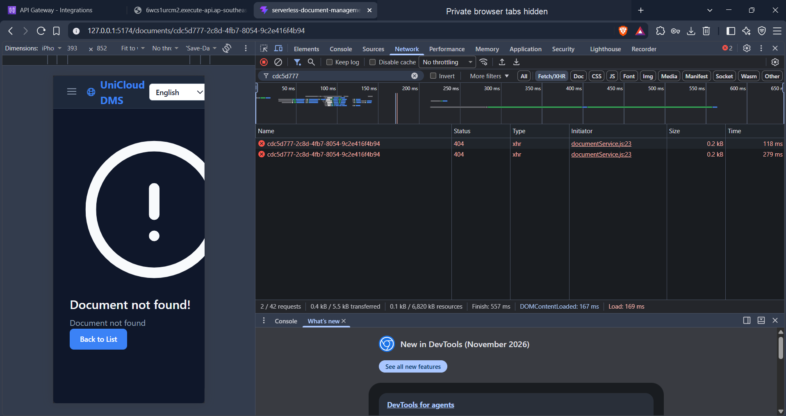

{}
Cognito JWT authorizer đã triển khai, cấu hình CORS API Gateway, từ chối request chưa xác thực, cho phép truy vấn tài liệu đã xác thực và chặn truy cập tài liệu khác tài khoản đã được xác minh.
{}

## Mục tiêu

Yêu cầu token Cognito hợp lệ và kiểm tra CORS nhưng không nhầm CORS với phân quyền.

## Các bước thực hiện

1. Cấu hình JWT authorizer bằng Cognito issuer URL và app client ID làm audience.
2. Gắn authorizer cho mọi route đọc hoặc thay đổi tài liệu người dùng.
3. Chỉ cho phép frontend origin local/deployed, method và header Authorization/Content-Type cần thiết.
4. Kiểm thử request thiếu token, token hợp lệ và người đã đăng nhập nhưng không có quyền tài liệu. Ghi status code và request ID.

## Vị trí ảnh chụp màn hình

Route `ANY /{proxy+}` đã gắn Cognito JWT authorizer. `GET /health` và `OPTIONS /{proxy+}` không yêu cầu đăng nhập để phục vụ health check và CORS preflight.

Authorizer lấy bearer token từ header `Authorization`, dùng Cognito User Pool issuer đang triển khai và kiểm tra audience là web app client.

API Gateway CORS cho phép các Vite origin local và Amplify origin production, các HTTP method/header cần thiết `authorization`/`content-type`, max-age 600 giây và tắt credentials.

Parameter `AllowedFrontendOrigins` đang triển khai cũng được chụp ở mục 5.9.2.

Request `GET /documents` không xác thực trả về `{"message":"Unauthorized"}`.

Network panel xác nhận request không xác thực trả về HTTP `401`.

Frontend local sau khi đăng nhập gửi hai request `GET /documents?view=owned&status=active`; cả hai đều trả về HTTP `200` và danh sách hiển thị `Konoka.png`.

Đăng nhập bằng tài khoản Cognito còn lại và gửi request trực tiếp tới tài liệu riêng chưa chia sẻ của chủ sở hữu, API trả HTTP `404`; giao diện hiển thị “Document not found.” Network ghi nhận hai lần request, cả hai đều có status `404`. API cố ý trả not-found cho tài liệu ngoài quyền truy cập để không xác nhận tài liệu đó có tồn tại hay không.

## Kết quả mong đợi

Route được bảo vệ từ chối token thiếu/không hợp lệ và Lambda chặn truy cập tài nguyên trái quyền.

## Khắc phục sự cố

- 401 thường liên quan xác thực; 403 thường liên quan phân quyền—hãy kiểm tra response thật.
- CORS cho phép browser gọi cross-origin nhưng không cấp quyền vào tài liệu.
