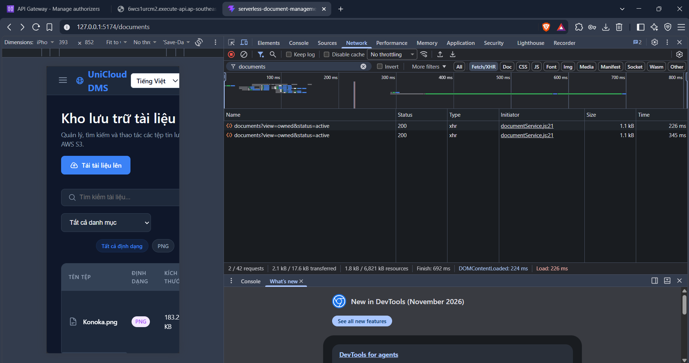
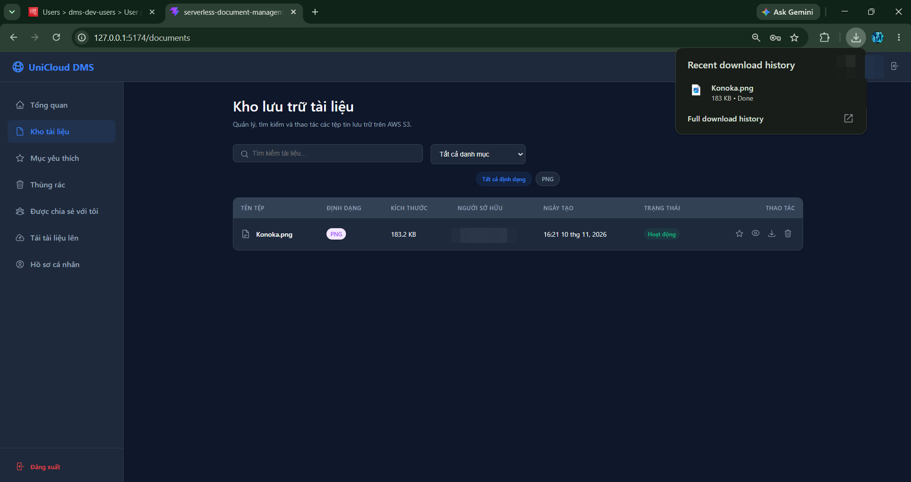
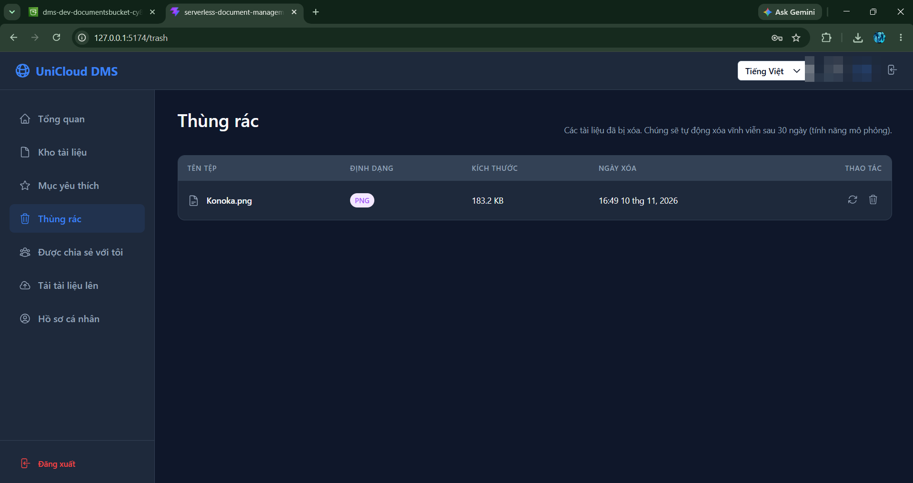
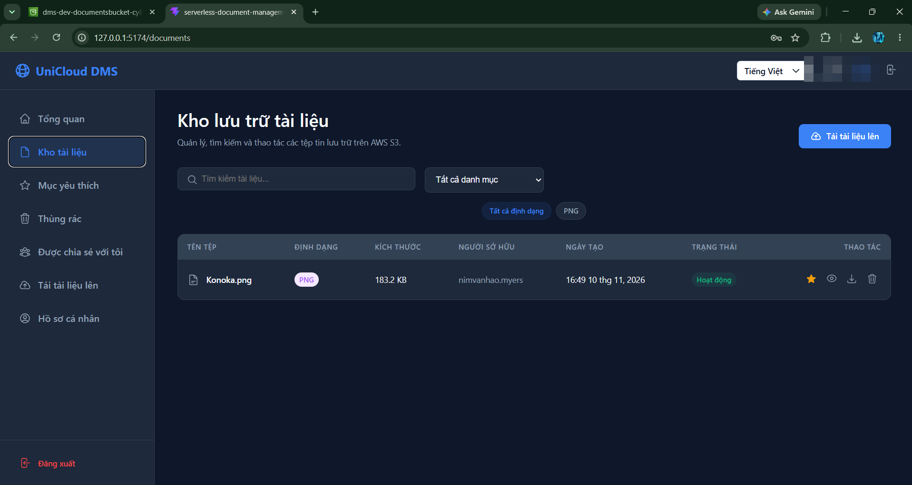
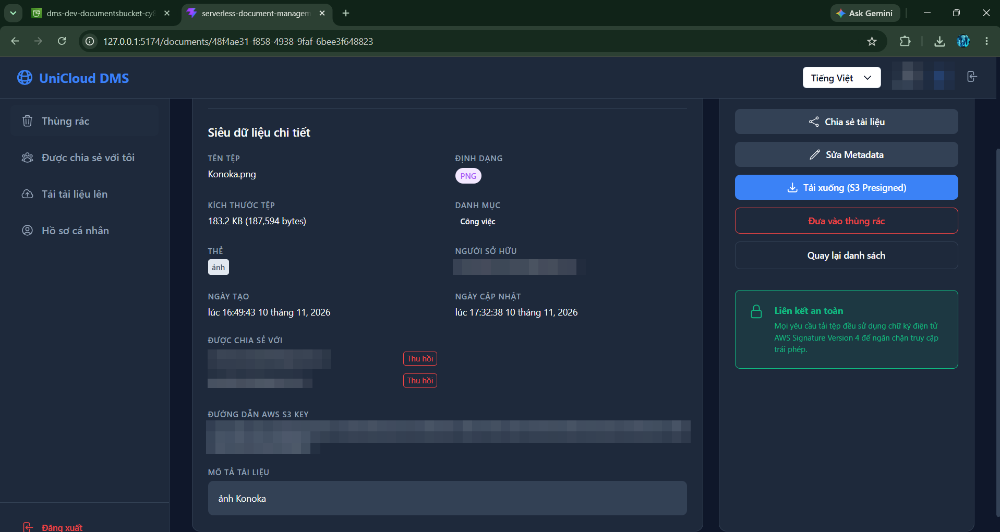

{}
Frontend services target the deployed AWS API. The `dms-dev` stack update completed successfully. Cognito sign-up/sign-in, upload/download, Favorites, Trash/restore, metadata changes, and document sharing between two Cognito accounts were exercised. Additional test limits are recorded in section 5.10.
{}

## Objective

Move document reads/writes to the backend and test upload/download and all existing features.

## Feature verification walkthrough

The application repository already contains the frontend/API integration. If you are using this source version, you do not need to rewrite the service layer. Complete section 5.8.1 first, then follow the actions below. The screenshots at the end of this page show results from the earlier verification run.

### Step 1: Sign in and upload a test file

Sign in with a confirmed Cognito account. In **Documents**, upload a supported sample file smaller than 20 MiB. Wait for the upload to finish. The expected result is that the file appears in the list with `Active` status.

The app performs this flow: the frontend requests a presigned URL from the API, the browser PUTs the file directly to S3, and the frontend calls the completion API. Lambda verifies the object and writes its metadata to DynamoDB. Do not upload the file manually in the S3 Console as a substitute for this test.

### Step 2: Download the uploaded file

Select the file and choose **Download**. The API validates the Cognito ID token and access permission before issuing a presigned URL. The expected result is that the file downloads and opens. Do not share the presigned URL because it grants temporary access.

### Step 3: Update metadata and add the file to Favorites

Open the file details, choose the metadata edit action, change its category, description, or tags, and save. Reload the details page to confirm the values persist. Select the star control to add the file to **Favorites**, then open Favorites and confirm it appears.

### Step 4: Move the file to Trash and restore it

From **Documents**, move the file to **Trash**. Open Trash and confirm the file appears there and is no longer in the active list. Choose **Restore**, return to Documents, and confirm the file is back with `Active` status.

### Step 5: Test sharing with a second account

Sign in as the owner, open the file's sharing action, and enter the email address of a second registered Cognito account. Sign out, then sign in as the recipient. Open **Shared With Me**, confirm the file appears, and try downloading it. The recipient should be able to download, but should not be able to edit or delete the owner's file. Section 5.10.2 records this workflow separately.

### Step 6: Check the API request and remaining features

Open Developer Tools → **Network**, refresh Documents, and select `GET /documents?view=owned&status=active`. An authenticated request should return HTTP `200`. Also check category filtering, tag search, and language selection as described in section 5.10.3.

If upload returns `403`, inspect CORS and request headers in section 5.5.2. This project signs `x-amz-meta-document-id` into the presigned URL, so the frontend sends only `Content-Type` with the PUT request and does not resend the metadata header.

## Screenshots and remaining evidence

The deployment terminal capture was not retained. The deployed stack outputs are recorded in section 5.9.2, and application-level API results are recorded below and in section 5.10.

## Expected result

Frontend build and stack update succeeded. Browser verification confirmed end-to-end upload to S3, Lambda/DynamoDB metadata persistence, download through a presigned URL, Favorites, Trash/restore, sharing and recipient download, and metadata updates.

## Troubleshooting

- If S3 returns `403` for an unsigned header, check that `x-amz-*` headers are signed or embedded in the presigned URL; do not duplicate metadata as a request header.
- Do not make S3 public to work around upload/download errors.
