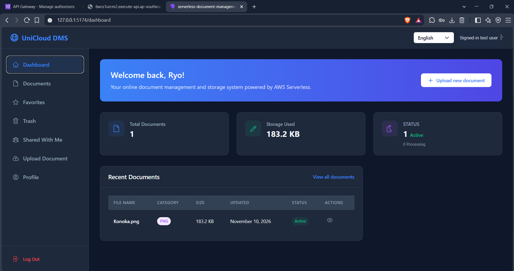
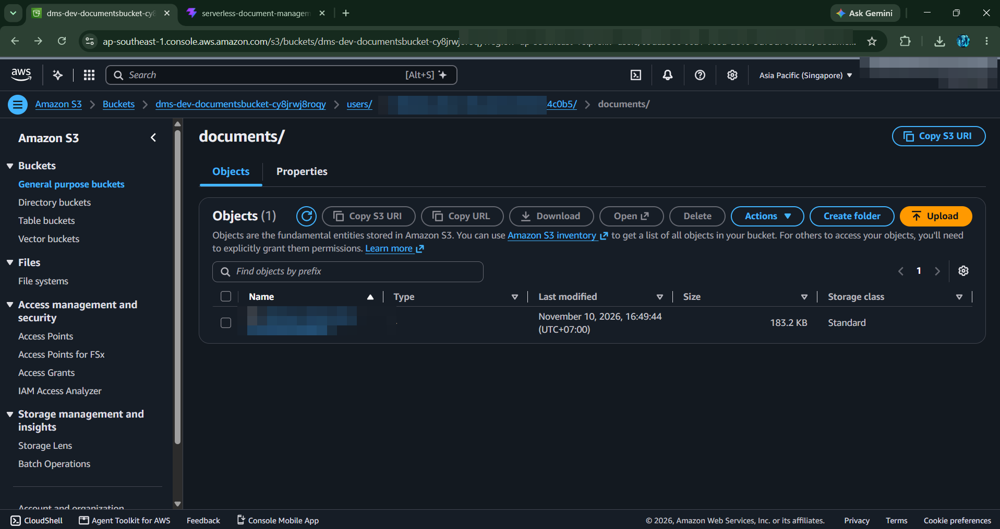
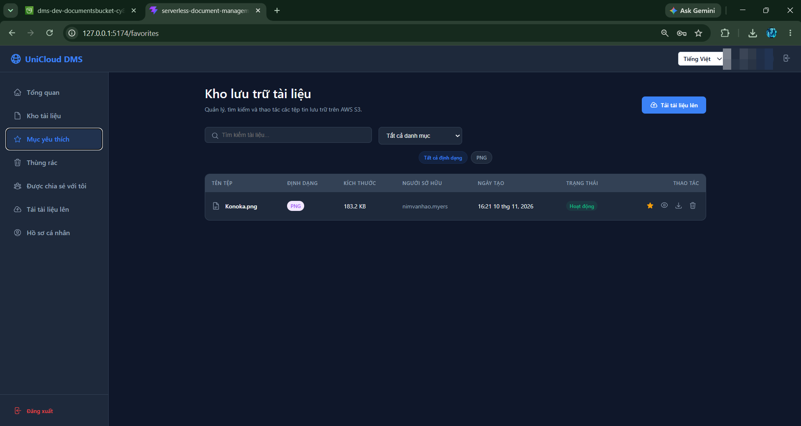
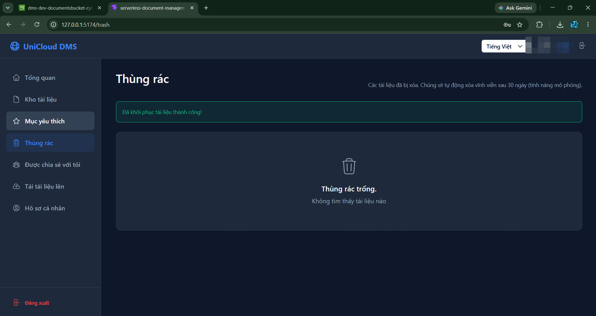
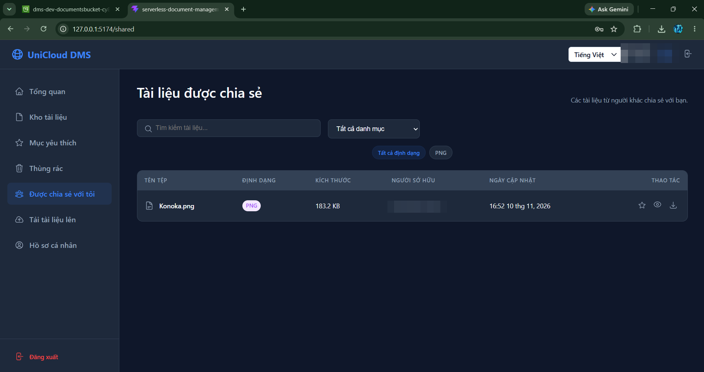
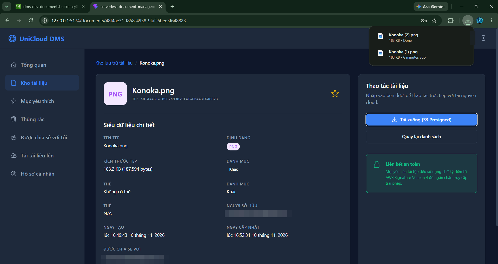
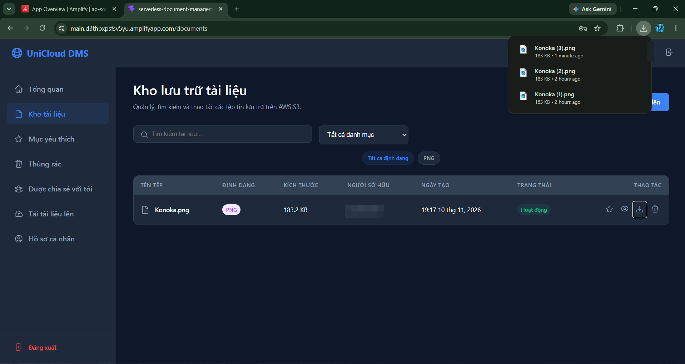

{}
Frontend services target the deployed AWS API. The `dms-dev` stack update completed successfully. Cognito sign-up/sign-in, upload/download, Favorites, Trash/restore, metadata changes, and document sharing between two Cognito accounts were exercised. Additional test limits are recorded in section 5.10.
{}

## Objective

Move document reads/writes to the backend and test upload/download and all existing features.

## Implementation steps

1. The service layer calls API Gateway for document lists/details, favorites, sharing, Trash, metadata updates, and deletion.
2. Upload uses three steps: request a presigned URL, PUT directly to S3 with Content-Type, then call the completion endpoint for Lambda to verify the object and write metadata to DynamoDB. The `x-amz-meta-document-id` metadata is already embedded in the presigned URL, so the frontend must not send it again as a header.
3. Downloads use a presigned URL issued by the API after its permission check. API routes require a Cognito ID token.
4. The frontend production build succeeded. Cognito sign-up/sign-in, API presigned URL issuance, direct upload of `Konoka.png` to S3, and its appearance in the document list with `Active` status were verified, confirming the completion API/DynamoDB metadata flow. Downloading `Konoka.png` through a presigned URL also succeeded; the browser marked the 183 KB file as done and it opened successfully.
5. Added an unauthenticated `OPTIONS /{proxy+}` route for CORS preflight; stack `dms-dev` reached `UPDATE_COMPLETE`. When S3 PUT returned 403, its response identified an unsigned request header. Since the URL already contained the metadata, the frontend was changed to send only Content-Type. The subsequent upload succeeded.
6. Marked `Konoka.png` as a favorite; it appeared on the Favorites page with the star enabled.
7. Re-uploaded `Konoka.png` after an earlier accidental permanent deletion. Used the Move to Trash action from Documents; the file appeared in Trash with its filename, PNG format, and 183.2 KB size.
8. Successfully restored `Konoka.png` from Trash. The Trash list became empty and the document reappeared in Documents with `Active` status.
9. Shared `Konoka.png` with a second Cognito account. After signing in as the recipient, the document appeared under **Shared With Me**, including its filename, PNG format, 183.2 KB size, and owner. This verifies the sharing API and the recipient's shared-document query.
10. From the recipient account, opened the document details and downloaded `Konoka.png` using an S3 presigned URL. The browser marked `Konoka (1).png` (183 KB) as complete, confirming that the recipient can access the file contents.
11. Updated `Konoka.png` metadata by changing its category to **Work** and description to **ảnh Konoka**. After saving, the detail page showed the new values; the screenshot also confirms the category and tags are no longer duplicated.
12. Configured `VITE_S3_BUCKET_NAME` in `.env.local` with the `dms-dev` stack bucket so the S3 path on the detail page no longer uses the sample bucket name.
13. With the local frontend signed in, opened Documents and inspected Network. Both `GET /documents?view=owned&status=active` requests returned **HTTP 200**, and `Konoka.png` appeared in the list.

## Screenshots and remaining evidence

The deployment terminal capture was not retained. The deployed stack outputs are recorded in section 5.9.2, and application-level API results are recorded below and in section 5.10.

## Expected result

Frontend build and stack update succeeded. Browser verification confirmed end-to-end upload to S3, Lambda/DynamoDB metadata persistence, download through a presigned URL, Favorites, Trash/restore, sharing and recipient download, and metadata updates.

## Troubleshooting

- If S3 returns `403` for an unsigned header, check that `x-amz-*` headers are signed or embedded in the presigned URL; do not duplicate metadata as a request header.
- Do not make S3 public to work around upload/download errors.
