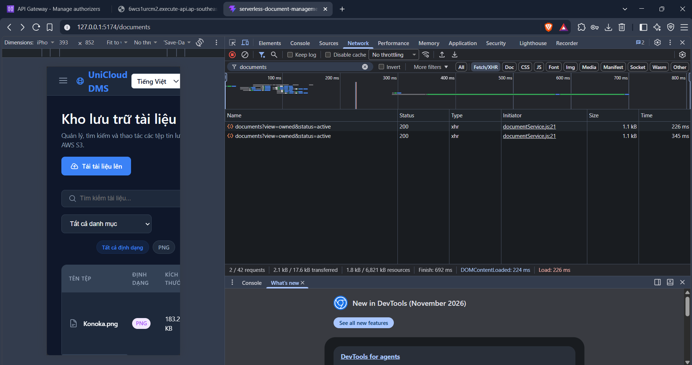
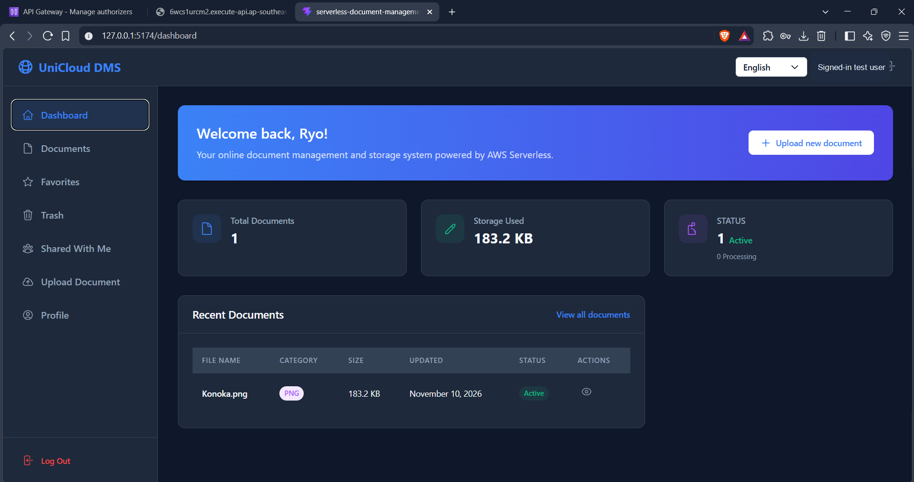
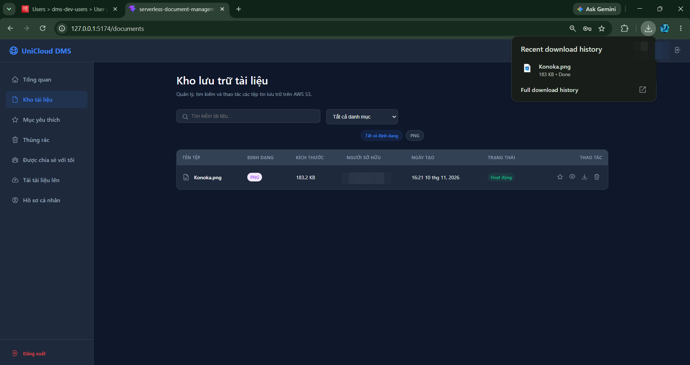
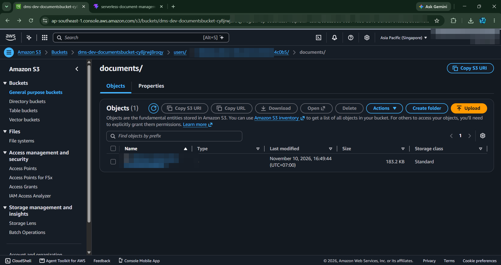
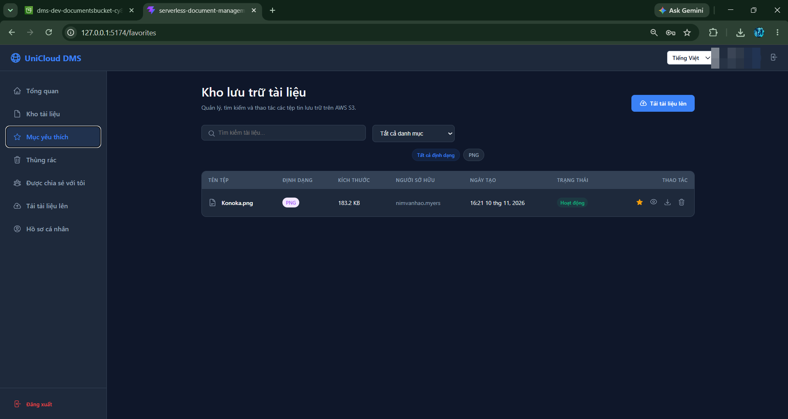
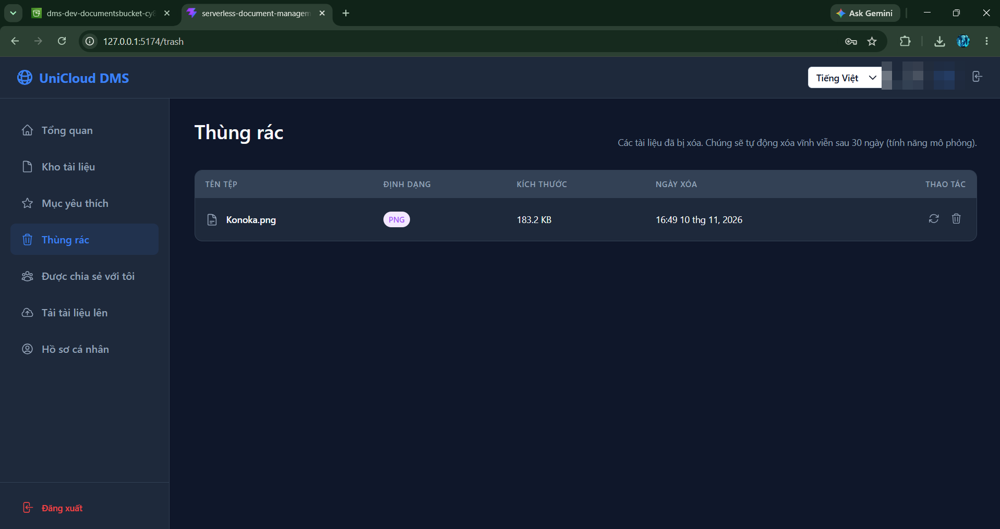
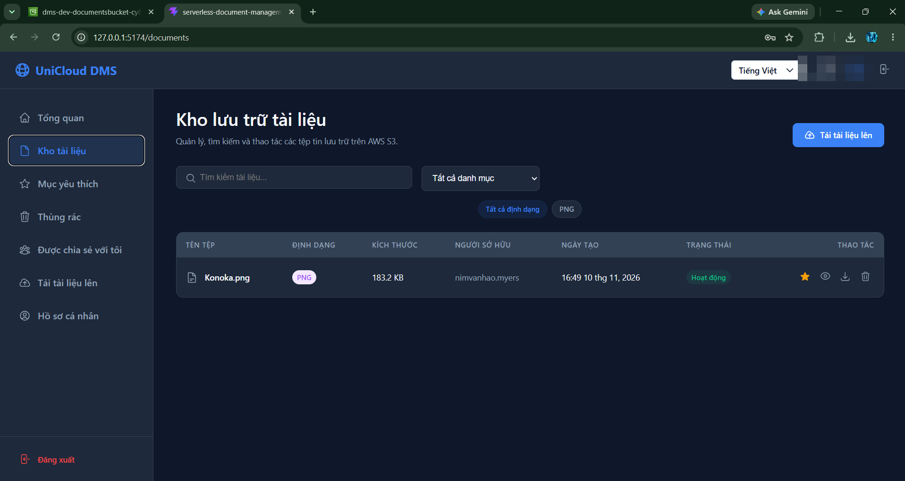
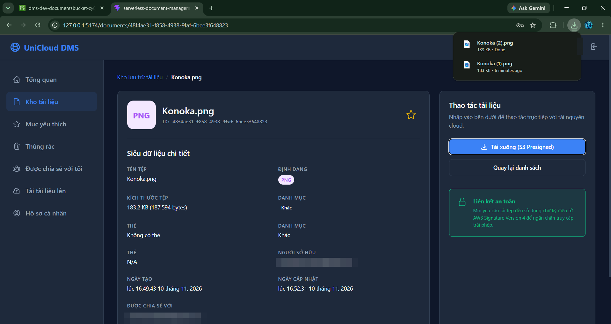
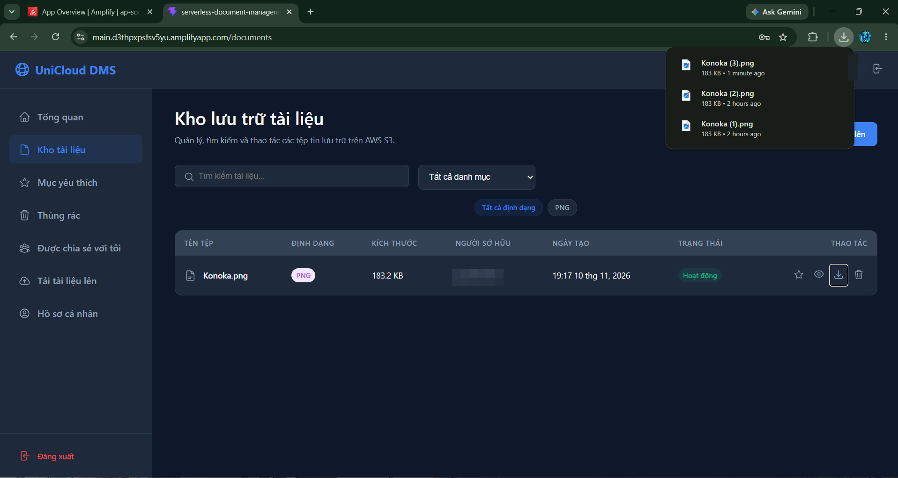

{}
Service frontend gọi AWS API đã triển khai. Stack `dms-dev` cập nhật thành công. Đã thao tác đăng ký/đăng nhập Cognito, upload/download, Favorites, Thùng rác/khôi phục, sửa metadata và chia sẻ giữa hai tài khoản Cognito. Các giới hạn kiểm thử bổ sung được ghi ở mục 5.10.
{}

## Mục tiêu

Chuyển đọc/ghi tài liệu sang backend và kiểm thử upload/download cùng các feature hiện có.

## Các bước thực hiện

1. Service layer gọi API Gateway cho danh sách/chi tiết tài liệu, favorites, chia sẻ, thùng rác, metadata và xóa.
2. Upload theo ba bước: lấy presigned URL, PUT trực tiếp lên S3 với Content-Type, rồi gọi API hoàn tất để Lambda kiểm tra object và ghi metadata vào DynamoDB. Metadata `x-amz-meta-document-id` đã nằm trong presigned URL nên frontend không gửi lặp lại header này.
3. Download dùng presigned URL do API cấp sau khi kiểm tra quyền. API yêu cầu Cognito ID token.
4. Frontend production build đã thành công. Đã đăng ký/đăng nhập bằng Cognito, lấy presigned URL từ API, tải `Konoka.png` trực tiếp lên S3 và thấy tài liệu xuất hiện trong danh sách với trạng thái `Active`, xác nhận bước hoàn tất metadata qua API/DynamoDB. Tải xuống `Konoka.png` bằng presigned URL cũng thành công; trình duyệt báo tải xong và file mở được.
5. Đã thêm route `OPTIONS /{proxy+}` không yêu cầu xác thực để xử lý CORS preflight; stack `dms-dev` cập nhật `UPDATE_COMPLETE`. Khi PUT S3 trả 403, phản hồi cho biết request có header chưa được ký. URL đã chứa metadata, nên frontend được sửa để chỉ gửi Content-Type. Upload sau đó thành công.
6. Đã đánh dấu `Konoka.png` là yêu thích; tài liệu xuất hiện trong mục Favorites với biểu tượng sao bật.
7. Đã upload lại `Konoka.png` sau lần xóa vĩnh viễn ngoài ý muốn. Dùng thao tác chuyển vào Thùng rác từ Kho tài liệu; file xuất hiện trong Thùng rác với tên, định dạng PNG và kích thước 183.2 KB.
8. Khôi phục `Konoka.png` từ Thùng rác thành công. Danh sách Thùng rác trở về trạng thái trống và tài liệu xuất hiện lại trong Kho tài liệu với trạng thái `Hoạt động`.
9. Chia sẻ `Konoka.png` tới tài khoản Cognito thứ hai. Sau khi đăng nhập bằng tài khoản nhận, tài liệu xuất hiện trong mục **Được chia sẻ với tôi**, hiển thị tên tệp, định dạng PNG, kích thước 183.2 KB và chủ sở hữu. Điều này xác nhận API chia sẻ và truy vấn danh sách tài liệu nhận đã hoạt động.
10. Từ tài khoản nhận, mở chi tiết tài liệu và tải `Konoka.png` bằng S3 Presigned URL. Trình duyệt báo tải xuống hoàn tất với tệp `Konoka (1).png`, dung lượng 183 KB, xác nhận người nhận có quyền truy cập nội dung file.
11. Sửa metadata `Konoka.png`: cập nhật danh mục thành **Công việc** và mô tả thành **ảnh Konoka**. Sau khi lưu, trang chi tiết hiển thị các giá trị mới; ảnh chụp cũng xác nhận danh mục và thẻ không còn bị lặp.
12. Cấu hình `VITE_S3_BUCKET_NAME` trong `.env.local` theo bucket của stack `dms-dev` để đường dẫn S3 trên trang chi tiết không còn dùng tên bucket mẫu.
13. Khi frontend local đang đăng nhập, mở Kho tài liệu và kiểm tra Network. Cả hai request `GET /documents?view=owned&status=active` đều trả về **HTTP 200**, đồng thời `Konoka.png` xuất hiện trong danh sách.

## Vị trí ảnh chụp màn hình

Không còn ảnh terminal SAM deploy. Outputs của stack đã triển khai nằm ở mục 5.9.2; kết quả API ở mức ứng dụng được ghi trong mục này và mục 5.10.

## Kết quả mong đợi

Build frontend và cập nhật stack thành công. Upload end-to-end lên S3, lưu metadata qua Lambda vào DynamoDB, tải xuống qua presigned URL, Favorites, Thùng rác/khôi phục, chia sẻ và tải file từ tài khoản nhận, cùng việc cập nhật metadata đều đã được xác minh.

## Khắc phục sự cố

- Nếu S3 trả `403` về header chưa được ký, kiểm tra các header `x-amz-*` đã được ký hoặc đã được nhúng vào presigned URL; không gửi lặp metadata header.
- Không public S3 để né lỗi upload/download.
