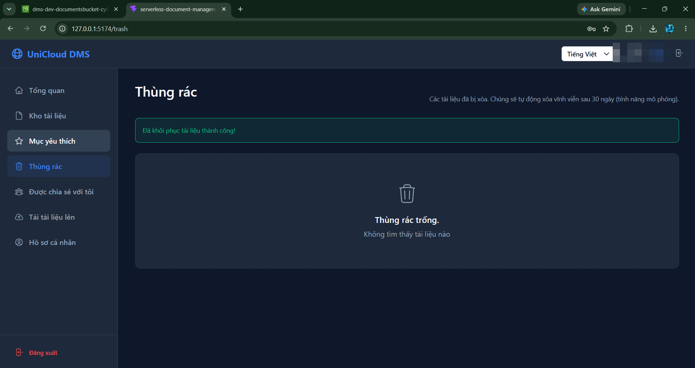
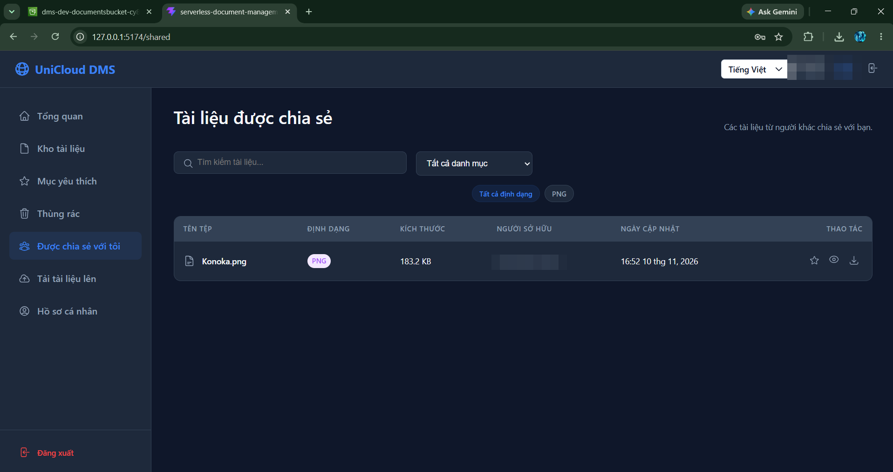

{}
Service frontend gọi AWS API đã triển khai. Stack `dms-dev` cập nhật thành công. Đã thao tác đăng ký/đăng nhập Cognito, upload/download, Favorites, Thùng rác/khôi phục, sửa metadata và chia sẻ giữa hai tài khoản Cognito. Các giới hạn kiểm thử bổ sung được ghi ở mục 5.10.
{}

## Mục tiêu

Chuyển đọc/ghi tài liệu sang backend và kiểm thử upload/download cùng các feature hiện có.

## Hướng dẫn kiểm tra các tính năng

Repo ứng dụng đã có frontend kết nối API; nếu dùng đúng mã nguồn này thì không cần tự viết lại service. Hoàn thành mục 5.8.1 trước, rồi làm từng thao tác dưới đây. Các ảnh ở cuối trang là kết quả lần kiểm thử trước, dùng để đối chiếu giao diện và trạng thái.

### Bước 1: Đăng nhập và tải một file thử nghiệm

Đăng nhập bằng tài khoản Cognito đã xác nhận. Trong **Kho tài liệu**, chọn tải lên một file mẫu được hỗ trợ và nhỏ hơn 20 MiB. Chờ quá trình hoàn tất. Kết quả cần thấy là file xuất hiện trong danh sách với trạng thái `Active`.

Luồng bên dưới tự động diễn ra: frontend xin presigned URL từ API, trình duyệt PUT nội dung trực tiếp lên S3, sau đó frontend gọi API hoàn tất. Lambda xác minh object rồi ghi metadata vào DynamoDB. Không tải file trực tiếp lên bucket bằng Console để thay cho bước này.

### Bước 2: Tải file lên S3 và kiểm tra chức năng tải xuống

Chọn file trong danh sách rồi chọn **Download**. API kiểm tra Cognito ID token và quyền truy cập trước khi cấp presigned URL. Kết quả cần thấy là file được tải về và mở được. Không chia sẻ presigned URL vì URL có quyền truy cập tạm thời.

### Bước 3: Sửa metadata và đánh dấu yêu thích

Mở trang chi tiết của file, chọn sửa metadata, cập nhật danh mục, mô tả hoặc thẻ rồi lưu. Tải lại trang chi tiết để xác nhận các giá trị vẫn còn. Dùng nút hình sao để thêm file vào **Favorites**, mở trang Favorites và xác nhận file xuất hiện.

### Bước 4: Chuyển file vào Thùng rác rồi khôi phục

Từ **Kho tài liệu**, chọn đưa file vào **Thùng rác**. Mở Thùng rác và xác nhận file xuất hiện ở đó, không còn trong danh sách đang hoạt động. Chọn **Khôi phục**, quay lại Kho tài liệu và xác nhận file trở lại trạng thái `Active`.

### Bước 5: Kiểm thử chia sẻ bằng tài khoản thứ hai

Đăng nhập bằng tài khoản owner, mở chia sẻ của file và nhập email tài khoản recipient đã đăng ký Cognito. Đăng xuất owner rồi đăng nhập recipient. Mở **Được chia sẻ với tôi**, xác nhận file xuất hiện và thử tải xuống. Kết quả mong đợi là recipient tải được file nhưng không có quyền sửa hoặc xóa file của owner. Thao tác này cũng được ghi riêng ở mục 5.10.2.

### Bước 6: Kiểm tra request API và các tính năng còn lại

Mở Developer Tools → **Network**, tải lại Kho tài liệu và chọn request `GET /documents?view=owned&status=active`. Request của phiên đăng nhập cần trả HTTP `200`. Kiểm tra thêm lọc theo danh mục, tìm theo thẻ và chuyển ngôn ngữ theo mục 5.10.3.

Nếu upload trả `403`, kiểm tra lỗi CORS/header ở mục 5.5.2. Với luồng của project, presigned URL đã ký metadata `x-amz-meta-document-id`; frontend chỉ gửi `Content-Type` khi PUT, không tự gửi lại header metadata này.

## Vị trí ảnh chụp màn hình

Không còn ảnh terminal SAM deploy. Outputs của stack đã triển khai nằm ở mục 5.9.2; kết quả API ở mức ứng dụng được ghi trong mục này và mục 5.10.

## Kết quả mong đợi

Build frontend và cập nhật stack thành công. Upload end-to-end lên S3, lưu metadata qua Lambda vào DynamoDB, tải xuống qua presigned URL, Favorites, Thùng rác/khôi phục, chia sẻ và tải file từ tài khoản nhận, cùng việc cập nhật metadata đều đã được xác minh.

## Khắc phục sự cố

- Nếu S3 trả `403` về header chưa được ký, kiểm tra các header `x-amz-*` đã được ký hoặc đã được nhúng vào presigned URL; không gửi lặp metadata header.
- Không public S3 để né lỗi upload/download.
