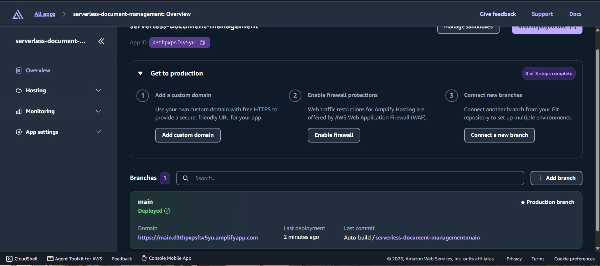
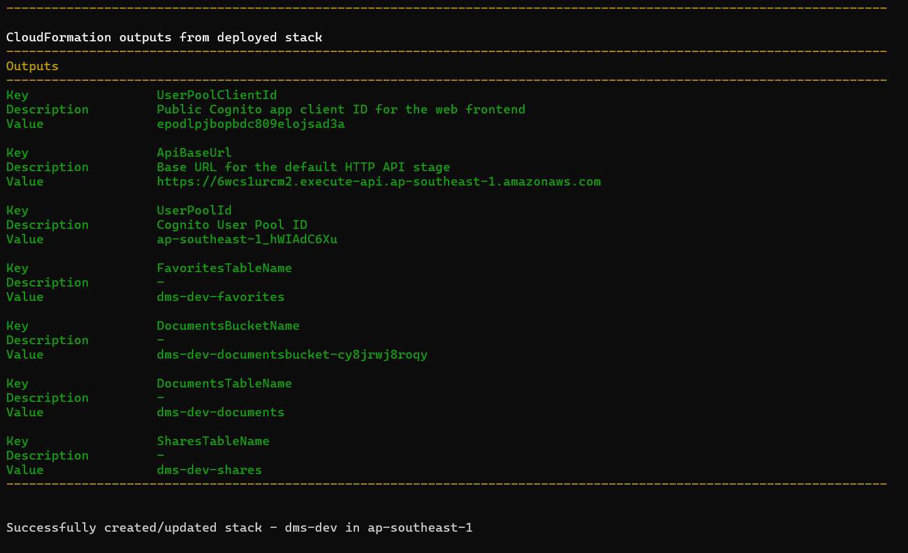
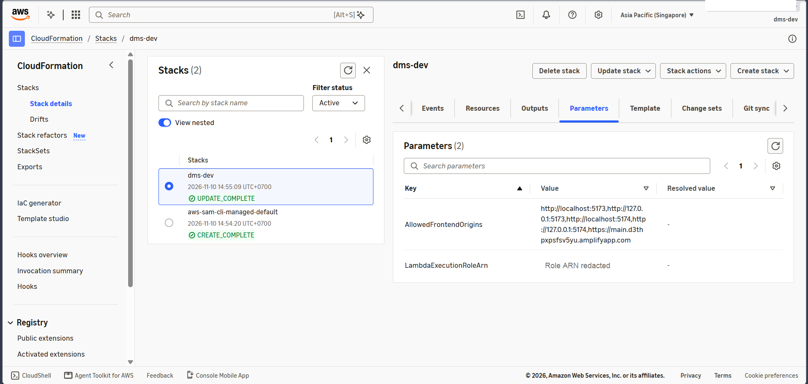

## Objective

Deploy the frontend and verify its real authentication and API calls.

## Implementation steps

Follow the steps in order. Read the action, its explanation, and the expected check before moving to the next step.

### Step 1: Set the environment variables for the Amplify branch

In Amplify Console, open the app → **Hosting → Environment variables**. Add the five `VITE_*` variables from the table in section 5.1.3 or 5.8.1, using Outputs from the same stack. Do not add secret access keys. Save the changes to trigger a new deployment.

### Step 2: Update CORS for the new domain

After the branch build succeeds, open its HTTPS URL and copy the origin, for example `https://main.xxxxx.amplifyapp.com` (without a trailing slash). In PowerShell, from the `backend` directory, rerun the `sam deploy` command in section 5.1.3 with the same stack name, Region, profile, and role. Keep any local origins still needed and add the Amplify origin to `AllowedFrontendOrigins`. Review the change set, confirm the correct stack, and wait for `UPDATE_COMPLETE`. The frontend calls Cognito User Pools API directly, so it does not need a managed-login callback URL.

### Step 3: Wait for the frontend build to finish

In Amplify → branch, open the latest build and wait for success. If it fails, check the `npm ci && npm run build` command, `dist` artifact directory, and `VITE_*` variables. Confirm the SPA rewrite from section 5.9.1 is configured so route refreshes do not return 404.

### Step 4: Verify the deployed application

Open the production HTTPS domain, sign up or sign in with Cognito, and load Documents. Open Developer Tools → **Network** and confirm an authenticated API request returns `200`. Try uploading/downloading a file smaller than 20 MiB. The API URL, Pool ID, Client ID, and bucket must come from the same stack; API and S3 CORS must exactly match the Amplify origin.

## Deployment evidence and verification

The deployed stack's `AllowedFrontendOrigins` parameter includes the production Amplify origin and the local Vite development origins. The Lambda execution role ARN is redacted in this report copy.

The API health check is recorded in section 5.7.2. Authenticated sign-in, document listing, upload/download, and document operations were exercised in the deployed application; see sections 5.8.2, 5.10.1, and 5.10.2. No separate composite screenshot was captured because the same workflows are already documented in those sections.

## Expected result

The app is available over HTTPS and can complete the verified backend workflow.

## Troubleshooting

- Build success does not guarantee API connectivity; check Network and CORS.
- Callback URLs must match the deployed origin exactly.
